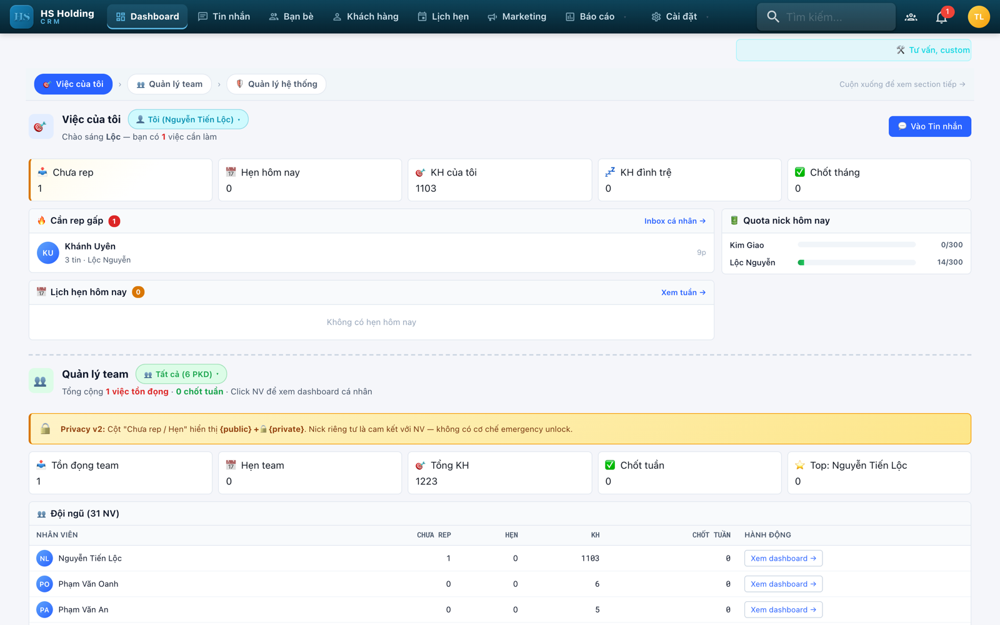
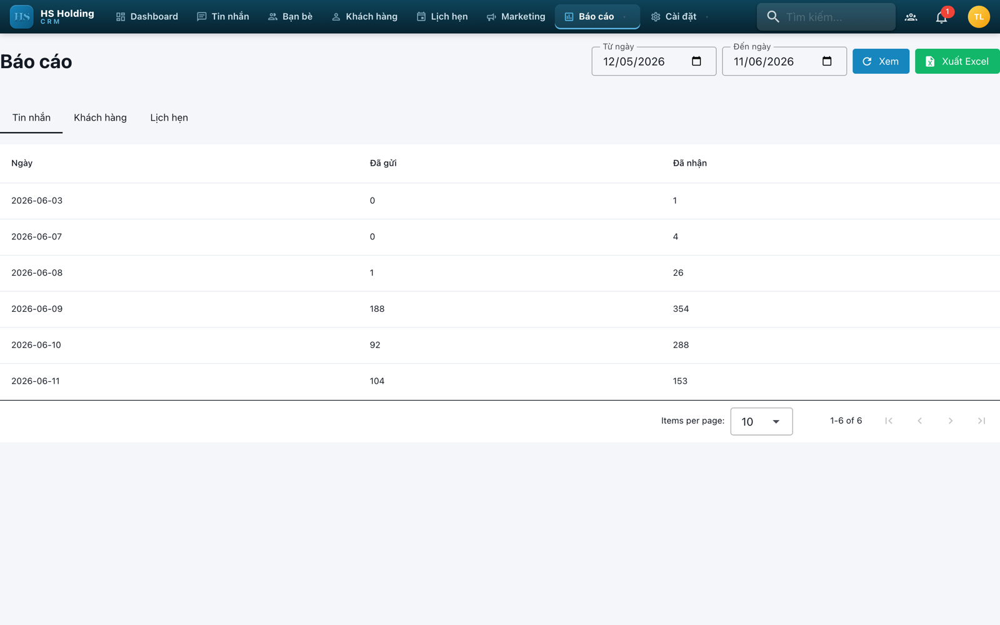
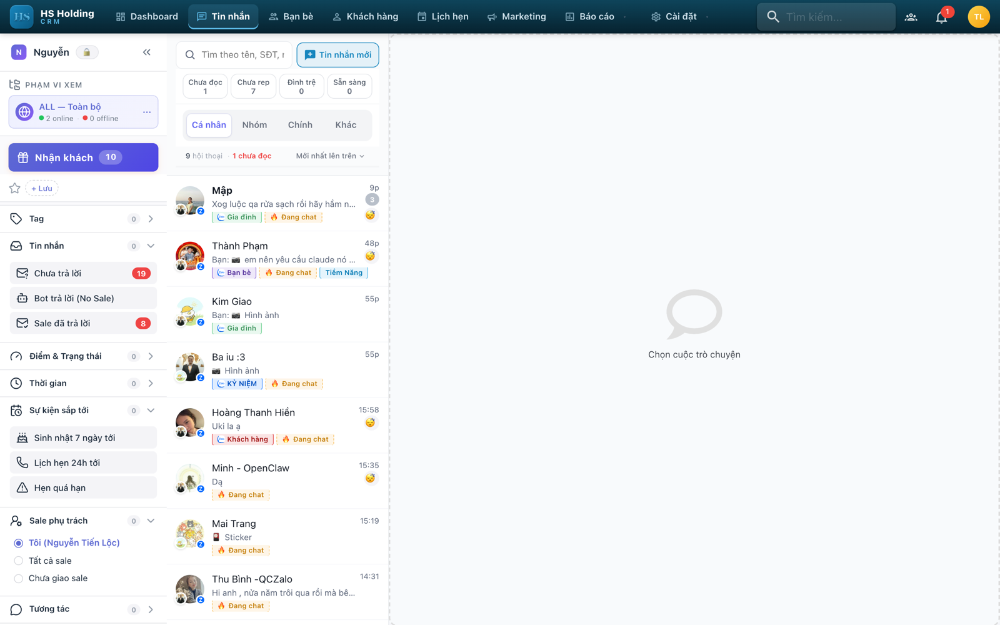
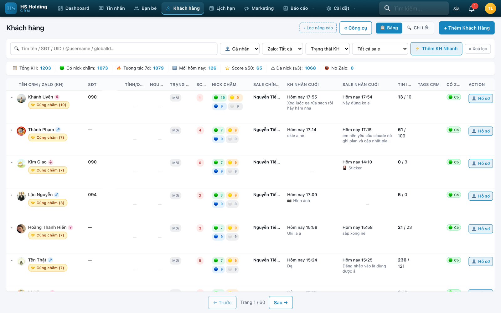
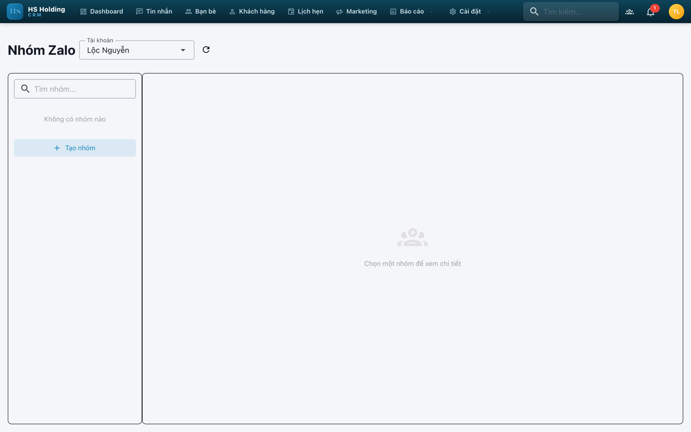
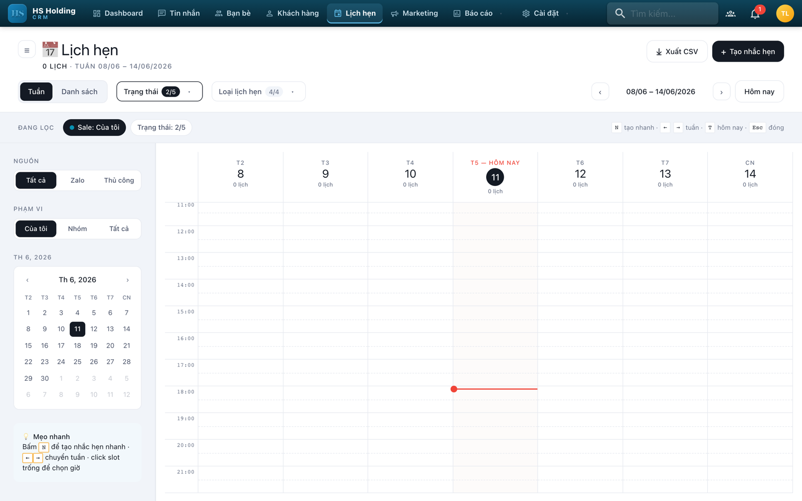

# ZCRM v3.4 — Quản lý nhiều tài khoản Zalo cá nhân

**VPS07/11/2026 — DEPLOYED_WITH_OPEN_FINDINGS.** CRM đã mở lại15:00 với schema130/RLS103/nonowner;122bảng giữ fingerprint,2nick connected. Theo dõi5phút phát hiện background tenant context, đang sửa4caller với B độc lập, giữ guard/RLS. [Trạng thái mới nhất](docs/reports-fix/09-vps-background-tenant-remediation-20261107-1511.md).

**VPS cutover07/11/2026 đang chuẩn bị — IN_PROGRESS, chưa chuyển production.** Đã giữ tùy chỉnh AI live và sửa B-P2 JSON-null sentinel; hai image cuối đang qua B disposable. Fresh DB/media và encrypted `.env` off-VPS đã có receipt; PREPARE không thay traffic/DB. [Checkpoint mới nhất](docs/reports-fix/09-vps-cutover-20261107-093609.md). Các mốc bên dưới là lịch sử.

**Rehearsal nghiệp vụ VPS bước4 —07/11/2026: COMPLETED_PENDING_VERIFICATION.** Đã chuyển đúng hai image RC4/fallback vào cache staging sau kiểm34OCI blobs, chạy primary→fallback→primary trên bản backup03/11 đã nâng cấp và làm sạch phiên/provider được liệt kê: **879/879 HTTP/JWT/report/Excel checks**, **48/48 health pause/recover**, **5/5 SPA production-mode probes**.7protected tables giữ fingerprint;0tenant-context/startup-fatal errors; giữ9FAIL harness V1 và diagnosis source-grounded, không sửa runtime/test. Dọn đúng33container, production ID/image/start/Git/ledger/RLS không đổi; root1166/candidate1037 inputs giữ hash. API dùng test mode/cron stub; SPA có Worker stub, chưa chứng nhận actual workers/provider/browser/full suite hoặc B. **VPS NOT_READY/BLOCKED; chưa deploy.** [Checkpoint và gate B](docs/reports-fix/09-vps-business-rehearsal-20261107-082623.md), [artifact/lệnh](artifacts/reports-vps-business-9a-20261107-082623/). Các mốc dưới giữ lịch sử.

**Rehearsal nâng cấp VPS bước1–3 —07/11/2026: COMPLETED_PENDING_VERIFICATION.** Preflight mới, restore backup03/11 vào PG16 network-none, rồi `migrate deploy`129→130,103policy ENABLE/FORCE và app role non-owner/NOSUPER/NOBYPASS: **127/127 checks đạt**.123bảng restore khớp snapshot; sau upgrade122bảng nghiệp vụ và129ledger cũ giữ fingerprint. Đã dọn đúng5container test; production ID/image/start/Git/ledger/RLS không đổi. Root1166/candidate1037 covered inputs giữ hash, candidate clean297fe538. Chỉ dùng image VPS cũ làm PrismaCLI7.5.0, chưa boot image ứng dụng candidate hoặc chạy JWT/HTTP/business/fallback/B. **VPS NOT_READY/BLOCKED; chưa deploy.** [Checkpoint/giới hạn](docs/reports-fix/09-vps-upgrade-rehearsal-20261107-080103.md), [artifact](artifacts/reports-vps-upgrade-9a-20261107-080103/). Bước tiếp: kiểm nghiệp vụ trên đúng candidate image và kiểm độc lập. Các cập nhật dưới đây giữ lịch sử.

**Release candidate Báo cáo rc2 — 03/11/2026 (+07): COMPLETED_PENDING_VERIFICATION, chưa phát hành.** Dựng trong git worktree riêng `F:\ZaloCRM-candidates\reports-20261103-1023` (branch cục bộ `release/reports-20261103-1023`, tag `reports-rc2-20261103` → `b50295c`), gồm báo cáo + E-1/O-1, **gỡ TikTok** (quyết định người dùng 03/11) và bản sửa đóng gói P2. Image local `zalo-crm-rc:reports-rc2-20261103` `sha256:90967793f2c7a351aeb66dffaf6801ca971adc9bb76d8cd62d382db9d748514a`: Node 22, chỉ 13 script ops đã duyệt, không helper/test/.env/TikTok. Trên PostgreSQL 16 disposable: `migrate deploy` 129 migration, RLS 103 policy, canonical 710/710, 6a3 129/129, E-1/O-1 524/524; smoke cô lập mạng 22/22; rollback rehearsal sang image `eb1be0b` cho thấy image cũ không phải fallback an toàn. Còn mở: 2 test cũ fail chỉ ở candidate (RC-1), cron/boot reconnect lỗi khi bật guard enforce (RC-2), drift schema có sẵn. Không push/deploy; staging/VPS chưa làm. [Chi tiết](docs/reports-fix/07-release.md#rc-20261103-1023), [artifact](artifacts/reports-release-candidate-20261103-1023/). Bước tiếp: 7B độc lập trên đúng tag/digest.

**Tái kiểm độc lập hồ sơ phát hành 7B — 03/11/2026: FAIL (1 finding P2).** `deploy.sh` chỉ kiểm tra diff tracked, không phát hiện untracked files; các helper kiểm thử có thể còn trong build context và Dockerfile copy toàn bộ `backend/scripts` vào image. Báo cáo 7B: [review và điều kiện đóng finding](docs/reports-fix/07-release-verification.md), [artifact](artifacts/reports-release-7b-20261103-0535/). **Candidate vẫn NOT_READY/BLOCKED**: không có image digest/candidate build cô lập; các gate PG16, full-suite, migration replay, restore/rollback và staging chưa được chứng minh. Không chạy test/build/deploy trong 7B.

**Hồ sơ phát hành Báo cáo7A —02/11/2026, bắt đầu22:54 (+07): COMPLETED_PENDING_VERIFICATION.** Đã tạo [runbook/candidate/preflight](docs/reports-fix/07-release.md), [manifest SHA256 và dependency](artifacts/reports-release-7a-20261102-225424/candidate-manifest.json), cập nhật [roadmap](docs/reports-fix/README.md). **5B/6B giữ PASS local sau E-1/O-1**:975/975 source/test/Prisma vẫn khớp B;16/16 phép kiểm nhất quán bằng chứng đã lưu đạt, không chạy mới test ứng dụng hoặc build/DB. **Phát hành BLOCKED / NOT_READY:** chưa cô lập/build candidate, Dockerfile:55 còn copy helper kiểm thử, chưa có full-suite baseline mới, rehearsal PG16 hoặc restore/rollback giữ biên bảo mật. E-1/O-1 chưa apply staging/production. **7B NOT_STARTED; chưa commit/deploy.** [Artifact7A](artifacts/reports-release-7a-20261102-225424/). Các cập nhật bên dưới giữ lịch sử; trạng thái7A cũ không thay thế mốc này.

**Tái kiểm độc lập B sau E-1/O-1 — 02/11/2026, kết thúc22:16 (+07): 5B/6B PASS local cho module Báo cáo.** Bằng chứng mới: canonical710/710 (contract60/60),6a3 API129/129, Engagement/funnel/team/saved189/189, JWT thu hồi quyền18/18, E1/O1 boundaries524/524 và inventory độc lập104/104. RLS matrix90/90; runtime14/14 với guard mới (giữ13/14 của helper cũ). Backend306/306 +refresh owner10/10; frontend161/161, hai build PASS. Browser mới đủ9route/API200,40layout, contrast82avatar/789mẫu chữ, F3/F4 width lẻ, trạng thái lỗi/thử lại, snapshot và UI roles. **975/975 source/test/Prisma giữ nguyên hash**, không sửa implementation. E-1/O-1 đạt kiểm local; chưa apply staging/production. Full backend suite chưa chạy mới trên patch này, giữ FAIL/baseline lịch sử của source trước; không tuyên bố toàn hệ thống xanh hoặc release READY. **7A/7B NOT_STARTED**, chưa commit/deploy. Đã dọn harness, Chrome/profile và container/4DB disposable, không còn listener. [5B mới](docs/reports-fix/05-mobile-verification.md#recheck-e1o1-20261102-2052), [6B, giới hạn và các lần chưa đạt](docs/reports-fix/06-acceptance-verification.md#recheck-e1o1-20261102-2052), [roadmap](docs/reports-fix/README.md), [artifact/lệnh/cleanup](artifacts/reports-5b6b-e1o1-20261102-205238/). Các cập nhật bên dưới giữ lịch sử và không thay thế kết luận B mới nhất.

**Remediation A E-1/O-1 — 02/11/2026: COMPLETED_PENDING_VERIFICATION.** Bổ sung28 policy để102/102 bảng có org_id được ENABLE/FORCE RLS trong DB disposable; tenant guard bổ sung30 model còn thiếu. Automation/Broadcast kiểm owner/admin hiện tại trong DB, hạ quyền có hiệu lực với cùng JWT. Bổ sung context cho scan job, short-link lịch hẹn và Telegram identity. Tự kiểm:524/524 DB/Prisma/JWT/HTTP,306/306 test liên quan, backend build PASS. **5B/6B chờ tái kiểm trên patch mới; PASS ở các đoạn dưới là lịch sử source trước E-1/O-1. 7A/7B NOT_STARTED.** Full backend chưa chạy mới, giữ FAIL lịch sử; chưa apply RLS staging/production, commit hay deploy. [Checkpoint và giới hạn](docs/reports-fix/06-remediation-e1-o1.md), [roadmap](docs/reports-fix/README.md), [artifact](artifacts/reports-e1-o1-20261102-201708/).

**Tái kiểm độc lập Báo cáo 5B/6B — 02/11/2026: PASS local trên working tree hiện tại.** F3/F4 đạt ở CSS width thật1099,248 và767,669px;40/40 bố cục,105/105 initials và794/794 mẫu chữ đạt contrast. R-A-1 đạt9/9 browser (snapshot8 khác khách mới trong kỳ6; loading/lỗi/thử lại/stale/export đúng). Oracle canonical710/710 (legacy694/710 với16expected cũ được giữ và giải thích riêng), rerun6a3 API129/129, Engagement/funnel/team/saved CRUD189/189, singleton/thu hồi quyền18/18, RLS90/90 + Prisma14/14; frontend161/161, backend báo cáo/tenant120/120 và refresh owner10/10, builds PASS. **Full backend vẫn FAIL:** current và baseline cùng35file/9test lỗi dưới cùng cấu hình an toàn; không có fail-name mới chỉ ở patch. Không suy mọi39file/9test lịch sử đã được giải thích. [5B](docs/reports-fix/05-mobile-verification.md#recheck-20261102-1804), [6B và baseline](docs/reports-fix/06-acceptance-verification.md#recheck-20261102-1804), [roadmap](docs/reports-fix/README.md), [artifact](artifacts/reports-5b-6b-recheck-20261102-180400/). 973/973 source/test/Prisma giữ hash; chỉ cập nhật hồ sơ và thêm helper kiểm tra. Đã dọn môi trường owned. **E-1/O-1 còn tồn đọng;7A/7B NOT_STARTED; không commit/deploy.** Đây không phải nghiệm thu production; các cập nhật bên dưới giữ lịch sử.

**Gỡ tích hợp TikTok — 01/11/2026:** Đã xóa connector TikTok Personal, worker/POC, API đăng nhập, tab kết nối và service Compose. Backend chỉ giữ kênh mock local/test; provider TikTok cũ bị từ chối. Kiểm tra: backend typecheck, frontend build và 55 test đạt. [Phạm vi, bằng chứng và bản sao nguồn trước khi gỡ](docs/ops/TIKTOK-REMOVAL-2026-11-01.md). Migration lịch sử, dữ liệu khách hàng và nhãn nguồn lead cũ được giữ để tương thích.

## Rà soát bản CorepViet và hướng nâng cấp — 29/10/2026

**Sửa nhãn snapshot R-A-1 — 02/11/2026 17:43: COMPLETED_PENDING_VERIFICATION.** `/reports-co-ban` tách hai nhóm: “Trạng thái hiện tại — không giới hạn theo kỳ” và “Khách mới trong kỳ”; kỳ dữ liệu đã tải thành công chỉ gắn với khách mới. Tự kiểm tra mới: RED 4 FAIL/8 PASS → GREEN 12/12 DOM, 161/161 frontend (20 spec), type-check/build PASS. Full backend trước đó **FAIL 39 file/9 test, chưa có baseline tương ứng nên nguồn gốc chưa xác minh**; đã rút nhận định “Coi là có từ trước”, giữ log/lịch sử. [Checkpoint và đầu vào kiểm độc lập](docs/reports-fix/06-remediation-snapshot-label.md), [roadmap](docs/reports-fix/README.md). Chưa chạy DB/browser/B; 5B/6B vẫn chờ tái kiểm đầy đủ gồm `6a3-api-acceptance`, Engagement và baseline backend. E-1/O-1 còn tồn đọng; giữ lịch sử 6A đã chạy và các FAIL. **7A/7B NOT_STARTED; chưa commit/deploy.** Các cập nhật bên dưới giữ lịch sử.

**Review patch F4/F6B3 —02/11/2026 17:28: còn việc trước nghiệm thu.** Đã đối chiếu source/log và chạy mới24 DOM +18 canonical/policy tests:42/42PASS; không chạy lại DB/browser/full6B. Patch canonical, error/retry, ngàyVN và breakpoint có thật;60/60 contract đạt,16 ca oracle còn lệch đều dùng expected legacy. Cần bổ sung nhãn `byStatus` là snapshot hiện tại, phân biệt với khách mới trong kỳ. Full backend39file/9testFAIL chưa có baseline nên chưa thể kết luận có từ trước. [Review, dòng source và bước tiếp](docs/reports-fix/06-remediation-6b3-review.md). Giữ chờ tái kiểm độc lập5B/6B;7A/7B NOT_STARTED; không sửa runtime, commit hay deploy. Các cập nhật bên dưới giữ lịch sử.

**Sửa F4 và F6B3-1/2/3 Báo cáo —02/11/2026 17:20: COMPLETED_PENDING_VERIFICATION.** Báo cáo cơ bản, Excel, custom và saved report giờ cùng định nghĩa contract: loại contact đã gộp và tin local/đã xóa/dry-run/test/hội thoại ảo ở mọi phạm vi, vẫn giữ tin AI/bot hợp lệ. Trang `/reports-co-ban` có báo lỗi kèm "Thử lại", không giữ bảng cũ khi lỗi, chặn response cũ về muộn, hiện `byStatus` và mặc định 30 ngày theo giờ Việt Nam. F4: chọn MobileLayout theo media query thực nên CSS 767,669px (innerWidth 768) không còn tràn header; F3 giữ nguyên. Frontend 157/157, backend 104/104 + 10/10, build PASS; oracle độc lập của 6B3 chạy lại đạt contract 60/60. [Checkpoint 6B3](docs/reports-fix/06-remediation-6b3.md), [checkpoint F4](docs/reports-fix/05-mobile-remediation-4.md), [roadmap](docs/reports-fix/README.md). **Cần kiểm tra độc lập lại 5B và 6B; E-1/O-1 còn nguyên; 7A/7B NOT_STARTED; chưa commit/deploy.** Các cập nhật bên dưới giữ lịch sử.

**Đối chiếu báo cáo6B —02/11/2026 16:51: FAIL giữ nguyên.** Source và artifact xác nhận F6B3-1 (canonical thiếu lọc: contact merged, tin local/deleted/dry-run/test/ảo) và F6B3-2 (trang cơ bản giữ bảng cũ khi request lỗi). Nên sửa cùng F6B3-3: byStatus và ngày VN/30ngày. Các số696/710, RLS90/90, frontend145/145 và backend112/112+10/10 khớp log6B; review này không chạy lại toàn bộ6B. Bổ sung từ phiên5B: F3 PASS ở CSS1099,248 thật nhưng **F4 P2 tại CSS767,669/innerWidth768** làm header desktop tràn318px, nút Báo cáo/Cài đặt ra ngoài viewport. Vì vậy5B cần remediation và kiểm lại; giữ lịch sử6A đã chạy,6B FAIL,7A/7B NOT_STARTED. [Review và thứ tự xử lý](docs/reports-fix/06-acceptance-report-review.md), [bằng chứng F4](docs/reports-fix/05-mobile-verification.md#supplement-20261102-1651), [roadmap](docs/reports-fix/README.md). Không sửa runtime, commit hay deploy; đã xác nhận môi trường riêng không còn listener. Các cập nhật bên dưới giữ lịch sử.

**Kiểm tra độc lập Báo cáo 6B lần 3 —02/11/2026 16:29: FAIL.** Chạy trên DB PostgreSQL disposable mới, dùng app role không bypass RLS, fixture và oracle SQL tự viết. Không có lỗi phân quyền hay rò dữ liệu khác org: leader/deputy theo subtree và nick được cấp; member bị chặn ở mọi route (179/179); cross-org; biên ngày VN; lịch ngày mai; KPI Overview/Sale/Pipeline/AI/Automation/Broadcast; saved report đều khớp. Đã thêm báo cáo cơ bản và export: 93/93 dòng Excel khớp SQL. RLS 90/90, Prisma 14/14. Browser Chrome DSF1,25 với chuột/bàn phím thật đạt các kịch bản bắt buộc. Frontend 145/145, backend 112/112 + 10/10, build PASS. Hai finding MEDIUM chặn: với admin, báo cáo cơ bản/export/custom/saved đếm cả contact đã gộp và tin dry-run/local/deleted/test, trái contract; trang `/reports-co-ban` không hiện lỗi mà giữ dữ liệu cũ. 28 bảng có `org_id` chưa có policy RLS cần xử lý trước 7A. [Kết quả](docs/reports-fix/06-acceptance-verification.md#lan-3-20261102-1559), [roadmap](docs/reports-fix/README.md). **Cần A sửa rồi chạy lại 6B; 7A/7B NOT_STARTED; chưa commit/deploy.** Các cập nhật bên dưới giữ lịch sử.

**Chạy lại nghiệm thu Báo cáo 6A —02/11/2026 15:13: COMPLETED_PENDING_VERIFICATION.** Trên patch RLS 14:57, fixture ghi theo UTC. API/JWT 129/129: cả 6 ca từng FAIL đều đạt, thêm chạy saved report cho admin/leader có đối chứng quyền và lịch ngày mai không lọt vào hôm nay. RLS bằng app role 45/45 (5 bảng mới cùng messages/contacts). Browser Chrome DSF1,25 với chuột/bàn phím thật: 9 danh mục, response cũ về muộn, loading, error/retry, drill-down ×3 giữ focus, quyền leader/deputy/member. Frontend 145/145, backend 101/101 + integration 10/10, build PASS. Có đo query/thời gian theo route trên dữ liệu test. Còn tồn tại (không chặn): 28 bảng có `org_id` chưa có policy RLS; export đang tắt. [Kết quả](docs/reports-fix/06-acceptance.md#rerun-20261102-1513), [roadmap](docs/reports-fix/README.md). **Bước tiếp: 6B; 7A/7B NOT_STARTED; chưa commit/deploy.** Các cập nhật bên dưới giữ lịch sử.

**Remediation sau 6A Báo cáo —02/11/2026 14:57: COMPLETED_PENDING_VERIFICATION.** Thêm ENABLE/FORCE RLS và policy tenant cho `care_sessions`, `care_session_events` (theo phiên cha), `lead_pool_distributions`, `broadcast_jobs`, `broadcast_runs` trong `tenant-rls.sql`. Trên DB disposable với app role: file cũ tái hiện đọc/ghi chéo org (15/35), file mới 35/35; qua Prisma thật với withTenant/runSystemQuery và giao dịch kiểu broadcast-cron 13/13. F6A-2 (biên ngày) là lỗi fixture ghi giờ VN vào cột timestamp UTC: với fixture UTC, API/JWT 121/121, không đổi expected nào, không sửa runtime. Backend 76/76, tsc PASS. Còn 28 bảng có `org_id` chưa có policy; RLS chưa apply staging/production. [Checkpoint](docs/reports-fix/06-remediation.md), [roadmap](docs/reports-fix/README.md). **Bước tiếp: chạy lại 6A; 6B/7A/7B NOT_STARTED; chưa commit/deploy.** Các cập nhật bên dưới giữ lịch sử.

**Nghiệm thu toàn luồng Báo cáo6A —02/11/2026 14:29: FAIL.** 115/121 API/JWT assertions đạt; 6 sai lệch oracle về biên ngày/AI drafts/custom report. App role đọc được dữ liệu org khác trên 5 bảng không có FORCE RLS/policy. Frontend145/145, backend62/62, type-check/build PASS nhưng không bù được lỗi runtime/RLS. Không sửa runtime, không commit/deploy; 6B và7A/7B vẫn NOT_STARTED. [Chi tiết, expected/actual, giới hạn và artifact](docs/reports-fix/06-acceptance.md), [roadmap](docs/reports-fix/README.md).

**Tái kiểm tra độc lập Báo cáo5B lần4 —02/11/2026 13:39: PASS local.** F3 đã hết: ở CSS width thật 1099,2px (innerWidth 1099, Chrome DSF1,25, bàn phím thật), sau khi menu đóng focus về đúng nút Báo cáo và Tab sang Cài đặt, 3/3 lần; 1100/1440, quay lại compact, Escape, late leave, MobileLayout và rời report đều sạch. Hồi quy: 48/48 bố cục (9 danh mục ở 320/390/430, compact, desktop), 693/693 chữ chính (min 4,56:1), 63/63 initials 11px (min 5,83:1), selector/đổi kỳ nhanh/loading/error-retry/0-null/drill-down/bảng/heatmap/chart/footer và menu theo admin/leader/deputy/member; 15/15 + 14/14 + 2/2 DB/JWT/HTTP, 44/44 API theo quyền; 74/74 report specs, 145/145 frontend, build PASS. Ghi chú P3 không chặn: late leave trả focus BODY. Lệnh snapshot đã ghi đè nhầm 3 file của một lượt kiểm tra khác (`artifacts/reports-mobile-5b-recheck4-20261102/`); lượt đó vẫn còn harness/container chạy, không bị đụng tới. [Chi tiết](docs/reports-fix/05-mobile-verification.md#recheck-20261102-1338), [roadmap](docs/reports-fix/README.md). Chưa có Safari/iPhone/PWA thật. **6A/6B NOT_STARTED; chưa commit/deploy.** Các cập nhật bên dưới giữ lịch sử.

**Sửa F3 Báo cáo5B —02/11/2026 12:38: COMPLETED_PENDING_VERIFICATION.** Bỏ guard `innerWidth>=1100` trong `use-report-compact-navigation.ts`; khi rời compact, focus trả về nút Báo cáo theo cùng media query với CSS và chỉ khi nút còn mounted/hiển thị, vẫn chặn ở MobileLayout, rời report, unmount và late leave. Test đối chứng media=false/innerWidth=1099: RED trên code cũ, GREEN 12/12; 74/74 report specs, 145/145 frontend tests, type/build PASS. Browser local trên build mới: 1100/1440 focus đúng nút Báo cáo, Tab sang Cài đặt, quay lại1024/Escape/766/rời report sạch; ca CSS width lẻ thật BLOCKED do pane DPR1. [Checkpoint](docs/reports-fix/05-mobile-remediation-3.md), [roadmap](docs/reports-fix/README.md). **Cần tái kiểm tra độc lập5B; 6A/6B NOT_STARTED; chưa commit/deploy.** Các cập nhật bên dưới giữ lịch sử.

**Tái kiểm tra độc lập5B lần3 —02/11/2026 12:13: FAIL, F3 chưa được sửa.** Không có checkpoint remediation F3; 837/837 file source/test trùng hash với lượt FAIL 11:59 và guard `innerWidth>=1100` vẫn ở `use-report-compact-navigation.ts:22/:29`. Chạy mới69/69 frontend tests và build PASS; browser local xác nhận mở menu ở1024 và đối chứng1099→1100 PASS, còn viewport lẻ thật bị BLOCKED do pane DPR1 (chẩn đoán override vẫn rơi BODY, không tính E2E). Hồi quy5B chưa chạy lại. [Chi tiết](docs/reports-fix/05-mobile-verification.md#recheck-20261102-1213), [roadmap](docs/reports-fix/README.md). Đã dừng harness/container. **6A/6B NOT_STARTED; chưa commit/deploy.** Các cập nhật bên dưới giữ lịch sử.

**Tái kiểm tra độc lập5B lần2 —02/11/2026 11:59: FAIL do F3.** F1 overlay1024→1100 và F2 initials đã PASS. Còn mất focus khi CSS width1099,248px nhưng innerWidth làm tròn1099: menu đóng, focus rơi BODY, Tab về logo vì guard trả focus>=1100. Đã tái hiện hai lần; không sửa runtime. Kiểm tra mới69/69 frontend tests, type/build,40/40 layout,100/100 initials (min5,83:1),691/691 mẫu chữ chính,31 DB/JWT/HTTP/SQL checks và44/44 API role statuses đạt. Browser đã kiểm tra race/error/retry/detail/0-null và menu theo quyền; không suy nghiệm thu iPhone/PWA/toàn luồng. [Finding, lệnh và bằng chứng](docs/reports-fix/05-mobile-verification.md#recheck-20261102-1159), [roadmap](docs/reports-fix/README.md).837/837 source/test giữ hash; đã dừng harness/container. **6A/6B NOT_STARTED; chưa commit/deploy.** Các cập nhật bên dưới giữ lịch sử.

**Sửa sau tái kiểm tra5B —02/11/2026 11:36: COMPLETED_PENDING_VERIFICATION.** Đã sửa overlay khi resize1024→1100 và focus nút Báo cáo; dùng palette avatar report đủ tương phản; chart30 ngày cuộn riêng trên compact. Tự kiểm tra cuối69/69 tests, type/build PASS;40/40 bố cục,84/84 mẫu initials (min5,83:1),540/540 mẫu chữ chính và15/15 quan sát tương tác đạt. Đã thử race, loading/error/retry và0/unavailable trên các luồng cụ thể; không coi là đủ mọi state9 danh mục. [Checkpoint, lệnh và bằng chứng](docs/reports-fix/05-mobile-remediation-2.md). **Cần tái kiểm tra độc lập5B;6A/6B NOT_STARTED.** Giữ nguyên FAIL độc lập trước sửa; notifications404 vẫn là giới hạn harness. Đã dừng môi trường test, chưa commit/deploy. Các cập nhật bên dưới giữ lịch sử.

**Tái kiểm tra độc lập Báo cáo5B —02/11/2026: FAIL; chưa đủ gate6A.** F1 còn overlay menu compact sau khi resize1024→1100px; F2 còn initials avatar chữ thường dưới4,5:1 (3,88:1 và4,05:1). Frontend51/51, build/type-check, DB/JWT/HTTP15/15 và API role matrix44/44 đạt; một số luồng browser đổi kỳ/error chưa xác minh độc lập. [Kết quả, source hash, lệnh và evidence mới](docs/reports-fix/05-mobile-verification.md), [roadmap](docs/reports-fix/README.md). **6A NOT_STARTED**, chưa sửa source, commit hay deploy; giữ nguyên lịch sử FAIL trước đó.

**Sửa2 finding5B —02/11/2026 08:51: COMPLETED_PENDING_VERIFICATION.** Header report768–1099px dùng menu Điều hướng, Reports/Settings/tài khoản nằm trong viewport; tăng contrast chữ phụ/empty/tab desktop (empty6,03:1, active7,72:1). Tự kiểm tra mới51/51 frontend, type/build PASS;34/34 geometry,469/469 mẫu contrast,11/11 tình huống nav/quyền đạt. Chỉ2 runtime frontend file thay đổi sau review. [Checkpoint và bằng chứng sửa](docs/reports-fix/05-mobile-remediation.md), [roadmap](docs/reports-fix/README.md). **Cần tái kiểm tra độc lập5B**, chưa đủ gate6A; báo cáo FAIL cũ giữ lịch sử và hết hiệu lực cho patch mới. Đã dừng môi trường test, chưa commit/deploy.

**Kiểm tra Báo cáo5B —02/11/2026 08:24: FAIL,2 P2.** Menu bị cắt ở768–1024px; contrast chữ trạng thái rỗng AI desktop2,64:1 và một số nhãn/tab dưới4,5:1. Mobile27/27 bố cục,18/18 tương tác,51/51 frontend tests, type/build và33/33 API capability checks mới đạt; chưa đủ gate sang6A. [Findings, lệnh và bằng chứng5B](docs/reports-fix/05-mobile-verification.md). Lượt này chỉ kiểm tra, runtime/source test và artifact5A không đổi; chưa commit/deploy, đã dừng môi trường test. Cần sửa2 finding rồi kiểm tra lại5B. Các mốc sau giữ lịch sử.

**Giao diện Báo cáo5A —02/11/2026 07:02: COMPLETED_PENDING_VERIFICATION.** Đã có entry mobile, selector9 danh mục theo quyền, kỳ VN/snapshot, bảng/heatmap cuộn riêng và chi tiết Sale có focus/quay lại. 51/51 frontend tests, type/build PASS;27 bố cục mobile,4 desktop và tương tác local đạt;33/33 API capability checks với JWT/DB disposable PASS. [Checkpoint và giới hạn](docs/reports-fix/05-mobile.md), [24 ảnh browser fixture](docs/reports-fix/renders/README.md). Giữ kết quả helper metrics11/12 và oracle giải thích sai khác ngày trong checkpoint; không tuyên bố toàn bộ backend checks PASS. **Bước tiếp5B**, chưa nghiệm thu iPhone/Safari/PWA thật; backend runtime không đổi, chưa commit/deploy. Các mốc sau giữ lịch sử.

**Kiểm tra Báo cáo AI4B —02/11/2026 05:35: PASS local.** 26/26 nhóm AI DB/JWT/HTTP (14 +12) trên PostgreSQL disposable có RLS, 15/15 baseline, 37/37 backend +33/33 frontend tests, type/build và 12/12 kịch bản browser mới PASS. Không sửa implementation; token/chi phí, nháp đang chờ, handoff/conversion thiếu nguồn vẫn unavailable. Đã đủ gate sang5A; bước5 vẫn NOT_STARTED, chưa commit/deploy. [Bằng chứng và giới hạn4B](docs/reports-fix/04-ai-report-verification.md), [roadmap hiện tại](docs/reports-fix/README.md). Các mốc phía dưới giữ lịch sử.

**Báo cáo AI4A —01/11/2026 23:48:** Đã thêm tab/menu AI, API có phạm vi quyền, KPI tin AI và nháp đã tạo; main/shared riêng, chỉ số thiếu nguồn hiển thị unavailable. Local PASS:37 backend +33 frontend tests,14 DB/JWT/HTTP checks, type/build và browser smoke. Trạng thái **COMPLETED_PENDING_VERIFICATION**, bước tiếp4B; chưa commit/deploy. [Nguồn chỉ số, bằng chứng và giới hạn](docs/reports-fix/04-ai-report.md), [roadmap hiện tại](docs/reports-fix/README.md). Các mốc phía dưới giữ lịch sử triển khai trước4A.

**Sửa F1/F2 sau review1B —01/11/2026:** Tin nhận theo nhân viên có nhóm chưa xác định; counter phản hồi tách main/shared-only, không gán nhầm chủ nick.Kiểm tra lại1B PASS phạm vi foundation:60 test đạt (có3 characterization bước2–3), backend typecheck đạt. Bước2 chưa triển khai. [Checkpoint và bằng chứng](docs/reports-fix/01-f1-f2-fix.md).

**Tiến độ sửa Báo cáo —01/11/2026:** [checkpoint và giới hạn rollout](docs/reports-fix/README.md), [patch scope backend](docs/reports-fix/01-scope.md), [kết quả45 local tests](docs/reports-fix/01-local-checks.md). Đã có sửa scope/viewer của saved-report và thời gian từ tin khách cuối; kiểm tra lại1B đã PASS phạm vi foundation, chưa mở đầy đủ role chuyên biệt, chưa deploy. Các mô tả audit phía dưới là lịch sử trước patch.

**Lộ trình fix Báo cáo:** [bộ prompt triển khai và kiểm tra từng bước](docs/prompts/REPORTS-FIX-IMPLEMENTATION-AND-VERIFICATION.md), gồm 8 giai đoạn, prompt sửa sau kiểm tra và tiếp tục sau gián đoạn. Đây là hướng dẫn cho các lượt thực hiện sau, chưa triển khai bản sửa.

**Audit iPhone/PWA:** bộ [tài liệu nâng cấp mobile](docs/mobile-upgrade/README.md) gồm khảo sát kiến trúc, UX, thông tin, design system, wireframe, PWA và kế hoạch nhiều agent. Chỉ audit/đề xuất; chưa sửa mã ứng dụng hay deploy. Bằng chứng trình duyệt mới chỉ trên trang login local, chưa phải nghiệm thu iPhone thật.

**Skill thiết kế bổ sung:** xem [danh sách, nguồn và cách áp dụng vào CRM](docs/mobile-upgrade/09_DESIGN_SKILLS_RECOMMENDATIONS.md). Ưu tiên interface-design, mobile-ux-optimizer và vue-best-practices; thêm design-system/web-design-guidelines cho review.

**Đã cài và áp dụng:** sáu skill thiết kế đã được cài theo commit nguồn, dùng để tạo [preview CRM V2 và ảnh render](docs/mobile-upgrade/preview-v2/README.md). Chỉ thay tài liệu/prototype; chưa thay mã ứng dụng đang vận hành. Quy ước thiết kế được lưu tại `.interface-design/system.md`.

**Bật/tắt AI:** cài đặt tại `/settings/crm/ai-assistant` (Cài đặt → CRM → Trợ lý AI); công tắc từng hội thoại nằm ở thanh thông tin chat. Xem [bản đồ điều khiển AI](docs/mobile-upgrade/10_AI_CONTROLS_LOCATION.md), đặc biệt khác biệt giữa cờ thủ công từng khách và phạm vi auto-reply tổng.

**Kết luận:** giữ nền Fastify + Prisma/PostgreSQL + Vue hiện có; ưu tiên độ tin cậy của API/webhook và chất lượng kho kiến thức trước khi mở rộng AI Marketing OS. Không cần dựng một backend FastAPI/Appsmith/Dify song song chỉ để làm lại các chức năng CRM và AI đã có. Tích hợp thêm dịch vụ theo nhu cầu được chứng minh bằng pilot.

### Phạm vi và bằng chứng

- Đối chiếu tài liệu upstream với working tree tại `F:/ZaloCRM-CorepViet`, HEAD `1b910e3` ngày 13/10/2026. Working tree có nhiều thay đổi chưa commit (AI, TikTok, Compose và tài liệu); kết quả dưới đây bao gồm nội dung đang có trên đĩa, không chỉ HEAD.
- Đây là rà soát mã nguồn và kiểm tra cục bộ có chọn lọc. Chưa truy cập VPS, container, database thật, tài khoản xã hội hay kiểm tra commit/image đang chạy. Không coi tên phiên bản `3.4.0` trong package là bằng chứng production đã đồng bộ.
- Không triển khai, migrate, đổi cấu hình vận hành, gửi tin hay đăng bài trong đợt rà soát này. Các đề xuất dưới đây chưa được triển khai.
- `PROJECT_IMPLEMENTATION_STATUS.md` là ảnh chụp tháng 07/2026; các tỷ lệ tiến độ, số test lỗi và xác nhận deploy trong đó không đại diện cho hiện trạng tháng 10.

Nguồn tham khảo đã đọc:

| Nguồn | Dùng để đối chiếu |
|---|---|
| [Hướng dẫn ZCRM](https://docs.locnguyendata.com/) | Chức năng CRM, marketing và phân biệt Community/Enterprise |
| [Mục lục API](https://docs.locnguyendata.com/api/) | Tài liệu hiển thị phiên bản 1.0.0, cập nhật 15/06/2026; không phải version triển khai CorepViet |
| [External REST API](https://docs.locnguyendata.com/api/22-21-api-cong-khai-rest-external-api-x-api-key/) | `/api/public/*`, `X-API-Key`, contacts, conversations, appointments, send |
| [API và Webhook](https://docs.locnguyendata.com/api/20-19-api-cong-khai-webhook/) | Đối chiếu route quản lý webhook được mô tả với code local |
| [Hướng dẫn API/Webhook](https://docs.locnguyendata.com/07f-api-webhook-chi-tiet/) | Cấu hình URL/secret và thao tác API key |
| [Hướng dẫn hệ thống/AI](https://docs.locnguyendata.com/07e-he-thong-chi-tiet/) | Baseline AI gợi ý; bản CorepViet có thêm tự trả lời |

Một số trang con API về AI, marketing và thương hiệu không tải được qua công cụ duyệt trong phiên này. Không suy diễn hợp đồng của các trang đó. Đây không phải xác nhận mọi trang tài liệu đều đã được kiểm tra.

### Hiện trạng và khác biệt với tài liệu

| Hạng mục | Bằng chứng trong repository | Đánh giá |
|---|---|---|
| Nền ứng dụng | `backend/package.json`, `frontend/package.json`, `backend/src/app.ts` | Đã có Fastify, Prisma, PostgreSQL, Vue, BullMQ/Redis; tái sử dụng trước khi bổ sung stack mới |
| Public API | `backend/src/modules/api/public-api-routes.ts` | Ngoài các API cơ bản còn có tra cứu số điện thoại, gửi ảnh và AI status/pause/resume; cần tài liệu riêng cho fork |
| API key | `webhook-settings-routes.ts`, `public-api-routes.ts` trong module `api` | Key được đối chiếu hash; key gốc trả một lần khi tạo. Không mô tả UI như nơi lấy lại key gốc |
| Webhook settings | `backend/src/modules/api/webhook-settings-routes.ts` | Local dùng GET/PUT `/api/v1/settings/webhook`, POST `/api/v1/settings/webhook/test`; khác trang API mô tả GET/POST `/api/v1/webhook-settings` |
| AI tự trả lời | `backend/src/modules/ai/ai-auto-reply-service.ts`, `ai-send-policy.ts` | Có auto-reply và full-auto theo cấu hình org; hướng dẫn upstream chỉ nói AI gợi ý là chưa đủ cho fork này |
| Kho kiến thức | `backend/src/modules/ai/knowledge/`, `backend/prisma/schema.prisma` | Có ingest/chunk/embedding/RAG theo org; chưa có brand/version/ngày hiệu lực trên KnowledgeDoc |
| Marketing | `backend/src/modules/marketing/marketing-facade-routes.ts` | Facade đọc dữ liệu legacy đã có. Tính năng có trên website tài liệu không đồng nghĩa mọi tính năng EE đã có trong fork |
| TikTok | Connector Personal đã gỡ ngày 01/11/2026 | Không còn API kết nối, worker, tab chat hay profile Compose; xem báo cáo gỡ phía trên |

### Backlog nâng cấp ưu tiên

| Mức | Việc cần làm | Lý do và điều kiện nghiệm thu |
|---|---|---|
| P0 | Thống nhất đường gửi public text qua lớp kiểm soát dùng chung | `/api/public/messages/send` gọi trực tiếp `api.sendMessage`, còn gửi ảnh dùng `zaloOps.sendImage`. Đưa kiểm tra hạn mức theo nick, trạng thái nick và audit về một đường; kiểm thử vượt quota bị chặn và trả mã lỗi rõ ràng |
| P0 | Webhook có delivery bền vững | `webhook-service.ts` gọi fetch kiểu fire-and-forget, không kiểm tra HTTP `res.ok`, không lưu attempt/retry/event ID. Dùng outbox ghi cùng transaction cho event nghiệp vụ quan trọng, worker giao có timeout/backoff, dead-letter và replay; bên nhận dedup theo event ID |
| P0 | Sửa ý nghĩa nút Test Webhook | Route test hiện trả `success: true` sau `emitWebhook`, trong khi hàm này chưa chờ kết quả giao. Chỉ báo giao thành công khi remote xác nhận 2xx, hoặc trả 202 + delivery ID để theo dõi; thử remote 500, timeout và URL bị chặn |
| P0 | Chống gửi trùng khi retry | Route gửi public chưa xử lý Idempotency-Key. Lưu key theo org + loại thao tác + payload hash, trạng thái và remote ID; cùng key khác payload trả conflict. Timeout sau gửi phải thành unknown và được đối soát, không retry mù. Cũng rà lại retry trong `shared/zalo-operations.ts` cho thao tác gửi |
| P0 | Hoàn tất kiểm tra bản đang chạy trước nâng cấp | Đối chiếu commit/image, migration, flags và backup/restore trên môi trường thật; chốt bộ thay đổi AI/TikTok chưa commit. Không pull/ghi đè working tree hiện tại |
| P1 | Chuẩn hóa hợp đồng public API | Bổ sung schema body/query/response, validate limit/ngày/threadType, cursor phân trang ổn định, OpenAPI và contract tests. Các list route hiện chủ yếu dùng take/limit; chưa đủ cho đồng bộ toàn bộ dữ liệu |
| P1 | Key riêng cho từng tích hợp | Auth hiện dựa vào setting public_api_key theo org, chưa biểu diễn scope/expiry/identity riêng cho mỗi key. Tách key CRM read, send và AI-control; hỗ trợ revoke/rotate, audit theo key ID và quota riêng. Global HTTP rate limit hiện theo JWT user hoặc IP, không thay hạn mức gửi theo nick/API key |
| P1 | Nâng độ đúng của RAG | Lưu version, hash, hiệu lực, trạng thái duyệt và phạm vi brand khi một org quản lý nhiều brand. Citation trỏ đúng version/chunk. Bộ test gồm giá hết hạn, thiếu nguồn, xung đột và khác brand; sources không rỗng chưa chứng minh câu trả lời đúng |
| P1 | Đồng nhất embedding và ingest | Retrieval hiện đọc toàn bộ chunk của org để tính cosine trong JS, không lọc embedModel. `cosineSim` dùng độ dài nhỏ hơn khi hai vector lệch chiều. Chặn model/dimension không tương thích, reindex có trạng thái; tạo doc/chunk nhất quán bằng transaction sau embedding; thêm timeout cho request embedding |
| P1 | Chốt chính sách full-auto | `ai-send-policy.ts` cho phép bỏ kiểm tra giá/chốt đơn khi fullAuto=true, vẫn yêu cầu nguồn. Giữ lựa chọn full-auto đã được chủ hệ thống cấu hình; bổ sung xác minh nguồn còn hiệu lực, log quyết định và test để tránh dùng bảng giá cũ |
| P1 | Tách cấu hình local/staging/production rõ ràng | Compose mặc định frontend dry-run=true nhưng backend MARKETING_DRY_RUN=false. Ghi rõ phạm vi từng cờ; thêm kiểm tra tránh UI báo mô phỏng nhưng worker gửi thật. FRIEND_INVITE_TEST_MODE mặc định true trong Compose nhưng chưa tìm thấy consumer trong src: xác minh cờ còn tác dụng trước khi giữ hướng dẫn |
| P2 | Tối ưu tìm kiếm vector theo số liệu | Đo số chunk, latency, RAM trước; nếu vượt ngưỡng pilot thì chuyển truy vấn sang vector index phù hợp. Không cần chuyển toàn bộ sang Dify ngay |
| P2 | Báo cáo và vận hành | Dashboard delivery thất bại, queue lag, send unknown, nguồn hết hiệu lực, token expiry và chi phí AI; kiểm thử restore cô lập và cập nhật runbook |

### Hướng triển khai AI Marketing OS trên nền hiện tại

1. **Ổn định CRM/integration:** hoàn thành nhóm P0; CRM tiếp tục sở hữu khách hàng, hội thoại, lead, lịch hẹn và hoạt động sale. n8n dùng adapter public API có version, không gọi đường JWT nội bộ bằng tài khoản owner để thay service credential.
2. **Pilot một brand:** dùng kho kiến thức hiện có, thêm metadata hiệu lực và đánh giá chất lượng. Làm brief → draft → revision → duyệt trong UI Vue hiện tại trước khi quyết định cần Appsmith hay Dify.
3. **Xuất bản social:** xây module content/revision/approval/publication và publish gate nếu cần đăng mạng xã hội. Thử Postiz trên một account test được phép; không dùng trạng thái broadcast/care-session Zalo thay trạng thái xuất bản social. Lark làm giao diện cộng tác/projection với mapping ID và chủ sở hữu từng trường.
4. **Mở rộng sau pilot:** dashboard nhiều brand, nghiên cứu qua Hermes và công cụ AI bổ sung. Chỉ đưa thêm dịch vụ khi có nhu cầu, quyền tích hợp và bằng chứng giảm công việc vận hành.

### Cổng kết nối Telegram — rà soát bổ sung 29/10/2026

Code hiện có hai chức năng khác nhau: `providers/telegram-bot.ts` gửi bản tóm tắt CRM qua bot; `providers/telegram-bridge/` là cầu chat Zalo ↔ Telegram. Cầu được đăng ký trong `backend/src/app.ts`, không phải mock, nhưng chưa kiểm chứng cấu hình và kết nối trên VPS trong đợt rà soát.

- **Luồng cầu:** tin Zalo được lưu vào CRM → bridge-bus → bot chuyển vào group Telegram của nick, mỗi hội thoại có một topic. Sale trả lời trong topic → receiver tra mapping → kiểm tra user CRM liên kết và quyền chat nick → `zaloOps` → Zalo. Forwarder hiện chỉ chuyển hội thoại Zalo 1-1, không chuyển group Zalo.
- **Khả năng trong code:** text và media hai chiều; `/link` liên kết Telegram user với user CRM; kiểm tra quyền qua `hasZaloAccess`; chống vòng lặp bằng `sentVia` và cache message ID. Video/audio từ Telegram được gửi qua nhánh file, không khẳng định giữ nguyên trải nghiệm video/voice native.
- **Kết nối:** receiver dùng long polling `getUpdates` và gọi HTTPS ra `api.telegram.org`, không có listener TCP riêng cho cầu trong code đã đọc. Không cần mở một cổng inbound mới riêng cho receiver. Các route quản trị `/api/v1/telegram-bridge/*` dùng cổng HTTP hiện có của CRM và JWT.
- **Cấu hình:** `TELEGRAM_BRIDGE_BOT_TOKEN`, `TELEGRAM_BRIDGE_BOT_USERNAME`; provisioner tự tạo group dùng `TELEGRAM_PROVISIONER_API_ID`, `TELEGRAM_PROVISIONER_API_HASH`, `TELEGRAM_PROVISIONER_SESSION`. Token bot đọc từ env dùng chung deployment; enabled/chat ID lưu theo nick trong DB. Đọc thêm `.env.example`; không lưu token/session thật vào README.
- **P0 — không mất tin:** offset hiện chỉ nằm trong RAM; lúc boot gọi `getUpdates(-1, 0)` để bỏ backlog; offset còn tăng trước khi xử lý từng update. Vì vậy có thể bỏ tin lúc downtime hoặc khi xử lý lỗi. Cần inbox/update ID bền vững, checkpoint sau ghi nhận an toàn, queue xử lý và trạng thái gửi unknown trước retry.
- **P1 — delivery và đa instance:** chiều CRM → Telegram dùng event bus trong process và fire-and-forget, chưa có hàng đợi delivery bền vững. Thêm outbox, retry có trạng thái, xử lý 429/retry_after, giới hạn đồng thời; một poller chủ động cho mỗi bot token bằng leader lock/worker riêng. Retry mạng hiện có không bảo đảm chống gửi trùng.
- **P1 — topic mapping:** hai tin đầu đồng thời có thể cùng tạo topic remote trước khi một bản ghi thua unique constraint. Cần serialize/lock theo conversation và đọc lại mapping thắng; thêm reconciliation cho topic mồ côi.
- **P1 — quyền xem:** kiểm tra quyền CRM khi gửi lại không đồng nghĩa kiểm soát quyền đọc group Telegram. Cần đối soát thành viên group với quyền nick, xử lý thu hồi quyền và kiểm tra tenant cho toàn bộ route provision/status/disable trước mở rộng.
- **P1 — mã liên kết:** code thật dùng TTL 60 phút, comment còn ghi 10 phút; mã lưu RAM. Thống nhất TTL/UI/tài liệu, bổ sung giới hạn thử mã và kho dùng chung nếu nhiều instance.
- **Nghiệm thu cần bổ sung:** text/media hai chiều, người chưa link/sai quyền bị chặn, restart không mất/nhân đôi tin, timeout/429, hai tin tạo topic đồng thời, thu hồi quyền. Chưa chạy các ca Telegram này trong đợt rà soát.

### Kiểm tra cục bộ của đợt rà soát

- Backend TypeScript: `cd backend` rồi `node_modules/.bin/tsc --noEmit --incremental false` — **PASS**, exit 0.
- Nhóm test: `ai-send-policy`, `public-ai-control-routes`, `ai-auto-reply-full-auto`, `tiktok-login-control` — **3 file đạt, 1 file lỗi; 19 test đạt, 1 test timeout**. Ca lỗi: `public AI control routes > requires X-Api-Key`, quá 5 giây; chưa kết luận nguyên nhân là code hay môi trường. Cần điều tra trước khi gọi bộ kiểm tra này xanh.
- Lượt test đầu không chạy được do EPERM khi Vite đổi tên cache ở thư mục temp sandbox. Đã chạy lại với TEMP/TMP trỏ `scratchpad/review-test-temp` trong workspace; kết quả test nêu trên là lượt chạy lại.
- Frontend TypeScript: `cd frontend` rồi `node_modules/.bin/vue-tsc --noEmit -p tsconfig.app.json --incremental false` — **PASS**, exit 0. `git diff --check -- README.md` — **PASS**. Chưa chạy full suite, full build, migration, E2E, gửi thật, kiểm tra VPS hay benchmark RAG. Unit test dùng mock không chứng minh tích hợp production hoạt động.

---

Hệ thống quản lý tập trung nhiều tài khoản Zalo cá nhân trên 1 giao diện web. Chat real-time, gửi ảnh/video/audio/file qua MinIO/S3/R2, cầu **Zalo ↔ Telegram** 2 chiều, AI assistant, tích hợp đa nền tảng, analytics nâng cao, PWA mobile.

**Mã nguồn mở:** [github.com/locphamnguyen/ZaloCRM](https://github.com/locphamnguyen/ZaloCRM) — phát hành theo **AGPL-3.0** (dual-license thương mại).

## Ảnh chụp giao diện

| Dashboard | Báo cáo |
|---|---|
|  |  |

| Chat | Khách hàng |
|---|---|
|  |  |

| Nhóm | Lịch hẹn |
|---|---|
|  |  |

> 📖 Hướng dẫn cài đặt & triển khai đầy đủ: [docs/HUONG-DAN-TRIEN-KHAI-PRODUCTION-COMMUNITY.md](docs/HUONG-DAN-TRIEN-KHAI-PRODUCTION-COMMUNITY.md).
> 📣 Changelog đầy đủ (mọi phiên bản): [CHANGELOG.md](CHANGELOG.md).

## Tính năng

### Mới trong v3.4
- **Giao diện mới** — Redesign toàn diện UI: layout, theme sáng/tối, responsive desktop/mobile
- **Giao diện Dashboard mới** — Trang điều hành thiết kế lại, biểu đồ + KPI trực quan hơn
- **Nâng cao bảo mật** — Access token ngắn + **refresh token rotation**, CSP + security headers, RBAC phòng ban/đội nhóm, audit log, Privacy PIN
- **Quét nhóm Zalo** — Quét nhóm & danh sách thành viên (GroupMember/GroupScan) bằng worker nền, trong menu Marketing
- **Bộ báo cáo mới** — Tổng quan điều hành · Vận hành Nick Zalo · Hiệu suất Sale & Team · Tương tác khách hàng · Audit & Sức khoẻ hệ thống · **Phân tích nâng cao**
- **Cầu Zalo ↔ Telegram** — Mirror tin nhắn **2 chiều** (vào/ra) giữa Zalo và Telegram, kèm **media** (ảnh/video/audio/file, giữ tên file gốc), realtime + badge chống lặp
- **Chuông "đang theo dõi"** sau tên khách trong chat + **Phạm vi làm việc** (scope thành điều kiện load hội thoại)
- **AI** — Quản lý API key + model provider per-org ngay trên giao diện
- **API hoàn chỉnh cho ZCRM Mobile App** — Bộ REST API đầy đủ phục vụ ứng dụng di động (auth, chat, contacts, lịch hẹn, báo cáo, push)
- **Public REST API** (X-API-Key) + tài liệu API (vi/en) + Postman collection
- **Mã nguồn mở AGPL-3.0** — Relicense sang AGPL-3.0 (copyleft + §13 SaaS), dual-license thương mại, kèm CONTRIBUTING + DCO

### Mới trong v3.3
- **Media forward đầy đủ** — Chuyển tiếp hình ảnh, video, audio trong chat thay vì chỉ chuyển tiếp text
- **Inbound media mirror** — Ảnh/video khách gửi đến được mirror/backfill từ Zalo CDN sang MinIO/S3/R2 để CRM kiểm soát file tốt hơn
- **Cloudflare R2 support** — `.env.example` có block R2, dùng chung cấu hình S3-compatible với MinIO/Amazon S3
- **Env parser chắc hơn** — Secret/password có ký tự `#` không còn bị hiểu nhầm là comment khi đọc `.env`
- **Video thumbnail + drag/drop** — Sửa thumbnail video và khôi phục kéo thả file/hình/video vào màn hình chat
- **Privacy/RBAC/Zalo redesign** — Privacy PIN V2, RBAC phòng ban, Zalo Accounts metrics/status, reaction/read receipt/typing dots
- **Fix issues #24/#25** — Fallback JSON lỗi từ `getFriendOnlines` và nhận diện message type `webchat`

### v3.2 (21/05/2026)
- **Lead Scoring** — Signal detector, auto-decay, 7 auto tag, stuck lead dashboard, scoring settings
- **UI redesigns** — Appointments, Friends, Zalo Accounts, Settings layout
- **Touch profile + alias sync** — Bổ sung thông tin khách từ SDK và đồng bộ alias Zalo Real ↔ CRM

### v3.1 (04/2026)
- **CrmTag system** — Quản lý tag riêng cho CRM, Settings tabs, optimistic UI
- **Notes thread** — Ghi chú CRM-style trong tab Hồ Sơ, AI suggest lịch hẹn
- **Zalo Labels 2-way sync** — Native dropdown, on-demand mode, auto-sync khi reconnect
- **DM history backfill** — Endpoint `/sync-history` + nút đồng bộ lịch sử DM
- **Duplicate review** — Dialog 3 cột để rà soát/gộp khách hàng trùng

### v3.0 (2026)
- **📎 Chat attachments** — Gửi/nhận hình ảnh, video, file (PDF, Excel, Word, ZIP…) qua composer chat, mirror lên MinIO để hiển thị trong CRM
- **🎬 Video player inline** — Tin nhắn video render trực tiếp với controls trong bubble (không cần download)
- **🎨 UI refactor 3 trang** — Chat / Contacts / Friends thiết kế Smax style, layout cố định, badge số tin chưa đọc
- **👥 Friend model + aggregates** — Model `Friend` + `FriendshipAttempt` riêng, đếm nick CRM đang chăm khách (`chattingNicksCount`, `acceptedNicksCount`)
- **😀 Reaction multi-emoji** — Đổng bộ 2 chiều Zalo ↔ CRM, mỗi user 1 reaction/emoji
- **🎟️ Sticker animated** — Render sticker động Zalo qua proxy `getStickersDetail` + picker gửi sticker từ CRM
- **🏦 Bank/QR card render** — Hiển thị card chuyển khoản, QR theo style zinstant của Zalo, clickable
- **👤 Zalo user info popup** — Click vào avatar trong nhóm xem thông tin user
- **🔗 Contact merge by Zalo globalId** — Gộp khách hàng cha-con tự động, policy hard/soft merge
- **🌐 Proxy per-account UI** — Cấu hình proxy HTTP/SOCKS5 cho từng Zalo qua giao diện (mặc định: kết nối thẳng internet)
- **🗃️ MinIO/S3 storage** — Object storage tích hợp Docker Compose cho file attachment
- **🐛 Fix: Dup message** — Đúng shape `sendResult.message.msgId` của zca-js
- **🐛 Fix: Image preview rỗng** — Upload `uploadAttachment` lấy hdUrl thật trước khi lưu Message
- **🐛 Fix: Reply preview JSON** — Hiển thị `[Hình ảnh]`/`[Video]`/`[Tệp]` thay vì raw JSON khi reply attachment
- **🐛 Fix: @mention không bôi lố** — Mention tô đúng vùng, ellipsis tên nhóm dài
- **⚡ Performance** — Cải thiện độ trễ khi đổi hội thoại + nhóm

### v2.1 (16/04/2026)
- Tab "Khác": ẩn hội thoại không quan trọng, chuyển tab bằng chuột phải
- Tên KH 2 lớp: CRM Name + Zalo Name, ưu tiên CRM Name
- Bộ lọc hội thoại: chưa đọc, chưa trả lời, thời gian, tags
- Template nhanh: gõ `/` để chèn mẫu tin nhắn với biến động
- Tin nhắn đặc biệt: hiển thị sticker, ảnh, video, file, chuyển khoản, cuộc gọi
- Đồng bộ tin nhắn: lấy 50 tin cũ, selfListen dedup, tự tạo contact
- Fix: tên "Unknown", PWA setup, tin nhắn trùng lặp khi gửi

### v2.0 (31/03/2026)
- AI Assistant: gợi ý trả lời, tóm tắt, phân tích cảm xúc
- Workflow Automation: tự động gửi tin, phân loại khách
- Integration Hub: Google Sheets, Telegram, Facebook, Zapier
- Mobile PWA: offline, responsive, installable
- Contact Intelligence: gộp trùng, lead scoring, auto-tag
- Advanced Analytics: funnel, team perf, report builder
- Multi-Provider AI: Anthropic, OpenAI, Qwen, Kimi
- Proxy per-account: cấu hình proxy riêng cho từng Zalo
- Fix: loại bỏ tin nhắn hiển thị trùng

### Cốt lõi (v1.0)
- **Quản lý nhiều Zalo** — Đăng nhập QR, tự kết nối lại, lưu phiên đăng nhập
- **Chat real-time** — Gửi/nhận tin nhắn, ảnh, file, sticker, nhóm chat
- **Quản lý khách hàng** — Pipeline (Mới → Đã liên hệ → Quan tâm → Chuyển đổi → Mất)
- **Lịch hẹn** — Tạo, theo dõi, nhắc nhở tự động hàng ngày
- **Dashboard** — Biểu đồ tin nhắn, KPI, nguồn khách hàng, trạng thái pipeline
- **Báo cáo** — Xuất Excel, lọc theo thời gian
- **Phân quyền** — Owner / Admin / Member, quản lý đội nhóm, phân quyền Zalo
- **API công khai** — REST API với xác thực API key cho tích hợp bên ngoài
- **Webhook** — Nhận thông báo khi có tin nhắn mới, khách hàng mới, Zalo kết nối/ngắt
- **Chống block Zalo** — Giới hạn 200 tin/ngày, phát hiện gửi quá nhanh
- **Thông báo** — Tin chưa trả lời >30 phút, lịch hẹn sắp tới, Zalo mất kết nối
- **Tìm kiếm toàn hệ thống** — Tìm khách hàng, tin nhắn, lịch hẹn
- **Giao diện** — Theme tối/sáng, thiết kế Liquid Silicon

## Yêu cầu hệ thống

| Thành phần | Tối thiểu | Khuyến nghị |
|-----------|----------|------------|
| CPU | 2 vCPU | 4 vCPU |
| RAM | 2 GB | 4 GB |
| Ổ cứng | 20 GB | 40 GB SSD |
| Hệ điều hành | Ubuntu 20.04+ | Ubuntu 22.04 LTS |
| Phần mềm | Docker + Docker Compose | Docker 24+ |

> v3.x dùng thêm Redis + object storage (MinIO/S3/R2) nên production nên có tối thiểu 4 GB RAM nếu chạy đủ service trên cùng VPS.

## Cài đặt mới

### ⚡ Cách nhanh nhất — 1 lệnh (tự động)

**1 lệnh** — tự kiểm tra & cài Docker/Compose/git nếu thiếu, tải/cập nhật mã nguồn, build, migrate (cài mới **hoặc** nâng cấp đều được, tự backup DB):

```bash
curl -fsSL https://raw.githubusercontent.com/locphamnguyen/ZaloCRM/main/scripts/install.sh | bash
```

> Tự cài vào `~/zcrm` (đổi: `ZCRM_DIR=/srv/zcrm curl ... | bash`). Đã có mã nguồn thì chạy thẳng:
> ```bash
> git clone https://github.com/locphamnguyen/ZaloCRM.git && cd ZaloCRM && ./scripts/zalocrm-deploy.sh
> ```

Truy cập **http://IP-server:3080** → trang `/setup` tạo tổ chức + tài khoản chủ.

### Hoặc thủ công từng bước

```bash
git clone https://github.com/locphamnguyen/ZaloCRM.git
cd ZaloCRM
cp .env.example .env
# Sửa file .env — đặt JWT_SECRET, ENCRYPTION_KEY, DB_PASSWORD, MINIO_ROOT_PASSWORD
docker compose up -d --build
```

Truy cập **http://IP-server:3080** → Tạo tài khoản admin lần đầu.

> 📘 Hướng dẫn triển khai production đầy đủ: [docs/HUONG-DAN-TRIEN-KHAI-PRODUCTION-COMMUNITY.md](docs/HUONG-DAN-TRIEN-KHAI-PRODUCTION-COMMUNITY.md)

### Tạo secret keys
```bash
# JWT_SECRET (32+ chars)
openssl rand -hex 32

# ENCRYPTION_KEY (32 bytes = 64 hex chars)
openssl rand -hex 32
```

## Nâng cấp lên v3.4 (từ v3.x)

> 📘 Hướng dẫn triển khai production đầy đủ: [docs/HUONG-DAN-TRIEN-KHAI-PRODUCTION-COMMUNITY.md](docs/HUONG-DAN-TRIEN-KHAI-PRODUCTION-COMMUNITY.md)

> ⚠️ **Backup database trước khi nâng cấp.** v3.4 thêm **cầu Zalo ↔ Telegram** (migration additive an toàn, chỉ thêm bảng/field mới), cùng Privacy/RBAC/Zalo UI, media forward và object storage mirror. Không commit `.env` thật lên git.

```bash
# 1. Backup database
docker exec zalo-crm-db pg_dump -U crmuser zalocrm > backup-v3.x-$(date +%Y%m%d-%H%M).sql

# 2. Pull code mới nhất
cd /path/to/ZaloCRM
git fetch origin
git checkout main
git pull origin main

# 3. Đồng bộ biến môi trường mới
#    Mở .env.example mới và copy các biến còn thiếu sang .env thật.
#    Nếu dùng Cloudflare R2, dùng endpoint/account/key của R2 trong block S3_*.
diff .env .env.example

# 4. Rebuild app
docker compose up -d --build app

# 5. Áp migration (migrate deploy thủ công) rồi restart app
docker exec zalo-crm-app npx prisma migrate deploy
docker compose restart app

# 6. Verify
curl http://localhost:3080/
docker logs zalo-crm-app --tail 50 | grep -E "telegram|media|storage|listener|cron"
```

### Biến môi trường cần rà soát ở v3.4

| Nhóm | Biến cần kiểm tra | Ghi chú |
|---|---|---|
| Object storage | `S3_ENDPOINT`, `S3_PUBLIC_URL`, `S3_BUCKET`, `S3_REGION`, `S3_ACCESS_KEY`, `S3_SECRET_KEY` | Dùng được cho MinIO, Amazon S3 hoặc Cloudflare R2 |
| MinIO local | `MINIO_ROOT_USER`, `MINIO_ROOT_PASSWORD` | Chỉ dùng khi chạy service MinIO trong Docker Compose |
| Telegram bridge | `TELEGRAM_BRIDGE_BOT_TOKEN` | (tuỳ chọn) bật cầu Zalo ↔ Telegram, để trống = tắt |
| Security | `JWT_SECRET`, `ENCRYPTION_KEY`, `DB_PASSWORD` | Không để trống ở production |

### Cloudflare R2 example

```env
S3_ENDPOINT=https://<account_id>.r2.cloudflarestorage.com
S3_PUBLIC_URL=https://<public-r2-domain-or-custom-domain>
S3_BUCKET=zalocrm-attachments
S3_REGION=auto
S3_ACCESS_KEY=<r2-access-key-id>
S3_SECRET_KEY=<r2-secret-access-key>
```

`S3_PUBLIC_URL` phải là URL browser truy cập được để ảnh/video hiển thị trong CRM. Nếu bucket private, gắn custom domain/public access hoặc cơ chế signed URL phù hợp.

### Backfill media cũ từ Zalo CDN

Sau khi cấu hình storage đúng, chạy lại job/script backfill media của hệ thống nếu DB còn message có URL dạng `zpc.zdn.vn`. Mục tiêu là object mới xuất hiện trong MinIO/S3/R2 và message trong DB trỏ về URL storage mới.

### Rollback về bản v3.x cũ

```bash
docker compose down
git checkout <tag-v3.x-cu>
docker exec zalo-crm-db psql -U crmuser -d zalocrm < backup-v3.x-<datetime>.sql
docker compose up -d --build
```

---

## Nâng cấp từ v3.1 lên v3.2

> ⚠️ **Backup database trước khi nâng cấp.** Schema v3.2 thêm các bảng Phase 6 (ScoringConfig, ScoreSignalRule, StageTransitionRule, StuckThreshold, NbaTemplate) + field `Organization.timezone`, `Contact.priorityScore/priorityUpdatedAt`.

```bash
# 1. Backup database
docker exec zalo-crm-db pg_dump -U crmuser zalocrm > backup-v3.1-$(date +%Y%m%d-%H%M).sql

# 2. Pull code v3.2
git pull origin main

# 3. Rebuild + restart (entrypoint tự `prisma db push --accept-data-loss`)
docker compose up -d --build app

# 4. Verify
curl http://localhost:3080/                                                              # HTTP 200
docker logs zalo-crm-app --tail 30 | grep -E "scoring|stuck|cron-scheduler"
```

### Tính năng mới v3.2

#### 📊 Lead Scoring (Phase 6) — chấm điểm + phát hiện KH đình trệ
- Scoring engine: signal detect (inbound/outbound/meeting) + auto decay
- Auto-tag 7 tags: `cold-lead`, `warm-lead`, `hot-lead`, `champion`, `cooling`, `at-risk`, `dormant`
- Stuck detection cron + `/leads/stuck` dashboard riêng
- Stage promotion logic + breakdown modal explainability
- `/settings/crm/scoring` để cấu hình weights + thresholds

#### 🎨 UI redesigns lớn
- **AppointmentsView** redesign theo Airtable-design spec
- **FriendsView** flat per-pair table + kind tabs
- **ZaloAccountsView** dashboard 2-axis status
- **Settings layout** overhaul: nav nhóm Personal / Team / CRM / Channels / Dev
- **Responsive overhaul** per Airtable breakpoints

#### ⚙️ Other
- ContactProfileView, CustomerActivityLogView
- Touch-profile endpoint: fill gender/phone/birthday/hasZalo từ SDK khi click conv
- Alias 2-way sync: `Friend.aliasInNick` Zalo Real ↔ CRM (pagination 200/page)
- Scripts mới: `deploy-local.sh`

### Rollback về v3.1
```bash
docker compose down
git checkout v3.1.2
docker exec zalo-crm-db psql -U crmuser -d zalocrm < backup-v3.1-<datetime>.sql
docker compose up -d --build
```

---

## Nâng cấp từ v3.0 lên v3.1

> ⚠️ **Backup database trước khi nâng cấp.** Schema v3.1 thêm các bảng mới: `statuses`, `zalo_labels`, `notes`, `crm_tags` và một số field FK trên `contacts`, `friends`, `zalo_accounts`.

```bash
# 1. Backup database
docker exec zalo-crm-db pg_dump -U crmuser zalocrm > backup-v3.0-$(date +%Y%m%d-%H%M).sql

# 2. Pull code v3.1
cd /path/to/ZaloCRM
git fetch origin
git checkout main
git pull origin main

# 3. Rebuild + restart (Dockerfile entrypoint tự `prisma db push --accept-data-loss`)
docker compose up -d --build app

# 4. Verify
curl http://localhost:3080/                                                          # HTTP 200
docker exec zalo-crm-db psql -U crmuser -d zalocrm -c "\dt statuses zalo_labels notes crm_tags"
docker logs zalo-crm-app --tail 30 | grep -E "listener|backfill"
```

### Tính năng mới v3.1
| Tính năng | Mô tả |
|-----------|-------|
| **CrmTag system** | Quản lý tag riêng cho CRM, Settings tabs, optimistic UI |
| **Notes thread** | Ghi chú CRM-style trong tab Hồ Sơ, AI suggest lịch hẹn |
| **Zalo Labels 2-way sync** | Native dropdown, on-demand mode (5s cooldown) |
| **DM history backfill** | Endpoint `/sync-history` + UI button — port openzca CLI `db sync` |
| **AI parse fallback** | Rule-based khi Gemini quota 429 |
| **Phone normalization** | `phoneNormalized` canonical, resolve-by-keys |
| **DuplicateReviewDialog** | 3-column compare UX, filter, dismiss |

### Rollback về v3.0
```bash
docker compose down
git checkout v3.0
docker exec zalo-crm-db psql -U crmuser -d zalocrm < backup-v3.0-<datetime>.sql
docker compose up -d --build
```

## Nâng cấp từ v2.1 lên v3.0

> ⚠️ **Backup database trước khi nâng cấp.** Schema v3.0 thêm một số bảng và field aggregate mới.

```bash
# 1. Backup database
docker exec zalo-crm-db pg_dump -U crmuser zalocrm > backup-v2.1-$(date +%Y%m%d-%H%M).sql

# 2. Pull code v3.0
cd /path/to/ZaloCRM
git fetch origin
git checkout main
git pull origin main

# 3. Bổ sung biến môi trường mới vào .env (MinIO/S3)
#    Mở .env.example mới và copy block "Object Storage" + REDIS_URL vào .env
diff .env .env.example   # xem var nào thiếu

# Cần thêm vào .env:
cat >> .env <<'EOF'

# === v3.0 — MinIO/S3 storage ===
REDIS_URL=redis://redis:6379
S3_ENDPOINT=http://minio:9000
S3_PUBLIC_URL=http://<DOMAIN-HOẶC-IP-SERVER>:9000
S3_BUCKET=zalocrm-attachments
S3_REGION=us-east-1
S3_ACCESS_KEY=minioadmin
S3_SECRET_KEY=minioadmin
MINIO_ROOT_USER=minioadmin
MINIO_ROOT_PASSWORD=<ĐẶT-MẬT-KHẨU-MẠNH>
EOF

# ⚠️ Quan trọng:
#   - S3_PUBLIC_URL phải là URL trình duyệt user truy cập được (không dùng localhost
#     nếu user khác máy server)
#   - S3_ACCESS_KEY/S3_SECRET_KEY phải khớp MINIO_ROOT_USER/MINIO_ROOT_PASSWORD

# 4. Rebuild + restart stack (Docker Compose sẽ tự tạo container minio + minio-init)
docker compose down
docker compose up -d --build

# 5. Apply schema mới
#    Dockerfile entrypoint tự chạy "prisma db push --accept-data-loss" khi container start
#    → bước này thường không cần làm thủ công. Nếu muốn force:
docker exec zalo-crm-app npx prisma db push --accept-data-loss

# 6. Verify
curl http://localhost:3080/                                              # HTTP 200
docker exec zalo-crm-db psql -U crmuser -d zalocrm -c "\dt friends"     # tồn tại
docker logs zalo-crm-app --tail 20                                       # listener OK
```

### Lưu ý khi nâng cấp
| Mục | Chi tiết |
|---|---|
| **`--accept-data-loss`** | v3.0 CHỈ THÊM bảng/field mới, không drop gì → an toàn. Nhưng PHẢI backup trước phòng rollback. |
| **`S3_PUBLIC_URL`** | URL browser dùng để hiển thị file attachment. Production: domain/IP server, không dùng `localhost`. |
| **Tin nhắn cũ** | Vẫn hiển thị bình thường. Chỉ file gửi từ thời điểm v3.0 trở đi mới đi qua MinIO. |
| **Recipient nhận file** | Không ảnh hưởng `S3_PUBLIC_URL` — file gửi trực tiếp qua Zalo CDN, độc lập với MinIO. |

### Rollback về v2.1
```bash
docker compose down
git checkout v2.1
docker compose up -d --build
docker exec zalo-crm-db psql -U crmuser -d zalocrm < backup-v2.1-<datetime>.sql
```

## Công nghệ sử dụng

| Thành phần | Công nghệ |
|-----------|----------|
| Backend | Node.js 20 / Fastify 5 / Prisma 7 |
| Frontend | Vue 3 / Vuetify 3 / TipTap / Chart.js / Pinia |
| AI | Anthropic Claude / OpenAI / Gemini / Qwen / Kimi |
| Cơ sở dữ liệu | PostgreSQL 16 |
| Real-time | Socket.IO |
| Object Storage | MinIO (S3-compatible) |
| Cache / Event Buffer | Redis 7 |
| Zalo | zca-js 2.x |
| Mobile | PWA (Service Worker + Web App Manifest) |
| Triển khai | Docker Compose |

## API & Webhook

> 📖 Hướng dẫn sử dụng đầy đủ (luôn cập nhật mới nhất): **https://docs.locnguyendata.com/**

### Xác thực API
```
Header: X-API-Key: your-api-key
```

### Endpoint chính
| Phương thức | Đường dẫn | Mô tả |
|------------|----------|-------|
| GET | `/api/public/contacts` | Danh sách khách hàng |
| POST | `/api/public/contacts` | Tạo khách hàng mới |
| POST | `/api/public/messages/send` | Gửi tin nhắn text |
| POST | `/api/v1/conversations/:id/attachments` | Gửi ảnh/video/file (multipart) |
| GET | `/api/public/appointments` | Danh sách lịch hẹn |
| PUT | `/api/v1/zalo-accounts/:id/proxy` | Cập nhật proxy |

### Sự kiện Webhook
| Sự kiện | Mô tả |
|---------|-------|
| `message.received` | Tin nhắn mới đến |
| `message.sent` | Tin nhắn gửi đi |
| `contact.created` | Khách hàng mới |
| `zalo.connected` | Zalo kết nối |
| `zalo.disconnected` | Zalo mất kết nối |

## Cộng đồng

### Nhóm hỗ trợ Zalo
Tham gia nhóm Zalo để được hỗ trợ nhanh, hỏi đáp và cập nhật:

<p align="left">
  <a href="https://zalo.me/g/lyyt7xg9lynqaitrl26l">
    
  </a>
</p>

- 📲 **Quét QR** bằng app Zalo, hoặc
- 💬 **Zalo:** [Tham gia nhóm hỗ trợ](https://zalo.me/g/lyyt7xg9lynqaitrl26l)

### Nhóm Telegram
Tham gia nhóm Telegram để trao đổi, hỏi đáp, nhận thông báo bản phát hành mới:

<p align="left">
  <a href="https://t.me/+KKJ3SJSx6PA3NDE1">
    
  </a>
</p>

- 📲 **Quét QR** ở trên bằng app Telegram, hoặc
- 💬 **Telegram:** [Tham gia group](https://t.me/+KKJ3SJSx6PA3NDE1)

## Dịch vụ & Hỗ trợ

Bạn cần triển khai ZCRM cho doanh nghiệp, custom thêm tính năng riêng, hoặc tích hợp với hệ thống có sẵn? Liên hệ trực tiếp tôi để được tư vấn:

- 🌐 **Website:** [https://locnguyendata.com](https://locnguyendata.com)
- 📧 **Email:** [locnt@locnguyendata.com](mailto:locnt@locnguyendata.com)
- 💬 **Telegram:** [Tham gia group](https://t.me/+KKJ3SJSx6PA3NDE1)

### Dịch vụ cung cấp
- **Setup & deploy** ZCRM trên server riêng (VPS / dedicated / cloud)
- **Customize** giao diện, workflow, AI prompt theo nghiệp vụ doanh nghiệp
- **Phát triển tính năng mới** theo yêu cầu (CRM module, AI agent, automation, dashboard riêng)
- **Tích hợp** với hệ thống có sẵn: ERP, CRM khác (HubSpot, Salesforce), payment gateway, kế toán
- **Đào tạo & support** team sử dụng, vận hành, troubleshoot
- **Mở rộng zca-js** — fix bug, thêm tính năng đặc thù, tối ưu chống block

## Miễn trừ trách nhiệm & Thông báo pháp lý

**ZCRM** là dự án mã nguồn mở độc lập, không chính thức, do bên thứ ba phát triển. Dự án **không** liên kết, không được tài trợ, không được chứng nhận và không có bất kỳ mối quan hệ nào với Zalo hoặc Công ty Cổ phần VNG.

"Zalo" là nhãn hiệu đã đăng ký của Công ty Cổ phần VNG. Mọi nhãn hiệu, nhãn hiệu dịch vụ và tên thương mại được nhắc tới trong dự án này thuộc sở hữu của chủ sở hữu tương ứng, được sử dụng duy nhất cho mục đích nhận diện và mô tả.

Phần mềm này được cung cấp **chỉ cho mục đích học tập, nghiên cứu cá nhân và tự động hoá cá nhân hợp pháp**. Đây là công cụ dành cho lập trình viên để khám phá API nhắn tin từ góc độ nghiên cứu.

ZCRM được xây dựng trên thư viện mã nguồn mở công khai `zca-js` (giấy phép MIT) thông qua cầu nối CLI `openzca`. **Không có mã nguồn độc quyền nào thuộc về Zalo hoặc VNG được sử dụng trong dự án này.**

Việc sử dụng công cụ tự động hoá **có thể vi phạm Điều khoản Dịch vụ của Zalo** và có thể dẫn tới việc tài khoản bị khoá hoặc hạn chế. Người dùng **chịu hoàn toàn trách nhiệm** đảm bảo việc sử dụng tuân thủ pháp luật hiện hành, các quy định liên quan, và Điều khoản Dịch vụ của Zalo.

Phần mềm được cung cấp **"nguyên trạng" (as is)**, không kèm bất kỳ bảo đảm nào, dù rõ ràng hay ngầm định. Tác giả và những người đóng góp **không chịu trách nhiệm** đối với bất kỳ thiệt hại nào phát sinh từ việc sử dụng phần mềm này.

Khi sử dụng ZCRM, bạn xác nhận rằng đã đọc, hiểu và chấp nhận các điều khoản trên, đồng thời tự chịu trách nhiệm và rủi ro khi sử dụng công cụ này.

---

### Disclaimer & Legal Notice (English)

**ZCRM** is an independent, unofficial, third-party open-source project. It is **not** affiliated with, endorsed by, sponsored by, or associated with Zalo or VNG Corporation in any way.

"Zalo" is a registered trademark of VNG Corporation. All trademarks, service marks, and trade names referenced herein are the property of their respective owners and are used solely for identification and descriptive purposes.

This software is provided **for educational purposes, personal research, and legitimate personal automation only**. It is intended as a developer tool for exploring messaging APIs from a research perspective.

ZCRM is built on the publicly available `zca-js` open-source library (MIT license) via the `openzca` CLI bridge. **No proprietary code belonging to Zalo or VNG Corporation is included in this project.**

Using automation tools **may violate Zalo's Terms of Service** and could result in account suspension or restrictions. Users are **solely responsible** for ensuring their use complies with all applicable laws, regulations, and Zalo's Terms of Service.

This software is provided **"as is"**, without warranty of any kind, express or implied. The authors and contributors **shall not be held liable** for any damages arising from the use of this software.

By using ZCRM, you acknowledge that you understand and accept these terms and that you use this tool **at your own risk and responsibility**.

## Giấy phép

Copyright © 2026 **Nguyễn Tiến Lộc**.

ZCRM là **phần mềm tự do** phát hành theo **GNU Affero General Public License v3.0 (AGPL-3.0)** —
xem [LICENSE](LICENSE). Mã nguồn công khai: <https://github.com/locphamnguyen/ZaloCRM>.

### Copyleft + điều khoản mạng (AGPL §13) — bắt buộc
Mọi bản **phân phối lại HOẶC cung cấp dưới dạng dịch vụ qua mạng (SaaS)** — kể cả bản đã chỉnh sửa — **bắt buộc**:
- Phát hành dưới cùng **AGPL-3.0**.
- **Công khai mã nguồn đầy đủ** (kể cả phần bạn sửa) cho người dùng — gồm cả người dùng truy cập qua mạng.
- Giữ nguyên thông báo bản quyền + giấy phép.

→ Không ai có thể biến ZCRM thành sản phẩm **đóng/độc quyền** (kể cả host SaaS) mà không mở mã nguồn.

### Giấy phép thương mại (dual-license)
Nếu bạn muốn dùng ZCRM **không chịu ràng buộc copyleft của AGPL** (vd nhúng vào sản phẩm đóng,
phân phối bản tuỳ biến không công khai mã, hoặc cung cấp SaaS độc quyền) → mua **giấy phép thương mại**.
Liên hệ: **locnt@locnguyendata.com**.

### Thương hiệu (Trademark)
Tên **"ZCRM"**, logo và nhận diện thương hiệu **KHÔNG** được cấp theo AGPL (AGPL/GPL không cấp quyền
nhãn hiệu). Bạn được fork và phân phối lại mã nguồn theo AGPL, nhưng **không được dùng tên/logo "ZCRM"**
để đặt tên, quảng bá hay bán bản phái sinh nếu chưa được phép bằng văn bản. Hãy đổi tên thương hiệu cho bản fork của bạn.

---

## Lời cảm ơn

Xin chân thành cảm ơn:
- [hsholding](https://github.com/hsholding) — vì những đóng góp ý tưởng, kinh nghiệm thực tế quý báu và codebase giúp đưa các logic và chức năng thiết thực vào sản phẩm
- [vuongnguyenbinh/ZaloCRM](https://github.com/vuongnguyenbinh/ZaloCRM) — vì những ý tưởng và codebase cho dự án này
- [darkamenosa/openzca](https://github.com/darkamenosa/openzca) — vì CLI tích hợp Zalo (zca-js wrapper) mà ZCRM dùng làm cầu nối tới các tài khoản Zalo


Trên cơ sở những đóng góp ý tưởng và code của các tác giả trên, tôi xây dựng tiếp và phát triển ZCRM thành phiên bản hiện tại.

> 📄 Bản gốc giấy phép MIT của 2 dự án source-fork (vuongnguyenbinh + darkamenosa) được lưu trong [THIRD-PARTY-LICENSES.md](THIRD-PARTY-LICENSES.md).
# Xem trước giao diện điều khiển AI

[Kết quả xác minh 4 điểm Báo cáo](docs/mobile-upgrade/12_REPORTS_FOUR_POINT_VERIFICATION.md) — bằng chứng truy vấn, 5 kiểm tra mô phỏng và thứ tự xử lý.

[Kiểm tra cấu trúc mã nguồn Báo cáo](docs/mobile-upgrade/11_REPORTS_SOURCE_REVIEW.md) — 8 màn hình hiện có, API, độ hoàn thiện dữ liệu và hướng nâng cấp mobile.

[Bản render 3 màn hình thiết lập AI và trạng thái hội thoại](docs/mobile-upgrade/preview-v2/AI-CONTROLS-README.md) — dữ liệu minh hoạ, chưa triển khai vào ứng dụng.


## Reports verification status — 2026-11-02

6B independent verification is **BLOCKED** pending isolated Docker/PostgreSQL access and a fresh API/RLS/browser rerun. See [6B report](artifacts/reports-6b-verification-20261102-1529/6b-report.md).


**Cập nhật Báo cáo 6B lần 2 (02/11/2026): BLOCKED tại preflight vì Docker API và quyền ghi artifact không khả dụng; chưa chạy kiểm tra độc lập.**

