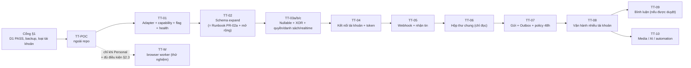

# Lộ trình TikTok Personal + QR: một tài khoản trước

**Cập nhật 13/10/2026. Phần hiện hành này thay thế roadmap Business-first trong phụ lục.** Chỉ là đề bài đánh giá, chưa cho phép chạy PoC/deploy.

## 1. Trình tự đã chốt

Nghiên cứu → PoC độc lập một tài khoản → đánh giá → staging chỉ đọc → gửi văn bản thủ công → pilot một tài khoản → thử hai tài khoản → mở rộng theo số đo. Hoãn Business OAuth, bình luận, LIVE, Shop, media và AI tự gửi.

## 2. TT-P0: đánh giá trước PoC

AI đọc nghiên cứu hiện hành, hướng dẫn và code repo. Xác minh loại tài khoản trong app; không tự chuyển Business. Đề xuất môi trường, file PoC, profile riêng, cách quan sát/bảo vệ/xóa phiên, nguồn/commit và giả định. Chưa sửa app/database. Không cần hoàn thành Messenger hoặc duyệt Business API để khảo sát Personal.

## 3. TT-P1: PoC độc lập một tài khoản

Chỉ thực hiện khi chủ dự án cho phép chạy thử và chủ tài khoản xác nhận phạm vi. Ưu tiên tài khoản thử/máy riêng; persistent profile riêng, không DB production. Chủ tài khoản quét QR và xử lý xác minh thông thường. Chỉ nhắn với người thử đồng ý.

| Test | Cách đo | Tiêu chí |
|---|---|---|
| P1 QR/danh tính | Quét, đối chiếu ID/username | Đúng tài khoản; không log session |
| P2 Nhận | 20 tin đánh số | Đủ, đúng thứ tự hoặc giải thích được thứ tự |
| P3 Gửi | 10 văn bản thủ công | Khách nhận đủ, không trùng; trạng thái có căn cứ |
| P4 Self-message | 5 tin từ điện thoại/Web | Đọc đủ, đúng bên gửi |
| P5 ID/dedup | Hai tin giống nhau, reload/cuộn | Không gộp mất/nhân đôi; ghi ID ổn định |
| P6 Lịch sử | Mở/cuộn thread | Ghi độ sâu, không hứa toàn bộ |
| P7 Restart | Dừng, có tin tới, mở lại | Đúng phiên; phục hồi hoặc phát hiện thiếu |
| P8 Mất mạng | Ngắt rồi nối | Không gửi lặp, phục hồi có bằng chứng |
| P9 Unknown send | Ngắt quanh lúc bấm gửi | Không retry mù; đối soát hoặc cần kiểm tra |
| P10 Hết phiên | Đăng xuất/thu hồi phiên thử | Dừng gửi, yêu cầu QR lại |
| P11 Requests | Người thử gửi request nếu cho phép | Ghi khả năng; không tự nhận mọi request |
| P12 Tài nguyên | CPU/RSS/profile/log/latency p50,p95 | Có số đo một tài khoản |

Quan sát đề xuất 72 giờ có hoạt động mỗi ngày, không bảo đảm production. Thiếu test ghi NOT TESTED, không PASS. Dừng khi lẫn danh tính, rò session, cảnh báo/hạn chế tài khoản hoặc cần né bảo vệ. Xác minh thông thường chuyển cho chủ tài khoản. Kết thúc thu hồi/xóa phiên theo thỏa thuận; báo cáo bỏ bí mật.

## 4. Cổng sau PoC

PASS cho tích hợp khi văn bản hai chiều, self-message, ID/dedup, unknown và phục hồi có bằng chứng. PARTIAL thì giảm scope: chỉ đọc được chỉ xem xét read-only. Thiếu lịch sử cũ có thể giảm scope; thiếu ID ổn định cần đánh giá trọng yếu. FAIL nếu lẫn phiên, gửi lặp hoặc thiếu tin không phát hiện. Chủ dự án quyết định bước tiếp. PASS kỹ thuật không đồng nghĩa được TikTok cấp phép.

## 5. PR dự kiến sau PoC

AI chốt file/dependency theo checkout thật trước code; đây chưa phải lệnh triển khai.

| PR | Mục tiêu | Điểm repo | Nghiệm thu |
|---|---|---|---|
| TT-01 | Adapter Personal/capability/flag OFF | config, app, health | Không đổi Zalo |
| TT-02 | Schema/identity đã chọn | Prisma, tenant guard, khung Messenger | Migration/restore test; không nick giả |
| TT-03 | ACL/đọc chung/null-safe/socket | chat-routes, scope, realtime, use-chat | HTTP/socket, list/count/search, regression |
| TT-04 | Một tài khoản/QR/worker | channels, UI accounts, Docker riêng | Profile riêng, restart đúng, QR kiểm quyền |
| TT-05 | Inbound và staging chỉ đọc | processor, ConversationList, MessageThread | Đủ tin/self-message/dedup |
| TT-06 | Gửi văn bản/Outbox | route gửi, worker, UI trạng thái | Unknown rõ, không retry mù |
| TT-07 | Pilot một tài khoản | health/metrics/reconciliation | Đối chiếu app, rollback diễn tập |
| TT-08 | Test hai tài khoản | profile/lease/queue/ACL | Gửi đồng thời; ngắt một không ảnh hưởng kia |
| TT-09 | Mở rộng theo số đo | resource/admission limits | Headroom và giới hạn đo được |

ACL/code null-safe phải xong trước hội thoại TikTok production. Nếu bảng chung, migrate nullable sau code tương thích, đánh giá XOR/backfill/index. Nếu bảng riêng, giải thích UNION/FK và nợ chuyển đổi. Mỗi PR nêu file sửa/tạo, migration, dependency, test có ý nghĩa, nghiệm thu, flag và rollback. AI/broadcast TikTok giữ tắt.

## 6. Deployment và rollback

Trước migration/deploy kiểm số liệu live, backup/restore DB+media, headroom build/rollback, RAM/CPU, health Zalo và mạng worker. Không đưa Chromium vào app container đang chạy để thử. Tắt outbound chặn lệnh chờ; lệnh có thể đã gửi giữ unknown, không reset hàng loạt. Tắt inbound rõ buffer/backfill hoặc khoảng mất tin. Rollback giữ dữ liệu đối soát; không xóa volume/database/backup.

Production là cổng riêng: PoC/staging đạt, quyền HTTP/socket, session, restart/rollback và điều khoản áp dụng được đánh giá bằng bằng chứng cụ thể. Chưa đủ giữ thử nghiệm và nêu lý do. Không lấy thiếu SLA làm lỗi kỹ thuật đã chứng minh.

## 7. Đầu ra AI

Đánh giá GO/PARTIAL/NO-GO cho PoC Personal QR một tài khoản; kế hoạch/file PoC tối thiểu; giả định/câu hỏi; chỉ sau kết quả mới chọn kiến trúc và chốt PR theo repo. Không bỏ PoC để xây toàn bộ đa kênh.

---

# Phụ lục roadmap cũ — Business-first

Các PR OAuth, policy và cổng dưới đây chỉ tham khảo nếu sau này chọn Business API; không thay quyết định Personal + QR hiện hành.

| | |
|---|---|
| Ngày | 13/10/2026 |
| Áp dụng cho | Repo `D:\ZaloCRM-CorepViet`, nhánh `main` @ `bf31cdf` |
| Đọc trước | `docs/TIKTOK-MULTIACCOUNT-RESEARCH.md` (gọi tắt **Research**). Mã bằng chứng `R1…R36`, `B1…B14` tham chiếu bảng trong Research |
| Tài liệu nền | `docs/TRIEN-KHAI-PRODUCTION-MESSENGER-NATIVE.md` (gọi tắt **Runbook**). Khi xung đột về khung đa kênh, Runbook thắng |
| Trạng thái | **Chưa được viết code.** Giai đoạn hiện tại chỉ là nghiên cứu. Mở PR đầu tiên khi đủ cổng ở §1 |

Không có ước lượng thời gian hay tỷ lệ tái sử dụng trong tài liệu này, vì chưa có số đo. Mỗi PR chỉ bắt đầu khi PR trước đạt tiêu chí nghiệm thu và được duyệt (Inspect → Plan → Implement → Test → review → **STOP chờ duyệt**, theo Runbook §19).

---

## 0. Tóm tắt

1. **Hướng chính: Business Messaging API chính thức (hướng C).** Điều kiện: tài khoản là Business, đăng ký ngoài EEA/CH/UK, và đơn xin quyền được duyệt.
2. **Hướng dự phòng chỉ cho tài khoản Personal: browser worker (hướng A).** Chỉ PoC. Production NO-GO.
3. **ReLttk (hướng B): không dùng** (Research §5.3).
4. **Repo thay đổi theo thứ tự:** khung đa kênh chung với Messenger (schema expand → nullable/XOR → quyền/danh sách/realtime theo kênh) → kết nối tài khoản TikTok → nhận tin → hộp thư chung → gửi qua Outbox → vận hành nhiều tài khoản → bình luận → media/AI.
5. **Bước đầu tiên:** chủ tài khoản xác nhận loại tài khoản, rồi chạy PoC §2 với hai tài khoản, **ngoài repo, ngoài VPS production**.

### Thứ tự đã điều chỉnh so với đề bài

Đề bài: PoC → adapter → dữ liệu/ACL/identity → nhận → hộp thư → gửi → vận hành → bình luận → media/AI.

Điều chỉnh theo bằng chứng repo:
- **Quyền và danh sách hội thoại phải sửa trước khi lưu tin TikTok.** Nếu không, tin TikTok được lưu nhưng biến mất khỏi danh sách (R19), member bị 403 (R17), và socket phát nội dung cho cả org (R22). Vì vậy TT-03 gộp "nullable/XOR" với "quyền/danh sách/realtime theo kênh".
- **Hộp thư chung (TT-06) đi trước gửi tin (TT-07)** như đề bài. Giai đoạn đó hội thoại TikTok hiển thị ở chế độ chỉ đọc, giúp đối soát số tin với app TikTok trước khi mở gửi.
- **Kết nối tài khoản (TT-04) đi trước nhận tin (TT-05)**, vì webhook cần `ChannelAccount` có `business_id` để định tuyến.

---

## 1. Cổng trước khi mở PR đầu tiên

| # | Điều kiện | Bằng chứng hiện có | Trạng thái |
|---|---|---|---|
| G1 | D1 chính thức PASS: disk < 80%, health 200, Zalo gửi/nhận OK, AI decrypt OK, port 9000 loopback | Biên bản D1 07/10: CONDITIONAL PASS; anh cho biết còn ~15 GB trống | ⏳ Cần cập nhật biên bản |
| G2 | Gate §11 Runbook: backup DB + media, off-site, restore test thành công | Runbook §20: chưa đủ | ⏳ Bắt buộc trước mọi migration |
| G3 | Chủ tài khoản xác nhận loại tài khoản và các câu ở Research §10 | Chưa có | ⏳ |
| G4 | PoC §2 PASS cho hướng đã chọn | Chưa có | ⏳ |
| G5 | Thứ tự với Messenger được chốt: kênh nào đi trước thì xây khung đa kênh (TT-02/TT-03 = Runbook PR-02a/PR-02b). Kênh sau dùng lại | Runbook: PR-02a chờ "Meta Spike PASS" | ⏳ Đề xuất đổi điều kiện thành "spike của **ít nhất một** kênh ngoài Zalo PASS" |

TT-01 không có migration, có thể mở khi G1, G3 đạt và G4 đang chạy. TT-02 trở đi cần đủ G1–G5.

---

## 2. Kế hoạch PoC (TT-POC)

### 2.1 Phạm vi chung

- **Hai tài khoản TikTok** mà chủ tài khoản đã đồng ý bằng văn bản (tin nhắn/email ghi rõ phạm vi và rủi ro). Ưu tiên tài khoản phụ, không phải tài khoản bán hàng chính.
- **Ít nhất hai tài khoản khách thử** (người thật trong công ty) để nhắn vào.
- Chạy **ngoài repo và ngoài VPS production**: script nhỏ trên máy riêng hoặc n8n workflow tạm, giống Meta Spike. Không ghi vào DB production. Dữ liệu chỉ lưu cục bộ, xóa sau PoC.
- Không đưa cookie/token thật vào công cụ bên thứ ba.
- Ghi kết quả vào bảng §2.5, theo mẫu Runbook §17.

### 2.2 PoC hướng C (ưu tiên)

Chuẩn bị (cần chủ doanh nghiệp):
1. Tài khoản Business, liên kết TikTok for Business/Business Center; bật "nhận tin từ mọi người" nếu muốn nhận message request qua API.
2. Developer app tại `business-api.tiktok.com/portal/apps`, pháp nhân và email tên miền doanh nghiệp, URL chính sách quyền riêng tư.
3. Nộp đơn Business Messaging API. Chờ duyệt.
4. Endpoint HTTPS công khai tạm cho webhook và redirect OAuth.

Thử nghiệm sau khi được duyệt:
- Ủy quyền **từng tài khoản riêng**. Ghi lại trang ủy quyền có cho đăng nhập QR không.
- Nhận `im_receive_msg` từ khách thử cho **cả hai tài khoản đồng thời**, xác minh chữ ký, đối chiếu `business_id`.
- Gửi văn bản từ API; ghi `message_id`; nhận `im_send_msg` tương ứng.
- Gửi từ **điện thoại** và từ **Business Suite**; kiểm tra có `im_send_msg` không.
- Gọi `conversation/list` và `content/list`; ghi giới hạn thời gian và có trả hội thoại `STRANGER` không.
- Gửi ngoài 48 giờ và gửi tin thứ 11 trong cửa sổ; ghi mã lỗi.
- Refresh token một lần; thu hồi quyền trong app TikTok rồi gọi API; ghi mã lỗi.
- Gửi trùng webhook (replay cùng body); xác nhận dedup theo `sha256(body)` và `message_id`.

### 2.3 PoC hướng A (chỉ khi Personal và không thể chuyển Business)

**Chỉ chạy khi đủ cả 6 điều kiện:**
1. Hướng C không áp dụng được (tài khoản bắt buộc Personal, hoặc đơn bị từ chối, hoặc API không khả dụng ở Việt Nam).
2. Chủ tài khoản đồng ý bằng văn bản, ghi rõ rủi ro khóa/hạn chế tài khoản và rủi ro điều khoản.
3. Người có thẩm quyền đã đọc ToS TikTok hiện hành cho Việt Nam.
4. Tài khoản phụ, máy riêng, không chạm production.
5. Không dùng stealth plugin, giả vân tay, proxy xoay vòng, dịch vụ giải CAPTCHA hay tự sinh chữ ký chống bot.
6. Áp dụng điều kiện dừng §2.6.

Thử nghiệm: Playwright với **một process + một persistent profile cho mỗi tài khoản**; đăng nhập QR trên trang web TikTok; khi bị yêu cầu xác minh thì dừng tự động hóa, chủ tài khoản tự làm trên cửa sổ trình duyệt thật. Ghi: có ID tin trong DOM không; tin từ điện thoại có hiện không; message request hiển thị thế nào; số lần mất phiên; số lần bị yêu cầu xác minh.

### 2.4 Hướng B

Không chạy (Research §5.3, B1). Nếu chủ doanh nghiệp vẫn muốn đánh giá, đó là quyết định riêng của họ sau khi đọc B1–B14; tài liệu này không đề xuất.

### 2.5 Checklist PoC — tiêu chí pass/fail

| # | Kiểm tra | Cách đo | PASS | FAIL |
|---|---|---|---|---|
| P1 | Kết nối riêng, đúng danh tính | Kết nối 2 tài khoản lần lượt; so `business_id`/username trả về với tài khoản đã đăng nhập | Cả hai đúng, không lẫn | Bất kỳ lần nào lẫn danh tính |
| P2 | Nhận đồng thời không lẫn tài khoản | Hai khách nhắn hai tài khoản cùng lúc, mỗi bên ≥ 20 tin có đánh số | 100% tin vào đúng tài khoản, đủ số thứ tự | Thiếu hoặc lẫn ≥ 1 tin |
| P3 | Gửi đồng thời không lẫn | Gửi xen kẽ từ hai tài khoản, mỗi bên ≥ 10 tin có đánh số (trong giới hạn 10 tin/cửa sổ với C) | Khách nhận đúng người gửi, đúng thứ tự | Lẫn hoặc thiếu |
| P4 | Tin gửi từ điện thoại được đồng bộ | Gửi ≥ 5 tin từ app, ≥ 5 từ Business Suite (nếu C) | Thấy đủ (C: qua `im_send_msg`) | Thiếu → ghi nhận "không đồng bộ được", ảnh hưởng thiết kế, chưa chắc là FAIL toàn bộ |
| P5 | Một tài khoản mất phiên không ảnh hưởng tài khoản kia | Thu hồi quyền / đăng xuất tài khoản 1 trong khi tài khoản 2 đang nhận | Tài khoản 2 tiếp tục nhận/gửi bình thường; tài khoản 1 báo trạng thái đúng | Tài khoản 2 bị gián đoạn |
| P6 | Restart | Dừng script/worker giữa lúc có tin đến, khởi động lại | C: webhook được TikTok gửi lại hoặc lấy lại qua `content/list`; không trùng | Mất tin không phát hiện được |
| P7 | Mất mạng | Ngắt mạng máy PoC một khoảng có đo, bật lại | Như P6 | Như P6 |
| P8 | Lịch sử | Gọi `content/list` (C) / cuộn UI (A) | Ghi lại được độ sâu thực tế | — (thông tin, không pass/fail) |
| P9 | ACK/echo, chống trùng | Replay webhook; gửi rồi cắt kết nối ngay sau khi request rời máy | Không tạo bản ghi trùng; trường hợp cắt kết nối được phân loại "chưa xác nhận" rồi đối soát được | Có tin trùng phía khách mà hệ thống không biết |
| P10 | Đối chiếu số tin | Cuối mỗi ngày đếm tin theo hội thoại ở app TikTok và ở log PoC | Khớp 100% | Lệch không giải thích được |
| P11 | Tài nguyên theo tài khoản | `docker stats`/`ps`: CPU, RSS, ổ đĩa (profile, log), độ trễ từ lúc khách gửi tới lúc nhận sự kiện (p50/p95) | Ghi số đo để tính sức chứa | — |
| P12 | Ràng buộc chính sách (C) | Gửi ngoài 48h, tin thứ 11 | Ghi mã lỗi thật | — |

Thời gian quan sát đề xuất: tối thiểu nhiều ngày liên tiếp có tin thật mỗi ngày. Kết quả nhiều ngày **không** đồng nghĩa ổn định production.

### 2.6 Điều kiện dừng ngay

- Bất kỳ cảnh báo, hạn chế, yêu cầu xác minh lặp lại hay khóa trên tài khoản.
- Phát hiện cần dùng kỹ thuật né phát hiện để tiếp tục.
- Lẫn danh tính giữa hai tài khoản (P1, P2, P3 FAIL).
- Rò token/cookie ra log hoặc ra ngoài máy PoC.

### 2.7 Cổng sau PoC

Kết quả là một trong ba: **chọn C**, **chọn A cho thử nghiệm nội bộ (production vẫn NO-GO)**, hoặc **dừng DM TikTok**. Cập nhật Research §4 với dữ kiện đã chứng minh. Chỉ mở rộng số tài khoản dựa trên P11.

---

## 3. Lộ trình PR

Quy ước chung cho mọi PR:
- File mới có SPDX header; TypeScript strict; import đuôi `.js`.
- Chạy `npx tsc --noEmit` (backend), `npx vue-tsc -b` + `npm run build` (frontend), toàn bộ `backend/tests/characterization/*` (R30) và suite hiện có. Không thêm failure mới.
- Mọi cờ mặc định **OFF**. Cờ phân cấp như `config/messenger-config.ts:63-78`: `TIKTOK_ENABLED` → `TIKTOK_INBOUND_ENABLED` / `TIKTOK_OUTBOUND_ENABLED` → `TIKTOK_AI_AUTO_SEND_ENABLED` (không dùng trong MVP). Thêm cờ theo tài khoản trên `ChannelAccount` (`inboundEnabled`, `outboundEnabled`).
- Rollback ứng dụng theo image tag (track OPS của Runbook).

---

### TT-01 — Hợp đồng adapter, capability, cờ, health

| Mục | Nội dung |
|---|---|
| Mục tiêu | Có ngôn ngữ chung "kênh" trong backend mà không đổi hành vi |
| Hành vi sau thay đổi | Không đổi gì với người dùng. `/health/ready` có thêm khối `tiktok: { status: 'disabled' }` không ảnh hưởng `statusCode` |
| Sửa | `backend/src/shared/http/health.ts` (thêm khối `tiktok`, như `messenger` ở `:13`); `backend/src/app.ts` (đọc config, truyền vào health); `backend/src/config/validate-production-config.ts` (cảnh báo cấu hình TikTok thiếu, không crash); `.env.example` (thêm `TIKTOK_MESSAGING_*`, ghi rõ khác `TIKTOK_*` của Lead Gen ở `:206-218`) |
| Tạo mới | `backend/src/config/tiktok-config.ts`; `backend/src/modules/channels/channel-types.ts` (`ChannelKind`, `ChannelCapabilities`, `NormalizedInbound`, `SendResult`); `backend/src/modules/channels/channel-capabilities.ts` (`ZaloLegacyCapabilities` mô tả đúng hành vi hiện tại, `TikTokBusinessCapabilities`); `backend/src/modules/channels/channel-adapter.ts` (interface `normalize/send/policy/capabilities/health`) |
| Migration | Không |
| Phụ thuộc | G1, G3 |
| Kiểm thử | Unit: parse cờ (thiếu/sai/phân cấp); health luôn 200 khi TikTok `misconfigured`; capability Zalo khớp hành vi hiện tại (snapshot). Characterization Zalo pass |
| Nghiệm thu | Typecheck + suite pass; health có khối `tiktok`; không file nào ngoài danh sách bị đổi |
| Cờ / rollback | Không có hành vi để tắt; rollback ứng dụng |
| Giới hạn còn lại | Chưa có dữ liệu, chưa có route |

---

### TT-02 — Schema expand (dùng chung với Messenger)

| Mục | Nội dung |
|---|---|
| Mục tiêu | Có bảng đa kênh. Đây là **Runbook PR-02a** cộng phần mở rộng cho TikTok. Nếu Messenger làm PR-02a trước thì TT-02 chỉ còn phần mở rộng |
| Hành vi sau thay đổi | Không đổi. Code cũ bỏ qua bảng/cột mới |
| Sửa | `backend/prisma/schema.prisma`; `backend/src/shared/tenant/org-scoped-models.ts` (R28) |
| Tạo mới | Migration `backend/prisma/migrations/<ts>_multichannel_expand/` gồm 7 model Runbook §9.1 (`ChannelAccount`, `TokenCredential`, `ContactIdentity`, `ContactMergeAudit`, `WebhookDelivery`, `ChannelEvent`, `OutboundCommand`); cột nullable `conversations.channel_account_id`, `messages.org_id`, `messages.platform_message_id`. **Mở rộng TikTok:** `ChannelAccount.authKind`, `connectionState`, `ownerUserId`, `lastHeartbeatAt`, `lastStateChangeAt`, `lastError`; bảng `ChannelAccountAccess` (unique `(channel_account_id, user_id)`); `TokenCredential.encryptedRefreshToken`, `expiresAt`, `refreshExpiresAt`; `conversations.thread_kind` (default `'dm'`) |
| Migration | **Có, expand-only.** Không đổi `zaloAccountId`. FK tới `channel_accounts` `ON DELETE RESTRICT`. Partial unique `token_credentials_one_active` |
| Tương thích dữ liệu cũ | Tất cả cột mới nullable hoặc có default; không backfill; app cũ chạy được với schema mới (Runbook §15.1) |
| Phụ thuộc | TT-01; G2 (backup + restore test); G5 |
| Kiểm thử | `prisma validate`; migrate trên DB trống và trên bản restore; test partial unique; test tenant guard cho model mới; characterization pass; đo thời gian migration trên bản restore |
| Nghiệm thu | Migration chạy trên bản restore không lỗi, có số đo; suite pass; `org-scoped-models.ts` có đủ model mới |
| Cờ / rollback | Rollback ứng dụng; schema giữ nguyên (Runbook §15.4). Chỉ drop khi chắc chắn chưa có dữ liệu kênh mới |
| Giới hạn còn lại | Chưa ghi được hội thoại TikTok (còn NOT NULL) |

---

### TT-03 — Nullable + XOR + quyền, danh sách, realtime theo kênh

Chia ba PR vì bán kính lớn (R1, R16, R17, R19–R22). Tương ứng **Runbook PR-02b** cộng phần quyền/danh sách mà Runbook để ở PR-06.

#### TT-03a — Code chịu `zaloAccountId` null, quyền theo kênh (không migration)

| Mục | Nội dung |
|---|---|
| Mục tiêu | Mọi đường đọc/ghi hội thoại an toàn khi hội thoại thuộc kênh khác. Quyền tính được cho cả hai loại tài khoản |
| Hành vi sau thay đổi | Với dữ liệu hiện tại (100% Zalo) **không đổi**. Prisma schema khai `zaloAccountId String?` nhưng DB vẫn NOT NULL (Runbook 02b-1) |
| Sửa | `backend/prisma/schema.prisma` (`zaloAccountId String?`, quan hệ `zaloAccount ZaloAccount?`); `backend/src/modules/chat/chat-routes.ts`: `:475` bỏ điều kiện quan hệ bắt buộc, thay bằng `OR: [{ zaloAccountId: null, channelAccountId: {in: …} }, { zaloAccount: DISPLAYABLE_NICK_WHERE, … }]`; `:786-795`, `:1107-1112`, `:151-154`, `:213-214`, `:368-369` dùng scope mới; `:1607` và các chỗ đọc `conversation.zaloAccount.x` thành null-safe; các bộ lọc Friend/nhãn (`:551-578`, `:620-630`) chỉ áp cho hội thoại Zalo; `backend/src/modules/zalo/zalo-access-middleware.ts` giữ nguyên cho route Zalo-only; các route chat chung chuyển sang `requireConversationAccess`; 13 file raw SQL (R21) thêm điều kiện rõ ràng (đếm Zalo hay tất cả kênh); frontend `frontend/src/composables/use-chat.ts:112` (`zaloAccount` có thể null, thêm `channel`), `frontend/src/components/chat/ConversationList.vue`, `MessageThread.vue`, `ChatContactPanel.vue`, `frontend/src/views/ChatView.vue` null-safe; ghi `messages.org_id` cho mọi tin mới (`message-handler.ts`, `chat-routes.ts`) |
| Tạo mới | `backend/src/modules/channels/channel-scope.ts` (`getChannelScope`: luật như `zalo-scope.ts:59-145` cho `ChannelAccount`); `backend/src/modules/channels/channel-access.ts` (`requireConversationAccess(min)`: tra hội thoại → kênh → `ZaloAccountAccess` hoặc `ChannelAccountAccess`); test kiến trúc cấm route mới gọi `zaloPool`/`zaloOps` ngoài nhánh Zalo |
| Migration | Không |
| Phụ thuộc | TT-02 đã lên production |
| Kiểm thử | Characterization pass; test quyền ma trận (owner/admin/trưởng phòng/member có grant/không grant × hội thoại Zalo/hội thoại kênh giả lập trong DB test); test danh sách: admin và member thấy đúng hội thoại kênh khi DB test có dòng `zaloAccountId=null`; test đếm/sidebar; test raw SQL không tự loại/nhân đôi; FE `work-scope-logic.spec.ts` mở rộng |
| Nghiệm thu | Không thay đổi kết quả API với dữ liệu Zalo (so snapshot trước/sau trên bản restore). Chạy production ít nhất vài ngày như Runbook 02b-1 trước TT-03b |
| Cờ / rollback | Rollback ứng dụng (DB chưa đổi) |
| Giới hạn còn lại | DB vẫn NOT NULL |

#### TT-03b — Backfill + migration nullable/XOR

| Mục | Nội dung |
|---|---|
| Mục tiêu | DB cho phép hội thoại thuộc kênh khác, đảm bảo đúng một chủ sở hữu |
| Hành vi sau thay đổi | Không đổi với Zalo |
| Tạo mới | `scripts/ops/backfill-message-org-id.ts` (batch, idempotent, `lock_timeout`); 3 migration theo Runbook §9.2: 02b-3 (DROP NOT NULL + CHECK XOR `NOT VALID` + FK `NOT VALID`), 02b-4 (VALIDATE + unique partial `(channel_account_id, external_thread_id)`), 02b-5 (`messages.org_id` NOT NULL + unique partial `(org_id, platform_message_id)`) |
| Migration | **Có, 3 file, chạy tách bước có duyệt** |
| Phụ thuộc | TT-03a chạy ổn định trên production |
| Kiểm thử | XOR từ chối cả hai null / cả hai có; backfill chạy lại không đổi kết quả; đếm dòng trước/sau; diễn tập trên bản restore có đo thời gian lock |
| Nghiệm thu | `num_nonnulls(...) = 1` đúng cho 100% dòng; 0 dòng `messages.org_id` null |
| Cờ / rollback | Trước khi có hội thoại kênh đầu tiên: drop constraint/index (Runbook §15.4) |

#### TT-03c — Realtime theo quyền tài khoản kênh

| Mục | Nội dung |
|---|---|
| Mục tiêu | Tin của hội thoại kênh mới chỉ tới socket của người có quyền |
| Hành vi sau thay đổi | Zalo: giữ nguyên `emitChatMessage` vào `org:` (không mở rộng phạm vi PR). Kênh mới: emit vào room `channel:{channelAccountId}` |
| Sửa | `backend/src/shared/realtime/emit-chat.ts` (nhánh kênh); payload thêm `channel` + `channelAccountId` (giữ `accountId` cho Zalo); `frontend/src/composables/use-chat.ts:872-899` và `work-scope-logic.ts` nhận cả hai |
| Tạo mới | `backend/src/modules/channels/channel-socket.ts`: `channel:subscribe` kiểm `getChannelScope` (không chỉ kiểm org như R6); tự join các room được phép khi socket kết nối; rời room khi quyền bị thu hồi |
| Migration | Không |
| Phụ thuộc | TT-03a |
| Kiểm thử | Socket: member không quyền không nhận event; thu hồi quyền → không nhận event tiếp; IDOR khác org bị từ chối; regression `zalo-conversation-websocket` |
| Nghiệm thu | Test socket pass; Zalo không đổi |
| Ghi chú | Lỗ R22 (nội dung nick Zalo "Thường" tới mọi socket trong org) và R6 (QR Zalo) là vấn đề có sẵn, nên tách PR bảo mật riêng cho Zalo, không gộp vào chuỗi TikTok |

---

### TT-04 — Kết nối tài khoản TikTok và token

| Mục | Nội dung |
|---|---|
| Mục tiêu | Owner/admin thêm nhiều tài khoản TikTok Business, xem trạng thái, ngắt, kết nối lại riêng từng tài khoản; cấp quyền nhân viên theo tài khoản |
| Hành vi sau thay đổi | Khi `TIKTOK_ENABLED=true`: trang "Tài khoản kênh" có nút **Thêm tài khoản TikTok** → mở trang ủy quyền TikTok → callback tạo/cập nhật `ChannelAccount(provider=TIKTOK_BUSINESS, externalId=business_id)` + `TokenCredential`. Một `business_id` đã thuộc org khác → từ chối |
| Sửa | `backend/src/app.ts` (đăng ký route sau cờ); `backend/src/shared/utils/logger.ts` (**redaction**: `Access-Token`, `access_token`, `refresh_token`, `auth_code`, `code`, `Tiktok-Signature`, header `Authorization`) (R27); `backend/src/modules/integrations/_shared/token-encryption.util.ts` (chỉ dùng, không đổi khóa); `frontend/src/router/index.ts` |
| Tạo mới | `backend/src/modules/channels/tiktok/tiktok-oauth-routes.ts` (start + callback, `state` ký và có hạn, gắn `orgId` + `userId`); `tiktok-auth-client.ts` (đổi code, refresh); `tiktok-token-service.ts` (lấy token hợp lệ, khóa Redis `tiktok:refresh:{accountId}`); `tiktok-token-refresh.job.ts` (refresh trước hạn; `invalid_grant` → `session_expired` + thông báo chủ tài khoản); `channel-account-routes.ts` (list/ngắt/bật tắt inbound-outbound/cấp quyền, kiểm quyền `admin`); `channel-account-access-routes.ts`; frontend `frontend/src/views/ChannelAccountsView.vue` (danh sách đa kênh: Zalo lấy từ API cũ, TikTok từ API mới), `frontend/src/components/settings/ChannelAccessDialog.vue` |
| Migration | Không (bảng có từ TT-02) |
| Phụ thuộc | TT-03a; app TikTok đã được duyệt (PoC C PASS) |
| Kiểm thử | `state` sai/hết hạn/khác org bị từ chối; callback lặp không tạo bản ghi thứ hai; `business_id` thuộc org khác bị từ chối; refresh đồng thời chỉ một lần; `invalid_grant` → `session_expired`, outbound bị chặn; log không chứa token (unit test redaction); member không quyền không thấy/không thao tác được tài khoản |
| Nghiệm thu | Kết nối 2 tài khoản thật trên staging, trạng thái đúng; ngắt một tài khoản không ảnh hưởng tài khoản kia; refresh qua ít nhất một chu kỳ |
| Cờ / rollback | `TIKTOK_ENABLED=false` ẩn trang và trả 404 cho route; token giữ trong DB (mã hóa) |
| Giới hạn còn lại | Chưa nhận/gửi tin |

---

### TT-05 — Webhook và lưu tin vào

| Mục | Nội dung |
|---|---|
| Mục tiêu | Tin khách gửi tới tài khoản TikTok được lưu đúng Contact/ContactIdentity/Conversation/Message, không trùng, không lẫn tài khoản; tin gửi từ điện thoại cũng được lưu |
| Hành vi sau thay đổi | Khi `TIKTOK_INBOUND_ENABLED=true` và tài khoản `inboundEnabled=true`: hội thoại TikTok xuất hiện trong DB và được emit tới room kênh. Hộp thư UI chưa hiển thị (TT-06) |
| Sửa | `backend/src/app.ts` (đăng ký plugin webhook trong scope riêng có content-type parser giữ raw body; hiện repo chưa có parser raw body); `backend/src/shared/realtime/emit-chat.ts` (dùng nhánh kênh từ TT-03c) |
| Tạo mới | `backend/src/modules/channels/webhook-delivery.service.ts` (ghi `WebhookDelivery` + `ChannelEvent` **cùng transaction**, 200 sau COMMIT, lỗi DB → 5xx; dùng chung với Messenger); `channel-event-processor.ts` (poll `PENDING`, `FOR UPDATE SKIP LOCKED`, retry có giới hạn); `contact-identity.service.ts` (không auto-merge); `backend/src/modules/channels/tiktok/tiktok-webhook-routes.ts`; `tiktok-signature.ts` (dùng `verifyHmacSignature` của `shared/security/hmac.ts`, kiểm lệch giờ, fail-closed); `tiktok-classifier.ts` (thuần, không I/O: `im_receive_msg` → `tt:msg:`, `im_send_msg` → `tt:echo:`, `im_mark_read_msg` → `tt:read:`, còn lại `IGNORED_UNSUPPORTED`); `tiktok-adapter.ts` (`normalize`) |
| Migration | Không |
| Phụ thuộc | TT-04, TT-03b, TT-03c |
| Kiểm thử | Chữ ký đúng/sai/thiếu/lệch giờ/body đổi 1 byte; `appKey` sai → 404; delivery trùng; `message_id` trùng; transaction lỗi → 5xx; process chết sau COMMIT → event vẫn được xử lý; `business_id` không thuộc tài khoản nào → `IGNORED_UNKNOWN_ACCOUNT`; tài khoản tắt inbound → chỉ lưu metadata; hai tài khoản cùng org và khác org không lẫn; `im_send_msg` có `message_id` đã có → không tạo tin thứ hai; tin từ điện thoại → tạo Message `senderType=self`, `sentVia='native'`; Contact TikTok có `zaloUid`/`zaloGlobalId` null; không chạm `Friend` |
| Nghiệm thu | Staging: P2, P4, P10 của PoC lặp lại trên CRM, khớp 100% với app TikTok; characterization Zalo pass |
| Cờ / rollback | `TIKTOK_INBOUND_ENABLED=false`: vẫn kiểm chữ ký, lưu metadata `IGNORED_DISABLED`, trả 200 để TikTok không tắt webhook |
| Giới hạn còn lại | Chưa hiển thị trên UI; chưa gửi; ảnh chỉ lưu metadata |

---

### TT-06 — Hộp thư chung (chỉ đọc cho TikTok)

| Mục | Nội dung |
|---|---|
| Mục tiêu | Nhân viên thấy hội thoại Zalo và TikTok trong cùng danh sách, lọc theo kênh, đúng quyền |
| Hành vi sau thay đổi | Bộ lọc kênh All/Zalo/TikTok; icon kênh; tên tài khoản TikTok; hội thoại TikTok mở được, ô nhập **khóa** kèm lý do "Chưa bật gửi TikTok"; bộ lọc chỉ Zalo (Friend, nhãn Zalo, quan hệ) tự ẩn khi chọn kênh TikTok |
| Sửa | `backend/src/modules/chat/chat-routes.ts` (tham số `channel`, DTO hội thoại có `channel`, `channelAccount`, `capabilities`); `GET /conversations/:id/messages` sắp theo `zaloMsgIdNum` rồi `sentAt` với null đúng (Research §6.7); frontend `ConversationList.vue`, `ConversationFilterBar.vue`, `ConversationFilterSidebar.vue`, `MessageThread.vue`, `ChatContactPanel.vue` (danh sách `ContactIdentity`), `ChatView.vue`, `use-chat.ts` |
| Tạo mới | `frontend/src/components/chat/ChannelBadge.vue`; `frontend/src/lib/channel-capabilities.ts` (đọc capability từ API, không tự suy) |
| Migration | Không |
| Phụ thuộc | TT-05 |
| Kiểm thử | Danh sách/đếm/tìm kiếm đúng cho admin và member; chọn bộ lọc Zalo-only không làm mất hội thoại TikTok khi xem "All" mà không chọn bộ lọc; phân trang khi xen kẽ hai kênh; FE build; characterization pass |
| Nghiệm thu | Đối chiếu số hội thoại/tin TikTok trên UI với app TikTok cho 2 tài khoản; member chỉ thấy tài khoản được cấp |
| Cờ / rollback | Ẩn bộ lọc kênh và hội thoại kênh khi `TIKTOK_ENABLED=false` |
| Giới hạn còn lại | Chưa gửi được |

---

### TT-07 — Gửi văn bản qua Outbox, policy 48 giờ

| Mục | Nội dung |
|---|---|
| Mục tiêu | Gửi văn bản tới khách TikTok an toàn: không trùng, không mất, đúng tài khoản, đúng chính sách |
| Hành vi sau thay đổi | Khi `TIKTOK_OUTBOUND_ENABLED=true` và tài khoản `outboundEnabled=true`: ô nhập mở trong cửa sổ 48 giờ, hiện số tin còn lại (≤ 10); tin hiện ngay với trạng thái "đang gửi" → "đã gửi" / "lỗi" / "chưa xác nhận"; "Gửi lại" chỉ là thao tác tay |
| Sửa | `backend/src/modules/chat/chat-routes.ts:1574`: rẽ nhánh theo kênh **trước** mọi truy cập `zaloPool` (Zalo đi đường cũ không đổi); `MessageThread.vue` + `message-bubble.vue` hiển thị trạng thái gửi |
| Tạo mới | `backend/src/modules/channels/messaging-policy-engine.ts` (provider TikTok: 48h kể từ tin khách cuối, đếm tin doanh nghiệp đã gửi trong cửa sổ kể cả echo; actor HUMAN/AI; trả mã lỗi rõ); `outbound-command.service.ts` (ghi Message `PENDING` + `OutboundCommand` cùng transaction, `idempotencyKey` từ `echoId` client); `outbound-dispatcher.ts` + `outbound-reaper.ts` (Runbook §7.3); `backend/src/modules/channels/tiktok/tiktok-sender.worker.ts` (BullMQ `tiktok-send`, `jobId = command.id`, ghi `PROCESSING` + `sendAttemptedAt` trước khi gọi API, phân biệt lỗi trước/sau khi gửi request); `tiktok-api-error.ts` (phân loại lỗi: token, quyền, ngoài cửa sổ, quota, 5xx); `unknown-delivery-reconciler.ts` (khớp echo theo `message_id`; không có thì tra `content/list` nếu PoC chứng minh dùng được; nhiều ứng viên → `NEEDS_REVIEW`) |
| Migration | Không |
| Phụ thuộc | TT-06 |
| Kiểm thử | Bảng policy (trong 48h, ngoài 48h, tin thứ 10/11, khách nhắn mới thì đặt lại); Redis chết sau COMMIT → không mất, không nhân đôi; `jobId` chống trùng; timeout sau khi ghi request → `UNKNOWN_DELIVERY`, 0 lần retry; connect refused → retry có giới hạn; reaper không bao giờ đưa `PROCESSING`/`UNKNOWN_DELIVERY` về `PENDING` (test bất biến); echo khớp đúng command; member chỉ có quyền `read` bị 403; gửi qua tài khoản `session_expired` bị chặn; **regression Zalo outbound** (`zalo-outbound.test.ts`) pass |
| Nghiệm thu | Staging: P3, P9 lặp lại trên CRM; không có tin trùng phía khách trong toàn bộ bộ kiểm thử |
| Cờ / rollback | `TIKTOK_OUTBOUND_ENABLED=false` + SQL abandon theo Runbook §15.3 (không đụng `UNKNOWN_DELIVERY`) |
| Giới hạn còn lại | Chỉ văn bản; AI chỉ nháp |

---

### TT-08 — Vận hành nhiều tài khoản

| Mục | Nội dung |
|---|---|
| Mục tiêu | Chạy ổn định nhiều tài khoản, phát hiện sự cố theo từng tài khoản |
| Hành vi sau thay đổi | Trang tài khoản kênh hiện trạng thái, lần nhận sự kiện cuối, lỗi gần nhất (đã lọc bí mật); thông báo cho chủ tài khoản khi `session_expired`/`access_blocked`; job đối soát định kỳ chỉ cảnh báo |
| Sửa | `backend/src/shared/http/health.ts` (khối `tiktok` có số tài khoản theo trạng thái, không ảnh hưởng `statusCode`); `backend/src/modules/system-notifications/system-notify-service.ts` (loại thông báo mới) |
| Tạo mới | `backend/src/modules/channels/metrics.ts` (theo tài khoản: inbound, outbound theo trạng thái, `unknown_delivery`, lỗi chữ ký, độ trễ webhook→lưu, token sắp hết hạn); `backend/src/modules/channels/tiktok/tiktok-reconciliation.job.ts` (so `conversation/list`/`content/list` với DB, chỉ cảnh báo, không ghi); `payload-purge.job.ts` (TTL payload webhook) |
| Migration | Không |
| Phụ thuộc | TT-07 |
| Kiểm thử | Metric tăng đúng; endpoint metric chỉ loopback; đối soát không ghi DB; một tài khoản lỗi liên tục không làm chậm processor của tài khoản khác (giới hạn retry theo tài khoản) |
| Nghiệm thu | Pilot 2 tài khoản đạt go/no-go §5; chỉ tăng số tài khoản theo số đo P11 và metric thực tế |
| Cờ / rollback | Tắt từng tài khoản bằng `inboundEnabled`/`outboundEnabled` |

---

### TT-09 — Bình luận video (nếu được duyệt Accounts API)

| Mục | Nội dung |
|---|---|
| Mục tiêu | Đọc và trả lời bình luận trên video của tài khoản được ủy quyền trong CRM |
| Hành vi sau thay đổi | Tab "Bình luận" (hoặc `threadKind='comment'` trong hộp thư); mỗi bình luận gốc là một thread có link video; trả lời qua `/business/comment/reply/create/` |
| Tạo mới | `backend/src/modules/channels/tiktok/tiktok-comment-*.ts` (webhook `comment.update` nếu PoC xác nhận, nếu không thì polling có checkpoint trong rate limit); dedup `ttc:cmt:` |
| Migration | Có thể có (bảng checkpoint polling), expand-only |
| Phụ thuộc | TT-08; đơn Accounts API được duyệt; PoC riêng cho bình luận |
| Kiểm thử | Không biến mỗi người bình luận thành DM; không ghép ID người bình luận với ID DM; ẩn/xóa có audit |
| Giới hạn | Chỉ video sở hữu; LIVE không thuộc PR này |

### TT-10 — Media, AI, automation (sau MVP)

- **Ảnh**: nhận qua `media/download`, lưu bằng `shared/storage/*` với chống SSRF (`shared/utils/ssrf-guard.ts`, giới hạn dung lượng); gửi ảnh chỉ khi `capabilities/get` trả `IMAGE_SEND=true`. Cờ riêng `TIKTOK_MEDIA_ENABLED`.
- **AI gửi tự động**: chỉ sau pilot ổn định; cờ kép; chỉ trong 48h; tính quota; qua `ai-send-policy.ts`. Sửa `ai-auto-reply-service.ts`, `ai-followup-cron.ts` để gọi gateway theo kênh thay vì `zaloOps`.
- **Automation/broadcast**: giữ tắt cho TikTok (`canInitiate=false`). Không nối sequence/broadcast Zalo sang TikTok.

### TT-W — Browser worker (chỉ khi PoC A PASS và chủ doanh nghiệp duyệt)

| Mục | Nội dung |
|---|---|
| Phạm vi | Image riêng có Chromium + Playwright, **host/container riêng**, không chung image `node:22-alpine` của app; một process + một profile mỗi tài khoản; lease Redis + epoch; ingest nội bộ `POST /internal/channels/tiktok-web/events` ký bằng `verifyHmacRequest` (`shared/security/hmac.ts`) và chỉ mạng nội bộ; queue `tiktok-web-send`; QR và trạng thái qua room `channel:{id}` có kiểm quyền `admin` |
| Không làm | Stealth, giả vân tay, giải CAPTCHA, proxy xoay vòng, AI tự gửi |
| Production | **NO-GO** cho tới khi có văn bản chấp thuận của TikTok hoặc thay đổi chính sách |

---

## 4. Bảng nợ chuyển đổi (tránh hai pipeline vĩnh viễn)

| Thành phần | Sau MVP còn "chỉ Zalo"? | Kế hoạch |
|---|---|---|
| Nhận tin Zalo (`handleIncomingMessage`) | Có | Giữ. Chỉ chuyển sang `ChannelEvent` khi có lý do kinh doanh |
| Gửi tin Zalo (route đồng bộ, R15) | Có | PR riêng đưa Zalo vào Outbox (sửa khe mất tin), không thuộc chuỗi TikTok |
| Đọc danh sách/chi tiết/quyền/realtime | **Không**, chung từ TT-03 | — |
| Bảng `conversations`/`messages` | **Không**, chung | — |
| Báo cáo raw SQL (R21) | Quyết định theo từng báo cáo ở TT-03a | Ghi rõ trong PR |
| AI/automation (R23) | Có | TT-10 |
| Lỗ realtime org-wide (R22), QR (R6) | Có (vấn đề có sẵn của Zalo) | PR bảo mật riêng |

---

## 5. Go/no-go cho production

| Hạng mục | Quyết định hiện tại | Điều kiện để GO |
|---|---|---|
| PoC hướng C | **GO có điều kiện** | G3 + app được duyệt; chạy ngoài repo/VPS production |
| PoC hướng A | **Không khuyến nghị**; chỉ GO khi đủ 6 điều kiện §2.3 | |
| Hướng B | **NO-GO** | — |
| Mở TT-01 | GO khi G1, G3 đạt | |
| Mở TT-02 trở đi | **NO-GO** | G1–G5 |
| Bật inbound TikTok production | **NO-GO** | TT-01…TT-06 lên với cờ OFF, Zalo qua Runbook §14.1 ở mỗi bước; P2/P4/P10 PASS trên staging; logger redaction hoạt động |
| Bật outbound TikTok production | **NO-GO** | Thêm: TT-07 PASS; không có tin trùng trong bộ kiểm thử; runbook rollback §15.3 diễn tập một lần |
| Mở rộng quá 2 tài khoản | **NO-GO** | Pilot 2 tài khoản đạt; metric TT-08 sạch; số đo tài nguyên |
| Production qua hướng A | **NO-GO** | Văn bản chấp thuận của TikTok |
| Bình luận | Chưa đánh giá đủ | Accounts API được duyệt + PoC riêng |
| TikTok Shop chat | Chưa đánh giá | Doanh nghiệp có shop và cần |

### Checklist trước khi bật cho khách thật

- [ ] Biên bản D1 PASS; disk dưới ngưỡng; port đúng
- [ ] Gate backup/restore Runbook §11 có bằng chứng
- [ ] Characterization Zalo pass trên commit sẽ deploy
- [ ] TT-01…TT-07 deploy với cờ OFF, Zalo kiểm theo Runbook §14.1 sau mỗi bước
- [ ] Logger redaction có unit test; grep log staging không thấy token
- [ ] Chữ ký webhook fail-closed; đồng hồ máy chủ đồng bộ
- [ ] Policy 48h/10 tin chặn ở backend (không chỉ UI)
- [ ] Member không quyền không thấy hội thoại qua HTTP **và** socket
- [ ] Đối soát số tin với app TikTok khớp trong pilot
- [ ] Runbook rollback (tắt tài khoản → tắt cờ → abandon queue) đã diễn tập
- [ ] Pháp chế xác nhận nghĩa vụ dữ liệu cá nhân
- [ ] Chủ tài khoản xác nhận ràng buộc 48h/10 tin và cách xử lý message request

---

## 6. Cờ và rollback

| Cờ | Mặc định | Tác dụng khi OFF |
|---|---|---|
| `TIKTOK_ENABLED` | false | Ẩn UI kênh TikTok, route OAuth/quản lý trả 404 |
| `TIKTOK_INBOUND_ENABLED` | false | Webhook vẫn kiểm chữ ký, chỉ lưu metadata, trả 200 |
| `TIKTOK_OUTBOUND_ENABLED` | false | Policy trả `OUTBOUND_DISABLED`; dispatcher không nhận command mới |
| `TIKTOK_MEDIA_ENABLED` | false | Chỉ text |
| `TIKTOK_AI_AUTO_SEND_ENABLED` | false | AI chỉ nháp (không dùng trong MVP) |
| `ChannelAccount.inboundEnabled/outboundEnabled` | false | Tắt riêng từng tài khoản |

Thứ tự xử lý sự cố: tắt tài khoản lỗi → tắt cờ outbound → tắt cờ inbound → rollback ứng dụng theo image tag. Không gửi lại hàng loạt khi bật lại. Không xóa hay di chuyển dữ liệu Zalo trong MVP.

---

## 7. Chưa đủ bằng chứng để cam kết

- Business Messaging API có duyệt cho tài khoản/doanh nghiệp Việt Nam không.
- Có giữ được bước "quét QR" (qua trang ủy quyền TikTok) không.
- Số tài khoản tối đa chạy ổn định; thời gian sống phiên (hướng A); quota thực tế (hướng C).
- Có bắt buộc OTP/xác minh khi đăng nhập không, tần suất bao nhiêu.
- Lịch sử lấy được bao xa; media gửi/nhận thực tế ở Việt Nam.
- `from_user.id` có ổn định giữa các hội thoại không.
- Tin gửi từ app có tính vào quota 10 tin không.
- Nguyên văn ToS TikTok hiện hành cho Việt Nam về tự động hóa.
- RAM/CPU còn trống trên VPS (chưa có số liệu); chỉ biết ổ đĩa còn khoảng 15 GB.
