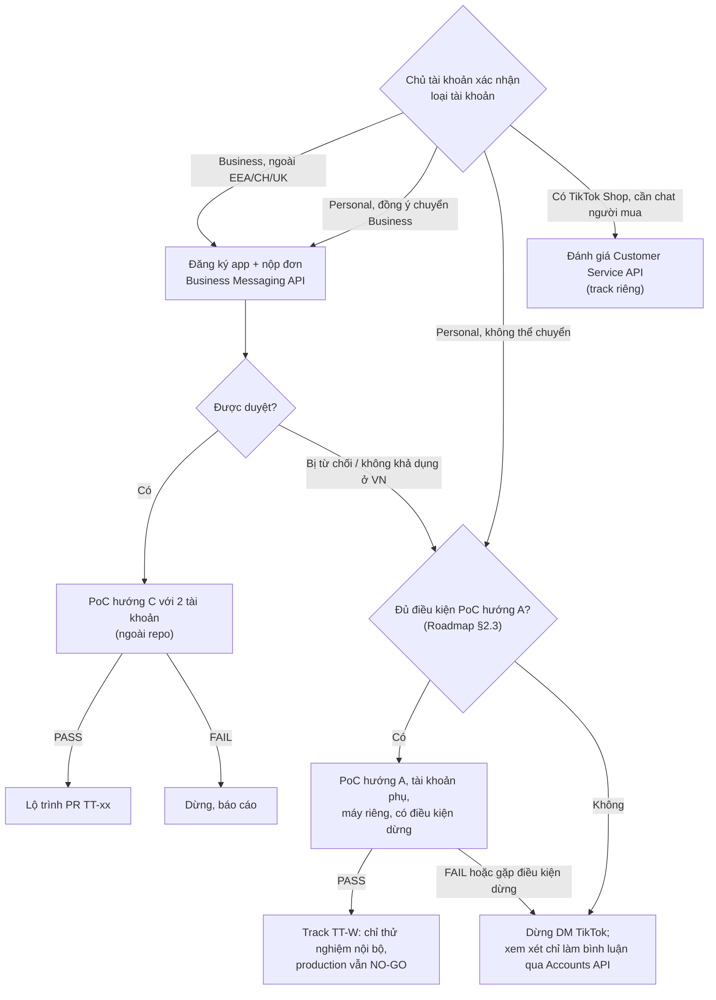
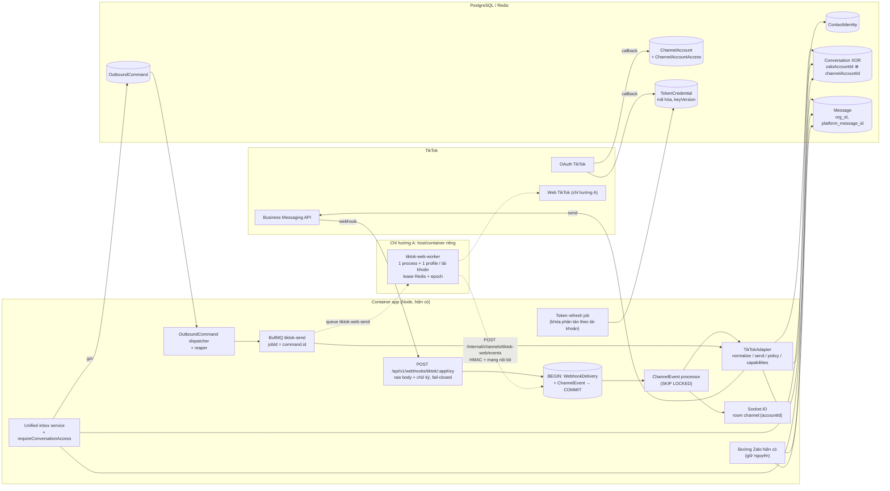
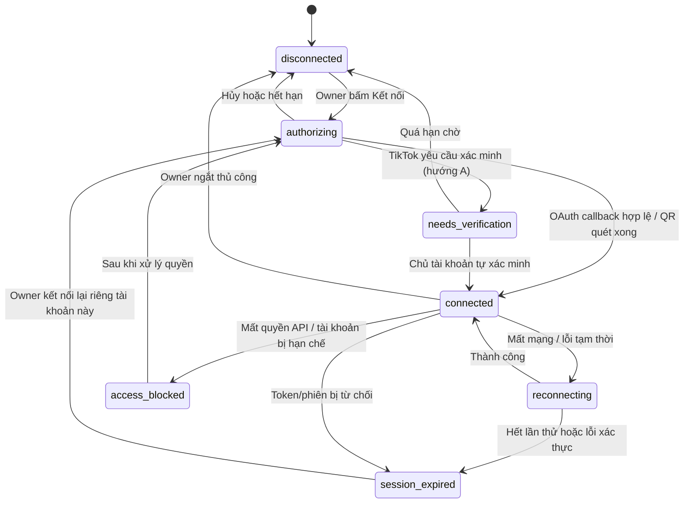
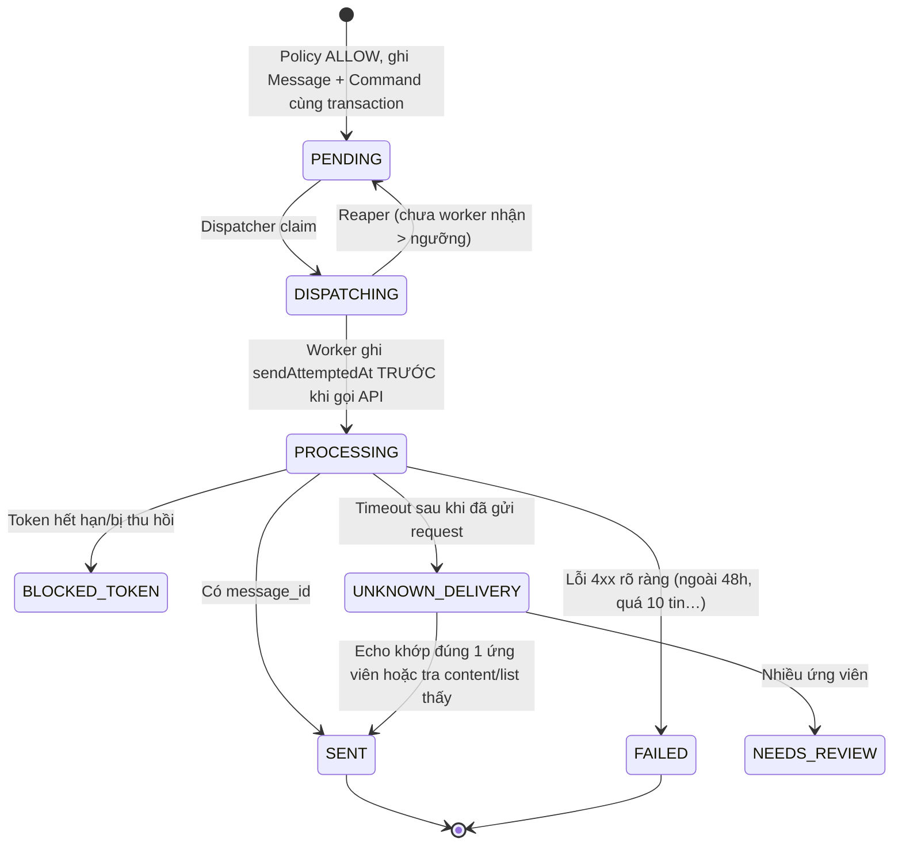

# Nghiên cứu TikTok Personal + QR: một tài khoản trước

**Bản điều chỉnh 13/10/2026 theo chủ dự án. Phần hiện hành dưới đây thay thế quyết định Business-first trong phụ lục.** Giữ khảo sát cũ để AI kiểm chứng bằng chứng, không dùng làm lệnh triển khai.

## Mục tiêu và phạm vi hiện hành

Ưu tiên TikTok Personal, quét QR; thử đúng một tài khoản độc lập trước. Sau kết quả mới chọn kiến trúc tích hợp ZaloCRM, rồi phát triển nhiều tài khoản. Không yêu cầu chuyển Business hoặc được duyệt Business API để nghiên cứu Personal. Ảnh business-suite/messages không đủ xác định loại tài khoản; kiểm trong app trước PoC, không tự chuyển loại tài khoản.

QR xác thực phiên, không tự cấp API nhận/gửi. AI được yêu cầu đánh giá tài liệu chỉ đọc code và viết kế hoạch, chưa cài dependency, chạy connector, dùng tài khoản thật, migrate hoặc deploy. Không yêu cầu gửi cookie/token vào chat.

Phạm vi PoC: QR, nhận/gửi văn bản thủ công, self-message từ điện thoại, ID/dedup, lịch sử giới hạn, restart/mất mạng/hết phiên và đo tài nguyên. Hoãn bình luận, LIVE, Shop, media hai chiều, AI tự gửi, broadcast, ghép khách xuyên kênh và nhiều tài khoản.

## Connector cần AI đánh giá

- **Browser worker: ứng viên PoC đầu tiên, chưa được chứng minh.** Playwright một persistent profile riêng, đăng nhập QR và xác minh do chủ tài khoản thực hiện. Đọc UI/gửi qua thao tác UI thông thường. Kiểm hộp thư Personal thực tế, ID tin/thread, selector, thứ tự, message request, self-message và session. Không stealth, giả vân tay, giải CAPTCHA hoặc proxy xoay vòng để né hạn chế; cần né bảo vệ thì dừng.
- **ReLttk: chỉ đọc so sánh, không chạy bản nguyên trạng.** Khảo sát cũ báo TLS bị tắt, fallback sang phiên khác, global config, bỏ self-message, chưa chờ ACK, tự nhận requests và plugin chuyển dữ liệu ngoài. Kiểm lại tại commit cụ thể; phân biệt lỗi sửa được với hạn chế giao thức/điều khoản chưa xác minh. Không coi README là bằng chứng hoạt động.
- **Business API: phương án về sau**, nếu chủ dự án chọn hoặc tài khoản thực tế phù hợp. Không đưa OAuth/webhook Business vào PoC Personal. Không áp 48h/10 tin, expiry token hoặc webhook timestamp của Business lên Personal Web.

## Khảo sát trực tiếp ZaloCRM

Kiểm checkout hiện tại và hướng dẫn repo. Bảng 36 bằng chứng trong phụ lục chỉ là đầu mối; xác minh file:dòng của schema, ZaloAccount, zaloPool/zaloOps, chat routes/handler, scope/ACL, realtime, frontend filter/count/search, AI/automation, raw SQL, tenant guard và Docker. Phân biệt code thực thi, schema, stub và kế hoạch.

Không tạo ZaloAccount giả, không xây schema đa kênh trước kết quả connector. Nếu PoC đạt, so sánh bảng riêng với chuyển đổi tăng dần dùng Conversation/Message chung và khung Messenger; chọn theo FK/query/regression thực tế, không mặc định XOR vì tài liệu cũ đã chọn.

## Nguyên tắc sau PoC

- Phiên/profile riêng; bí mật không log/export; QR chỉ người có quyền kết nối thấy. Xác nhận danh tính sau login.
- Không ghép khách Zalo–TikTok theo tên/avatar/socialTiktok. ID nền tảng lưu String.
- Hash nội dung theo phút không đủ dedup: có thể gộp mất hai tin giống nhau. Thiếu ID ổn định phải đánh giá trọng yếu.
- Phân biệt pending/submitted/confirmed/failed/unknown. Tin xuất hiện trên UI không tự chứng minh delivered/seen. Timeout sau bấm gửi không retry mù.
- Worker riêng; backend kiểm HTTP/socket ACL. Lease/epoch và giới hạn tài nguyên khi mở rộng.
- Tắt inbound phải rõ buffer hay bỏ tin và cách khôi phục. Nếu có quota, kiểm lại trước gửi và reservation nguyên tử cho gửi đồng thời.
- AI chỉ nháp; automation/broadcast tắt trong MVP.

## Đầu ra yêu cầu AI

Đánh giá GO/PARTIAL/NO-GO riêng cho nghiên cứu, PoC, staging và production. Nêu bằng chứng code/nguồn chính thức, suy luận, điều cần PoC; pin commit connector. Kiểm điều khoản áp dụng bằng nguồn cụ thể, không biến nguồn thứ cấp thành kết luận pháp lý.

Đề xuất kế hoạch test một tài khoản và tiêu chí dừng. Nếu PASS, lập PR theo file thực tế; nếu PARTIAL, đề xuất giảm scope; nếu FAIL, nêu nguyên nhân. Không cam kết số tài khoản hoặc uptime trước đo.

VPS theo người dùng ngày 12/10: khoảng 15 GB trống, dùng 82%, không phải số liệu live. Chưa đo RAM/CPU worker. Ưu tiên host thử riêng; disk <80% không phải cổng chặn nghiên cứu/test local. Deployment cần headroom thực đo.

---

# Phụ lục khảo sát cũ — Business-first

Các kết luận, cổng và GO/NO-GO phía dưới là lịch sử. Phạm vi hiện hành theo phần đầu; thông số API và phát hiện code phải kiểm lại trước sử dụng.

| | |
|---|---|
| Ngày | 13/10/2026 |
| Phạm vi | Repo `D:\ZaloCRM-CorepViet`, nhánh `main` @ `bf31cdf`. Chỉ đọc và viết tài liệu: không sửa code, không cài dependency, không migrate, không kết nối tài khoản thật, không deploy |
| Tài liệu đi kèm | `docs/TIKTOK-MULTIACCOUNT-IMPLEMENTATION-ROADMAP.md` (lộ trình PR, PoC, go/no-go) |
| Tài liệu đầu mối | `docs/TIKTOK-INTEGRATION-FEASIBILITY-2026-10-12.md` (đã kiểm tra lại, xem §11) |
| Tài liệu nền trong repo | `docs/TRIEN-KHAI-PRODUCTION-MESSENGER-NATIVE.md` (runbook v1.2, gọi tắt **Runbook Messenger**), `docs/ops/PHIEN-DEPLOY-D1-2026-10-07.md` |

---

## 0. Kết luận

**Khả thi có điều kiện. Điều kiện quyết định là loại tài khoản TikTok, chưa phải là code.**

1. **Nếu các tài khoản là TikTok Business** (đăng ký ngoài EEA, Thụy Sĩ, Anh): dùng **Business Messaging API chính thức (hướng C)**. Đây là hướng duy nhất có hợp đồng API, webhook có chữ ký, ID tin ổn định và echo cho cả tin gửi từ điện thoại. Giao diện tham chiếu `tiktok.com/business-suite/messages` là công cụ dành cho Business Account, nên khả năng cao các tài khoản này đã là Business. Cần chủ tài khoản xác nhận.
   - Đổi lại, trải nghiệm "quét QR" trở thành **luồng ủy quyền OAuth của TikTok**. Chủ tài khoản đăng nhập trên trang của TikTok (trang đó có thể cho đăng nhập bằng QR, cần PoC xác nhận) rồi bấm cho phép. CRM không tự sinh QR.
   - Ràng buộc nghiệp vụ: khách phải nhắn trước; doanh nghiệp chỉ trả lời trong **48 giờ** và tối đa **10 tin** mỗi cửa sổ; gửi được văn bản và một ảnh.
2. **Nếu bắt buộc dùng tài khoản Personal**: không có API chính thức cho DM. Chỉ còn **browser worker (hướng A)**, và chỉ ở mức PoC có điều kiện dừng. Production qua A hiện là **NO-GO**, vì không có SLA, rủi ro điều khoản và khóa tài khoản rơi vào chủ tài khoản, và chưa chứng minh được ID tin ổn định để chống trùng.
3. **ReLttk (hướng B) không nên dùng, kể cả cho PoC trong CRM.** Đọc mã nguồn cho thấy connector này tự sinh chữ ký chống bot của TikTok (`X-Bogus`, `X-Gnarly`, `X-Dynosaur`), tắt kiểm tra chứng chỉ TLS, tự chấp nhận mọi message request, giữ cấu hình ở biến toàn cục, có thể nạp nhầm phiên của tài khoản khác, và bỏ qua tin do chính tài khoản gửi (nên tin gửi từ điện thoại không về CRM). Chi tiết ở §5.3.
4. **Repo chưa sẵn sàng cho kênh thứ hai.** Hội thoại, tin nhắn, quyền, realtime, gửi tin, AI và automation đều gắn trực tiếp với `ZaloAccount` (bảng §3). Runbook Messenger đã thiết kế sẵn khung đa kênh (`ChannelAccount`, `ContactIdentity`, `ChannelEvent`, `OutboundCommand`, `Conversation` XOR), nhưng **chưa có dòng code nào của khung này** (PR-02a "chưa bắt đầu"). TikTok nên đi chung khung đó với Messenger, không dựng pipeline riêng.
5. **Bình luận video**: Accounts API chính thức hỗ trợ đọc, trả lời, ẩn bình luận trên video của tài khoản được ủy quyền, và theo mô tả của TikTok áp dụng cho cả Business lẫn Personal. App mới phải nộp đơn xin quyền riêng. Đây là phạm vi sau MVP.
6. **TikTok Shop chat** là API riêng (Partner Center, quyền Customer Service), không thay được DM. Chỉ đánh giá khi doanh nghiệp có shop.

**Bước đầu tiên để chứng minh:** chủ tài khoản xác nhận loại tài khoản. Nếu là Business thì đăng ký developer app, nộp đơn Business Messaging API, rồi chạy PoC hai tài khoản **ngoài repo, ngoài VPS production** theo checklist trong Roadmap §2.

---

## 1. Phương pháp và giới hạn

- **Mã nguồn repo**: phiên này không có shell trên máy anh. Mình đọc bản clone công khai của `github.com/huynhthuan12321/ZaloCRM-CorepViet` ở **đúng commit `bf31cdf`** (trùng `refs/heads/main` trên máy anh). Mình cũng đối chiếu thời điểm sửa của toàn bộ `backend/src` trên máy: không file nào sửa sau commit. Các file chỉ có trên máy (`docs/TIKTOK-INTEGRATION-FEASIBILITY-2026-10-12.md`, `docs/ops/PHIEN-DEPLOY-D1-2026-10-07.md`, `docs/prompts/*`) được đọc trực tiếp từ máy.
- **Số dòng** trong tài liệu đã được kiểm lại bằng `grep -n`/`sed -n` trên commit trên.
- **Connector bên ngoài**: đọc mã nguồn, không chạy. ReLttk ở commit `da1d2f0` (12/10/2026). SDK TikTok ở commit `f809c39` (28/02/2026).
- **Tài liệu TikTok chính thức** (`business-api.tiktok.com/portal/docs/...`) render bằng JavaScript nên công cụ đọc web chỉ lấy được tiêu đề và mô tả. Điều khoản `tiktok.com/legal/...` chặn công cụ đọc. Vì vậy các dữ kiện API được đối chiếu qua mã nguồn Chatwoot, tài liệu nhà tích hợp (respond.io, SleekFlow, Infobip, Chatwoot) và một PR công khai. Mỗi dữ kiện có nhãn:

| Nhãn | Nghĩa |
|---|---|
| **[XM-code]** | Đã xác minh trong mã nguồn (repo hoặc connector), có file:dòng |
| **[XM-TL]** | Đã xác minh từ tài liệu hoặc code bên thứ ba có trích dẫn, từ hai nguồn độc lập trở lên |
| **[1N]** | Chỉ có một nguồn bên thứ ba, cần kiểm lại |
| **[SL]** | Suy luận kiến trúc |
| **[PoC]** | Chưa biết, phải thử trên tài khoản thật |

---

## 2. Ba loại tài khoản, ba cơ chế

Cách gọi "TikTok cá nhân" không đủ để chọn connector. Bảng dưới là điều cần chủ tài khoản xác nhận đầu tiên.

| | Personal | Business | TikTok Shop (chat người mua) |
|---|---|---|---|
| DM qua API chính thức | **Không** [XM-TL: Chatwoot "Personal TikTok accounts are not supported"; respond.io "Personal TikTok accounts cannot be connected"] | **Có**, Business Messaging API, phải xin quyền và được duyệt [XM-TL] | Có, Customer Service API trong Partner Center [XM-TL] |
| Bình luận video qua API | Có, Accounts API ghi hỗ trợ "TikTok Business Account and TikTok Personal Accounts" [1N: meta mô tả trang Accounts Overview] | Có [XM-TL] | Không thuộc phạm vi |
| Web Business Suite | Không nêu | Có: "allows you to access all of your Business Account content… through a web browser" [XM-TL: TikTok Ads Help] | Seller Center riêng |
| Chuyển đổi | Đổi sang Business ngay trong app [XM-TL: respond.io] | | Cần mở shop |
| Hệ quả với CRM | Chỉ còn hướng A (browser) hoặc B (reverse-engineer) | Hướng C | Connector Shop riêng |

Dấu hiệu từ yêu cầu: anh lấy `tiktok.com/business-suite/messages` (có Messages và Comments) làm giao diện tham khảo. Trang này thuộc Business Suite nên các tài khoản **có khả năng đã là Business** [SL]. Cần chủ tài khoản mở *Cài đặt → Tài khoản* trong app TikTok để xác nhận.

---

## 3. Khảo sát repo ZaloCRM

### 3.1 Hướng dẫn repository

- `CONTRIBUTING.md`: AGPL-3.0; TypeScript strict, backend NodeNext (import đuôi `.js`), Vue 3 `<script setup>`; file mới có SPDX header; kiểm tra bằng `npx tsc --noEmit` (backend), `npx vue-tsc -b` và `npm run build` (frontend); Conventional Commits và `Signed-off-by`.
- `CLAUDE.md`, `AGENTS.md` bị `.gitignore` và không có trên máy, nên không có hướng dẫn AI riêng.
- Runbook Messenger §19: mỗi PR đi theo Inspect → Plan → Implement → Test → review → **STOP chờ duyệt**. Roadmap TikTok giữ quy tắc này.
- License dependency: ReLttk (MIT), SDK TikTok (MIT), Playwright (Apache-2.0) đều tương thích AGPL-3.0. License không phải điểm chặn.

### 3.2 Bảng bằng chứng

Cột **Loại**: *Chạy thật* = code thực thi; *Chỉ schema* = có bảng/cột, không có code dùng; *Kế hoạch* = chỉ có trong tài liệu; *Nhãn* = chỉ là giá trị hiển thị/ghi tay.

| # | Hạng mục | Bằng chứng (file:dòng) | Loại | Ý nghĩa với TikTok |
|---|---|---|---|---|
| R1 | Hội thoại bắt buộc thuộc một nick Zalo | `backend/prisma/schema.prisma:767` `zaloAccountId String` (NOT NULL); `:794` FK `onDelete: Cascade`; `:802` `@@unique([zaloAccountId, externalThreadId])` | Chạy thật | Không tạo được hội thoại TikTok cho tới khi làm XOR `zaloAccountId ⊕ channelAccountId` |
| R2 | Định danh tin theo Zalo | `schema.prisma:824` `zaloMsgIdNum BigInt` (khóa sắp xếp), `:887` `@@unique([conversationId, zaloMsgId])`, `:889` `@@unique([conversationId, clientEchoId])`; bảng `messages` chưa có `org_id` | Chạy thật | ID tin TikTok vào `platform_message_id` mới. Sắp xếp phải dựa `sentAt` cho kênh không có snowflake |
| R3 | Trạng thái tài khoản Zalo | `schema.prisma:359` `status` = `connected/disconnected/qr_pending`; `:361` `sessionData Json` | Chạy thật | Thiếu `needs_verification`, `session_expired` mà TikTok cần |
| R4 | Mã hóa phiên Zalo | `backend/src/shared/crypto/session-crypto.ts:24` dùng `ENCRYPTION_KEY`; ghi ở `modules/zalo/zalo-pool.ts:550-554` | Chạy thật | Mẫu tham khảo. Token TikTok nên dùng `TOKEN_ENCRYPTION_KEY` + keyring (Runbook §7.5) |
| R5 | Đăng nhập QR + đẩy QR qua socket | `zalo-pool.ts:164` `loginQR`; `:214` emit `zalo:qr` vào room `account:{id}` | Chạy thật | Mẫu UI QR dùng lại được cho hướng A |
| R6 | **Ai cũng xem được QR của nick trong org** | `modules/zalo/zalo-socket.ts:29-49`: `zalo:subscribe` chỉ kiểm account **cùng org**, không kiểm quyền trên account | Chạy thật | Không copy cho TikTok. Room QR/trạng thái của tài khoản kênh phải kiểm quyền `admin` trên tài khoản |
| R7 | Epoch chống phiên cũ ghi đè | `zalo-pool.ts:82` `Map` instance; `:190` `epoch = ++this.epochCounter`; `:732` `autoReconnect(accountId, expectedEpoch)` | Chạy thật | Ý tưởng "fencing token" dùng lại cho lease worker TikTok |
| R8 | Khôi phục sau restart | `backend/src/app.ts:591-608` đọc nick có `sessionData` rồi `zaloPool.reconnect` | Chạy thật | Kênh TikTok cần cơ chế tương đương, tách khỏi vòng lặp Zalo |
| R9 | Proxy theo nick bằng biến môi trường toàn cục | `modules/zalo/proxy-util.ts:40-58` đổi `process.env.HTTP_PROXY` dưới mutex | Chạy thật | Bài học: thư viện dùng trạng thái toàn cục buộc phải tuần tự hóa hoặc tách process. Liên quan trực tiếp tới ReLttk (§5.3) |
| R10 | Một process gánh mọi thứ, RAM app 1G | `docker-compose.yml:66-67` `memory: ${APP_MEMORY_LIMIT:-1G}`, `cpus: 2`; `docker/Dockerfile:37` `FROM node:22-alpine` | Chạy thật | Không đưa Chromium vào container app |
| R11 | Không có runtime trình duyệt | `backend/package.json`: có `bullmq ^5.77.7` (:45), `socket.io ^4.8.3` (:56), `zca-js ^2.1.2` (:59); không có `playwright`/`puppeteer` | — | Hướng A là runtime mới, cần image riêng |
| R12 | Luồng nhận tin chỉ dành cho Zalo | `modules/chat/message-handler.ts:27-68` `IncomingMessage` toàn trường Zalo (`cliMsgId`, `contactGlobalId`, `zaloName`…); `:273` tra `prisma.zaloAccount`; `:296` `findOrCreateConversation`; `:544` tra `Friend` theo `zaloAccountId_zaloUidInNick` | Chạy thật | Không tái dùng `handleIncomingMessage` cho TikTok. Cần processor riêng ghi vào cùng bảng |
| R13 | Khử echo tin tự gửi theo **nội dung trong 30 giây** | `message-handler.ts:320`, `:348` (`Date.now() - 30_000`); `:438` bắt `P2002` | Chạy thật | Heuristic. TikTok (hướng C) khử echo theo `message_id` |
| R14 | Tạo hội thoại theo cặp nick/thread | `message-handler.ts:980-1044`: tìm `{ zaloAccountId, externalThreadId }`, rồi chống xé theo `globalId` | Chạy thật | TikTok cần khóa `(channelAccountId, externalThreadId)` |
| R15 | **Gửi tin đồng bộ, không outbox** | `modules/chat/chat-routes.ts:1574` route; `:1708` `zaloPool.getInstance`; `:1786` gọi SDK; `:1828` `message.create` **sau** khi gửi; `:1730-1736` kiểm `echoId` trước khi gửi | Chạy thật | Process chết giữa `:1786` và `:1828` thì tin đã tới khách nhưng CRM không có bản ghi, và `echoId` không cứu được. TikTok phải đi qua Outbox |
| R16 | Route gửi đọc thẳng thuộc tính nick | `chat-routes.ts:1607` `conversation.zaloAccount.archivedAt` | Chạy thật | Lỗi runtime khi `zaloAccount` null. Có 77 chỗ đọc `x.zaloAccount.y`/`x.zaloAccount?.y` ngoài lời gọi Prisma trong `backend/src` (đếm bằng grep) |
| R17 | Quyền HTTP theo nick | `modules/zalo/zalo-access-middleware.ts:69` owner/admin bypass; `:72-81` lấy nick từ `conversation.zaloAccountId`; `:87` không thấy nick thì 404 | Chạy thật | Khi `zaloAccountId` null, middleware rơi về `params.id` (id hội thoại) → member bị 403/404. Cần `requireConversationAccess` mới |
| R18 | Quyền theo phòng ban + grant | `modules/zalo/zalo-scope.ts:59` `getZaloScope` (owner, trưởng/phó phòng, `ZaloAccountAccess`); `schema.prisma:502` quyền `read/chat/admin` | Chạy thật | Logic cần tổng quát hóa sang "tài khoản kênh" |
| R19 | **Danh sách hội thoại lọc qua quan hệ nick** | `chat-routes.ts:475` `where = { …, zaloAccount: DISPLAYABLE_NICK_WHERE }`; `:786-795` member chỉ thấy `zaloAccountId in displayableIds`; `:1107-1112` chi tiết hội thoại chặn nếu nick ngoài scope | Chạy thật | Hội thoại không có nick Zalo bị **loại khỏi mọi danh sách**, kể cả với admin. Đây là điểm sửa bắt buộc cho hộp thư chung |
| R20 | Bộ lọc dựa trên `Friend` của Zalo | `chat-routes.ts:551-578` (nhãn, `relationshipKindAny`), `:620-630` (`zaloLabels`), `:912` `friend.findMany` | Chạy thật | Với hội thoại TikTok các bộ lọc này phải tắt hoặc trả rỗng có chủ đích. Không được "lọc mất" hội thoại TikTok khi người dùng chưa chọn bộ lọc |
| R21 | Raw SQL theo `zalo_account_id` | 13 file, ví dụ `modules/dashboard/dashboard-routes.ts:130` `AND c.zalo_account_id = ANY(...)`; còn `report-analytics-routes.ts`, `dashboard-action-hub-routes.ts`, `contact-aggregate.ts`, `broadcast-*.ts`, `target-*.ts`… | Chạy thật | Báo cáo và đếm phải quyết định rõ: tính TikTok hay loại trừ. Không để tự loại do JOIN |
| R22 | **Realtime phát cho cả org** | `shared/realtime/emit-chat.ts:58-63` emit `chat:message` vào room `org:{orgId}`; `shared/realtime/socket-auth.ts:97,101` mọi socket tự join `org:` và `user:`; FE lọc theo phạm vi ở `frontend/src/composables/use-chat.ts:893-899` | Chạy thật | Nội dung tin của nick "Thường" tới socket của mọi user trong org; quyền chỉ áp ở FE. Với TikTok nên emit vào room theo tài khoản kênh mà user chỉ join khi có quyền |
| R23 | AI và automation gửi thẳng qua Zalo | `modules/ai/ai-auto-reply-service.ts:281`, `modules/ai/ai-followup-cron.ts:273`, `modules/broadcast/broadcast-cron.ts:306`, `modules/automation/process-care-session-step.ts:213` đều gọi `zaloOps.sendMessage` | Chạy thật | MVP TikTok: AI chỉ tạo nháp; mọi đường gửi tự động phải bỏ qua hội thoại không phải Zalo |
| R24 | Hàng đợi | BullMQ dùng ở `modules/zalo/group-scan-queue.ts:21`, `modules/tags/zalo-label-queue.ts:29`; Redis `noeviction` trong compose | Chạy thật | Dùng lại cho queue gửi TikTok |
| R25 | Health chỉ thông tin cho Messenger | `shared/http/health.ts:13` khối `messenger`, không ảnh hưởng `statusCode` | Chạy thật (PR-00) | Mẫu cho khối `tiktok`: kênh phụ lỗi không được kéo Zalo xuống |
| R26 | Cờ tính năng phân cấp | `config/messenger-config.ts:63-78` (`MESSENGER_ENABLED` → `INBOUND`/`OUTBOUND` → `AI_AUTO_SEND`) | Chạy thật | Mẫu cho `TIKTOK_*` |
| R27 | Logger không có redaction | `shared/utils/logger.ts:30-45` chỉ thêm timestamp rồi `console.*` | Chạy thật | Phải có redaction (token, `Tiktok-Signature`, cookie) trước khi đụng credential TikTok |
| R28 | Tenant guard dùng danh sách tay | `shared/tenant/org-scoped-models.ts:15` | Chạy thật | Model mới phải thêm vào đây |
| R29 | Xuất cookie Zalo dạng rõ | `modules/zalo/credential-routes.ts:37` `GET …/export` (chỉ owner/admin/admin nick) | Chạy thật | **Không** làm tính năng tương tự cho TikTok |
| R30 | Kiểm thử đặc tả Zalo | `backend/tests/characterization/` 6 file (`zalo-inbound`, `zalo-outbound`, `zalo-conversation-websocket`, `zalo-assignment`, `zalo-ai-handoff`, `zalo-broadcast-labels-queue`) | Chạy thật (PR-01) | Lưới regression bắt buộc cho mọi PR TikTok |
| R31 | Trường "TikTok" trên Contact | `schema.prisma:592` `socialTiktok String?` | Nhãn | Ô ghi tay. Không dùng làm khóa ghép khách |
| R32 | TikTok Lead Gen | `schema.prisma:3897` `TiktokAppConfig`, `:3912` `TiktokAdvertiserConnection`; `.env.example:206-218` `TIKTOK_*` | Chỉ schema | Marketing API lấy lead form, không phải tin nhắn. Không tái dùng bảng này cho DM |
| R33 | Nhãn nguồn lead TikTok | `modules/integrations/_shared/normalized-lead.schema.ts:13` `'tiktok-leadgen'`; `frontend/src/lib/source-badge.ts:18` | Nhãn | Chỉ hiển thị nguồn lead |
| R34 | Integration không có TikTok | `modules/integrations/integration-routes.ts:14` `VALID_TYPES = ['google_sheets','telegram','facebook','zapier']` | Chạy thật | Không có connector TikTok nào trong repo |
| R35 | Khung đa kênh | Runbook §7, §9.1, §19: 7 model, XOR, Outbox, PolicyEngine; PR-02a "⏳ chưa bắt đầu" | **Kế hoạch** | Điểm tựa chính cho TikTok. Phải xây trước, dùng chung với Messenger |
| R36 | Hạ tầng | Biên bản D1 07/10: disk 98% sau build, port 9000 `0.0.0.0` trên VPS, **D1 = CONDITIONAL PASS**. Anh cho biết lần kiểm gần nhất còn ~15 GB trống. `docker-compose.yml:164` hiện bind MinIO `127.0.0.1` | Vận hành | Hướng C gần như không tốn tài nguyên. Hướng A cần đo RAM/CPU theo tài khoản trước khi đặt lên VPS |

### 3.3 Luồng nhận tin hiện tại (Zalo)

```
zca-js listener (zalo-listener-factory.ts:686, :928)
  → handleIncomingMessage (message-handler.ts:269)
      → prisma.zaloAccount.findUnique (:273)          ← gắn Zalo
      → upsertContact (:809, theo zaloGlobalId/zaloUid)
      → findOrCreateConversation (:980, khóa zaloAccountId + externalThreadId)
      → khử echo tự gửi theo nội dung 30s (:300-372)
      → prisma.message.create; P2002 = trùng (:438)
      → scoring theo Friend (:536-578), webhook (:612), automationEventBus (:673-738)
  → caller emit chat:message qua emitChatMessage (emit-chat.ts:50) → room org:{orgId}
  → FE use-chat.ts:872 lọc theo workScope
```

### 3.4 Luồng gửi tin hiện tại (Zalo)

```
POST /api/v1/conversations/:id/messages  (chat-routes.ts:1574, preHandler requireZaloAccess('chat'))
  → conversation + zaloAccount (:1598); chặn nick đã xóa (:1607)
  → nhánh hội thoại ảo (isVirtual) lưu local
  → zaloPool.getInstance (:1708); rate limit (:1726)
  → echoId đã có → trả tin cũ (:1730-1746)
  → instance.api.sendMessage (:1786)                  ← tin đã đi
  → prisma.message.create (:1828)                     ← chỉ ghi sau khi gửi xong
  → P2002 trên clientEchoId → trả bản đã có (:1856-1870)
```

Không có trạng thái "đang gửi" bền vững. Lỗi timeout sau khi đã gửi không phân biệt được với "chưa gửi". Runbook Messenger §7.3 đã thiết kế Outbox để xử lý khe này. TikTok dùng chung Outbox đó.

### 3.5 Phân loại phần tái dùng

| Nhóm | Thành phần | Ghi chú |
|---|---|---|
| **Dùng lại nguyên trạng** | `Contact`, `Status`, ghi chú, nhắc hẹn (phần dữ liệu), tag CRM, lead scoring cấp Contact; `shared/storage/*`; xác thực socket (`socket-auth.ts`); RBAC tổ chức (`rbac/*`); `token-encryption.util.ts` (keyring từ PR-00); khung AI (provider, knowledge base, `ai-send-policy.ts`) | Đã xác minh qua đọc file. AI chỉ dùng phần tạo nháp |
| **Phải tách thành lớp chung** | `Conversation` (XOR), `Message` (`org_id`, `platform_message_id`), quyền (`requireZaloAccess`, `getZaloScope` → theo kênh), danh sách/đếm hội thoại (R19, R21), realtime (R22), route gửi (rẽ nhánh theo kênh), AI/automation gửi (R23), frontend (`use-chat.ts:112` `zaloAccount: ZaloAccount \| null`, `MessageThread.vue`, `ConversationList.vue`, `ChatView.vue`) | Bán kính lớn nhất là R1 + R19 |
| **Giữ riêng cho Zalo** | `zaloPool`, listener, `zaloOps`, rate limiter/SdkLimit, friend/group/label, privacy nick `main`, hội thoại ảo, cầu Telegram, backfill lịch sử Zalo, export/import credential, chống xé hội thoại theo `globalId` | Không trừu tượng hóa sớm |

**Không tạo ZaloAccount giả để chứa TikTok.** Làm vậy thì listener, health-check, friend sync, rate limiter, privacy và cầu Telegram sẽ chạy trên một nick không tồn tại (R5, R8, R18).

### 3.6 Ảnh hưởng tới các tính năng khác khi có hội thoại không phải Zalo

| Tính năng | Ảnh hưởng nếu không sửa | Bằng chứng |
|---|---|---|
| Danh sách hội thoại | Hội thoại TikTok biến mất (lọc qua quan hệ nick) | R19 |
| Đếm/badge, sidebar tag | Đếm theo `getZaloScope` → bỏ sót TikTok | `chat-routes.ts:151-154`, `:213-214`, `:368-369` |
| Tìm kiếm | Lọc trong cùng `where` nên cũng mất | R19 |
| Bộ lọc Friend/nhãn Zalo | Chọn bộ lọc thì hội thoại TikTok bị loại; cần ẩn bộ lọc khi chỉ xem kênh TikTok | R20 |
| Báo cáo/dashboard | Raw SQL theo `zalo_account_id` tự loại TikTok | R21 |
| Quyền | Member bị 403/404 trên route `/conversations/:id/*` | R17 |
| Realtime | Payload `accountId` hiện hiểu là nick Zalo; FE `classifyIncoming` dựa trên scope nick | R22 |
| AI tự trả lời / follow-up | Gọi `zaloOps.sendMessage(conv.zaloAccountId…)` → lỗi hoặc gửi nhầm kênh | R23 |
| Broadcast/sequence/care session | Dựa vào `Friend`/uid Zalo. Phải loại hội thoại TikTok khỏi audience | R23 |

---

## 4. TikTok: dữ kiện API đã kiểm tra

### 4.1 Business Messaging API (hướng C)

| Dữ kiện | Nhãn | Nguồn |
|---|---|---|
| Chỉ cho TikTok Business Account; Personal không kết nối được | [XM-TL] | Chatwoot docs, respond.io |
| Phải xin quyền và được duyệt; "You cannot proceed with the integration until your application is approved" | [XM-TL] | Chatwoot docs |
| Tài khoản phải liên kết TikTok for Business hoặc Business Center để có Advanced Access; đang Open Beta | [1N] | respond.io |
| Không dùng được cho tài khoản ở EEA, Thụy Sĩ, Anh | [XM-TL] | Chatwoot, respond.io; code Chatwoot ghi `im_receive_msg` cho người gửi ngoài EEA/CH/UK |
| Khách phải nhắn trước; doanh nghiệp không được khởi tạo, không broadcast | [XM-TL] | respond.io, SleekFlow |
| Cửa sổ 48 giờ, tối đa 10 tin mỗi cửa sổ, đặt lại khi khách nhắn mới | [XM-TL] | respond.io, SleekFlow |
| Text tối đa 6.000 ký tự; ảnh JPG/PNG; giới hạn dung lượng ảnh khác nhau giữa các nguồn (3 MB / 20 MB) | [1N] cho giới hạn ảnh | respond.io, SleekFlow |
| Gửi ảnh chỉ khi cả hai bên ở thị trường hỗ trợ; kiểm bằng `GET /business/message/capabilities/get/` (`IMAGE_SEND`) | [XM-TL] | respond.io, code Chatwoot `client.rb` |
| Gửi: `POST /open_api/v1.3/business/message/send/` trả `message_id`; upload ảnh `/business/message/media/upload/`; tải ảnh `/business/message/media/download/` | [XM-code] Chatwoot | `app/services/tiktok/client.rb` |
| Webhook: `im_receive_msg` (khách gửi), `im_send_msg` ("either an echo message or a message sent directly via tiktok application"), `im_mark_read_msg` | [XM-code] Chatwoot | `app/jobs/webhooks/tiktok_events_job.rb` |
| Chữ ký webhook, lệch giờ tối đa 5 giây | [XM-TL] | Chatwoot docs |
| Access token ~24 giờ, refresh token ~30 ngày; hết refresh token phải ủy quyền lại | [XM-TL] | Chatwoot docs |
| Danh sách hội thoại `GET /business/message/conversation/list/` (loại `SINGLE`/`STRANGER`, limit 1-100, cursor) và lịch sử `GET /business/message/content/list/` | [1N] | PR `ishinaillab/ishikeit#63` (03/10/2026) |
| Rate limit 10 QPS cho thao tác nhắn tin | [1N] | respond.io |
| Không hỗ trợ video, voice, sticker khi gửi; nội dung không hỗ trợ hiển thị dạng fallback | [XM-TL] | respond.io, SleekFlow |
| Không giới hạn số tài khoản kết nối nếu đủ điều kiện (theo nhà tích hợp) | [1N] | respond.io |
| SDK chính thức `tiktok-business-api-sdk` **không** có endpoint `/business/message/*` hay `/business/comment/*`; chỉ có `/comment/*` cho bình luận quảng cáo (cần `advertiser_id`) | [XM-code] | grep toàn bộ `js_sdk`, `python_sdk`, `java_sdk` @ `f809c39` |

Việt Nam không nằm trong danh sách loại trừ của các nguồn trên, nên **có khả năng** dùng được [SL]. Chưa có xác nhận trực tiếp: **[PoC]**.

### 4.2 Accounts API cho bình luận (sau MVP)

| Dữ kiện | Nhãn | Nguồn |
|---|---|---|
| Áp dụng cho "TikTok Business Account and TikTok Personal Accounts" | [1N] | meta mô tả trang Accounts Overview |
| Endpoint: `/business/comment/list/`, `/business/comment/reply/list/`, `/business/comment/reply/create/` (cần `business_id`, `video_id`, `comment_id`, `text`), `/business/comment/hide/`, `/business/comment/delete/`, `/business/comment/like/` | [1N] | Fixmation; tài liệu đầu mối 12/10 cũng ghi danh mục tương tự |
| Webhook `comment.update` báo trong khoảng 5 phút | [1N] | Fixmation |
| Từ 20/03/2026 app mới hoặc app tăng scope "TikTok Accounts" phải nộp Accounts API Access Application Form | [XM-TL] | Tài liệu đầu mối 12/10 (trích trang TikTok) và Fixmation |
| Developer phải là doanh nghiệp: "we are unable to onboard personal accounts or individual developers" | [1N] | Fixmation. Đây là điều kiện với **nhà phát triển app**, khác với loại tài khoản TikTok được ủy quyền |
| Không suy rộng sang bình luận trên video của người khác | [SL] | |

### 4.3 TikTok Shop Customer Service

- Partner Center có API gửi tin theo conversation của shop [XM-TL: trang Partner Center "Send Message", tài liệu đầu mối 12/10; klink.cloud].
- Cần tài khoản seller sở hữu shop, quyền "Customer Service / Message", có thể "Pending review" [1N: klink.cloud].
- Chỉ gồm chat người mua–người bán. Không gồm DM TikTok hay bình luận video [1N: klink.cloud].
- Doanh nghiệp có shop TikTok tại Việt Nam không: **cần xác nhận**. Nếu không có thì bỏ qua.

### 4.4 Điều khoản

- Không đọc được nguyên văn Terms of Service hiện hành (trang chặn công cụ đọc; bản lưu bên thứ ba ghi điều khoản chống scraping "no longer published"). Các nguồn thứ cấp diễn giải rằng TikTok cấm truy cập tự động/bot nếu không được chấp thuận [1N].
- Nguyên tắc áp dụng trong tài liệu này, không phụ thuộc kết quả đọc điều khoản: **không đề xuất vượt CAPTCHA, giả vân tay trình duyệt, plugin stealth, tự sinh chữ ký chống bot, hay xoay proxy để tránh phát hiện.** Xác minh danh tính khi TikTok yêu cầu do **chủ tài khoản tự làm**.
- Cần người có thẩm quyền đọc ToS bản áp dụng cho Việt Nam trước bất kỳ PoC nào theo hướng A.

---

## 5. So sánh connector

### 5.1 Bảng tổng hợp

| Tiêu chí | **A. Browser worker (Playwright), profile riêng** | **B. ReLttk (API nội bộ/WebSocket)** | **C. Business Messaging API** |
|---|---|---|---|
| Loại tài khoản | Personal hoặc Business | Personal hoặc Business | Chỉ Business, ngoài EEA/CH/UK [XM-TL] |
| Đăng nhập | QR trên trang web TikTok, chụp vùng QR gửi lên UI [PoC] | QR qua `passport/web/get_qrcode` [XM-code `qrlogin.py:408`] | OAuth của TikTok. Có QR trên trang TikTok hay không: [PoC] |
| Xác minh khi TikTok yêu cầu | Chủ tài khoản tự làm qua màn hình trình duyệt thật (remote view) | Hỏi mã qua `input()` trên console [XM-code `qrlogin.py:356`] → phải sửa code mới đưa lên web | Không có (OAuth do TikTok xử lý) |
| Lưu/khôi phục phiên | `storageState`/persistent profile mỗi tài khoản. Thời gian sống: [PoC] | JSON cookie **dạng rõ** `session/<username>.json` [XM-code `qrlogin.py:197-201`] | Access ~24h + refresh ~30 ngày [XM-TL] |
| Logout/thu hồi | Đăng xuất trên UI + xóa profile | Gọi `/logout` + xóa file [XM-code `client.py:1196-1224`] | Thu hồi quyền app; hết refresh token → `REAUTH_REQUIRED` |
| Nhận văn bản | Quan sát DOM hoặc mạng nội bộ của web client [PoC] | WebSocket `im-ws-va.tiktok.com` [XM-code `config.py:3`] | Webhook `im_receive_msg` [XM-code Chatwoot] |
| Gửi văn bản | Gõ và bấm gửi trên UI | Gửi gói protobuf qua WS [XM-code `client.py:385`] | `POST /business/message/send/` [XM-code Chatwoot] |
| Xác nhận gửi | Phải đọc lại UI; không có ID chắc chắn [PoC] | `send_message` trả về ngay sau `websocket.send`. Echo chỉ cập nhật dict nội bộ, không có cơ chế chờ ACK [XM-code `client.py:385-390`, `:1097-1103`] | Response có `message_id` [XM-code] |
| Tin gửi từ điện thoại về CRM | Đọc được từ UI nếu DOM hiển thị [PoC] | **Bị bỏ qua**: `if msg["sender_id"] == self._own_user_id: continue` [XM-code `client.py:1130`] | `im_send_msg` gồm tin gửi trực tiếp từ app [XM-code Chatwoot] |
| Lịch sử | Cuộn UI [SL] | `get_conversation_history` qua `im-api-sg.tiktok.com` [XM-code `core/api.py:327`, `:393`] | `content/list` [1N] |
| Message request | Thao tác tay trên UI | **Tự chấp nhận mọi người lạ mỗi 10 giây** [XM-code `client.py:995-1024`] | Loại hội thoại `STRANGER` [1N]; cài đặt "nhận tin từ mọi người" [XM-TL] |
| Media | [PoC] | Nhận/tải sticker, video, voice; README ghi gửi ảnh/voice/video **chưa có** [XM-code README] | Text + 1 ảnh; nhận ảnh, share post [XM-TL] |
| Chạy nhiều tài khoản | Mỗi tài khoản một BrowserContext, tốt nhất một process [SL] | Bắt buộc **một process/tài khoản**: cấu hình ở biến toàn cục `config.*` [XM-code `config.py`; dùng ở `client.py:377-380`], bộ đếm ký `_req_counter` toàn cục [XM-code `signer_client.py:14`] | Một app, nhiều tài khoản ủy quyền; định tuyến theo `business_id` [SL] |
| Khả năng lẫn tài khoản | Thấp nếu profile tách thư mục [SL] | **Cao**: `_load_session` thử phiên đang dùng rồi **mọi file phiên khác** [XM-code `client.py:1244-1260`, `:1247`] | Thấp: token theo tài khoản, webhook mang `business_id` [SL] |
| Dịch vụ/dữ liệu đi ra ngoài | Chỉ tới TikTok | Core: chỉ host `tiktok.com`. Plugin `videodl` upload tới máy chủ riêng `linkmail.wtf` [XM-code `plugins/videodl.py:25`] | Tới TikTok API |
| Bảo mật kết nối | TLS mặc định của trình duyệt | **Tắt kiểm tra chứng chỉ**: `check_hostname = False`, `CERT_NONE` [XM-code `client.py:1275-1276`] | HTTPS chuẩn |
| Cơ chế chống bot | Không được né (không stealth). Bị chặn thì dừng | **Tự sinh chữ ký chống bot** `X-Bogus`/`X-Gnarly`/`X-Dynosaur` [XM-code `core/signer_client.py:34-45`, `signers/*`]; `requirements.txt` có `stealth-requests` (chưa thấy import) | Không áp dụng |
| Log dữ liệu cá nhân | Tự kiểm soát | In nội dung tin và tên người gửi ra log [XM-code `client.py:1187`] | Tự kiểm soát |
| Bảo trì | Playwright bảo trì tốt; selector TikTok vỡ khi đổi UI [SL] | Một tác giả, 44 commit từ 19/07/2026, 8 sao, 1 fork, không release; tác giả ghi "early stage" | API có version; thay đổi theo thông báo của TikTok |
| Điều khoản | Tự động hóa UI; cần đọc ToS [SL] | Reverse-engineer + tự ký chống bot: xung đột trực tiếp với nguyên tắc "không né cơ chế bảo vệ" | Đường được TikTok cấp phép |
| SLA | Không | Không | Theo chính sách TikTok |
| Tài nguyên VPS | Chromium thường trực mỗi tài khoản. Phải đo [PoC] | Một process Python mỗi tài khoản. Phải đo [PoC] | Không cần worker; chỉ webhook + job refresh |

### 5.2 Hướng C — điểm cần PoC

1. Đơn xin Business Messaging API có được duyệt cho doanh nghiệp/tài khoản đăng ký tại Việt Nam không.
2. Trang ủy quyền TikTok có cho đăng nhập bằng QR không (để giữ trải nghiệm gần giống Zalo).
3. Webhook đến đủ và đều không; `im_send_msg` có đến cho tin gửi từ điện thoại và từ Business Suite không.
4. `from_user.id` có ổn định giữa các hội thoại của cùng một khách không.
5. `conversation/list` và `content/list` trả được bao xa; có trả tin của hội thoại `STRANGER` không.
6. Mã lỗi thực tế khi gửi ngoài 48 giờ và khi vượt 10 tin.
7. Refresh token chạy đúng ít nhất một chu kỳ; thu hồi quyền trong app TikTok thì API trả lỗi gì.

### 5.3 Hướng B — kết quả đọc mã nguồn ReLttk

| # | Phát hiện | Bằng chứng | Hệ quả |
|---|---|---|---|
| B1 | Tự sinh chữ ký chống bot của TikTok | `core/signer_client.py:34-45` `sign_full` gọi `signers/xdynosaur.py`, `signers/xgnarly.py`; `signers/bogus.py` | Đây chính là cơ chế bảo vệ của TikTok. Dùng nó là né cơ chế bảo vệ. Loại khỏi production; không khuyến nghị PoC |
| B2 | Tắt kiểm tra TLS | `client.py:1275-1276` | Cookie phiên đi qua kết nối không xác thực máy chủ |
| B3 | Cấu hình là biến module toàn cục; gói gửi dùng `config.DEVICE_ID`, `config.MSG_SDK_MS_TOKEN`… (để trống, không có chỗ nào gán) | `config.py:1-20`; `client.py:377-380`; grep không có phép gán `config.X =` | Không chạy nhiều tài khoản trong một process được. Chưa rõ gửi tin có ổn định với giá trị trống không |
| B4 | Nạp phiên lần lượt mọi file trong `session/` | `client.py:1244-1260` | Nếu phiên A hỏng, process có thể chạy bằng phiên B: **lẫn tài khoản** |
| B5 | Bỏ qua tin do chính tài khoản gửi | `client.py:1130` | Tin gửi từ điện thoại không về CRM; không thể đối soát hai chiều |
| B6 | Gửi xong là trả, không chờ ACK | `client.py:385-390` | Không phân biệt được "đã tới TikTok" và "mất kết nối sau khi ghi socket" |
| B7 | Tự chấp nhận mọi message request | `client.py:995-1024` | Hành vi nghiệp vụ không mong muốn; phải tắt |
| B8 | Phát hiện bị cấm gửi chỉ ghi log rồi tiếp tục | `client.py:1079-1093` | Không có tín hiệu trạng thái cho CRM |
| B9 | Cookie lưu JSON dạng rõ | `qrlogin.py:197-201` | Phải mã hóa nếu dùng |
| B10 | 2FA hỏi qua console | `qrlogin.py:356` | Không dùng được qua web nếu không sửa |
| B11 | Log in nội dung tin, tên người gửi | `client.py:1187` | Rò dữ liệu cá nhân vào log |
| B12 | Plugin gửi dữ liệu ra máy chủ bên thứ ba | `plugins/videodl.py:25` | Phải gỡ toàn bộ plugin |
| B13 | Hằng số phiên gắn cứng (`ttwid`, `Web-Sdk-Ms-Token`, `TT_CSRF_TOKEN`) | `config.py:3-15` | Dễ vỡ khi TikTok đổi; mọi tài khoản dùng chung giá trị |
| B14 | Reconnect vòng lặp 5 giây, không backoff | `client.py:1361-1362` | Dễ tạo mẫu truy cập bất thường |

Phải sửa phần lớn các điểm trên mới nhúng được vào CRM, và B1 thì không sửa được nếu không bỏ hẳn cách tiếp cận. Kết luận: **B không phù hợp.**

### 5.4 Hướng A — đánh giá

- **Ưu điểm**: là đường duy nhất cho tài khoản Personal mà không reverse-engineer giao thức. Đăng nhập QR và xác minh có thể chuyển cho chủ tài khoản qua màn hình trình duyệt thật.
- **Nhược điểm đã biết** [SL]: không có idempotency khi gửi; timeout sau khi bấm gửi nghĩa là "không biết"; selector vỡ khi TikTok đổi giao diện; mỗi tài khoản là một Chromium thường trực; không có SLA.
- **Chưa biết** [PoC]: DOM có ID tin ổn định không; thời gian sống phiên; tần suất bị yêu cầu xác minh; web có hiển thị đủ message request, ảnh, tin từ điện thoại không.
- **Giới hạn đạo đức/kỹ thuật**: không stealth plugin, không giả vân tay, không giải CAPTCHA, không xoay proxy. Bị yêu cầu xác minh thì chuyển `needs_verification` và chờ chủ tài khoản.

### 5.5 Phương án khuyến nghị



**Chọn C làm hướng chính.** Lý do:
1. Có ID tin (`message_id`) và echo theo ID nên chống trùng và đồng bộ tin từ điện thoại có căn cứ, không phải heuristic.
2. Webhook có chữ ký khớp đúng khung Runbook Messenger (`WebhookDelivery` → `ChannelEvent` → processor). Phần lớn hạ tầng dùng chung với Messenger.
3. Không cần worker, không cần Chromium. Phù hợp VPS còn khoảng 15 GB trống và chưa có số liệu RAM/CPU.
4. Nhiều tài khoản là nhiều token trên một app, không có trạng thái toàn cục.
5. Rủi ro khóa tài khoản và rủi ro điều khoản thấp nhất trong ba hướng.

**Đổi lại:** không giữ được trải nghiệm QR do CRM tự sinh; không chủ động nhắn khách; giới hạn 48 giờ/10 tin; chỉ Business.

---

## 6. Thiết kế nhiều tài khoản

### 6.1 Kiến trúc



### 6.2 Mô hình tài khoản kênh và quyền

- `ChannelAccount` theo Runbook §9.1, mở rộng:
  - `provider`: `FACEBOOK_PAGE` | `TIKTOK_BUSINESS` | `TIKTOK_SHOP` | `TIKTOK_WEB_SESSION` (chỉ hướng A).
  - `externalId`: `business_id` (C) / `shop_cipher` (Shop) / id nội bộ (A). Unique `(provider, externalId)` toàn hệ thống, nên một tài khoản TikTok chỉ thuộc một org.
  - Thêm `authKind` (`OAUTH_TOKEN` | `BROWSER_SESSION`), `connectionState`, `ownerUserId`, `lastHeartbeatAt`, `lastStateChangeAt`, `lastError` (đã lọc bí mật).
- `ChannelAccountAccess(channelAccountId, userId, permission read|chat|admin)`, unique `(channelAccountId, userId)`, tương đương `ZaloAccountAccess` (`schema.prisma:498-510`).
- `getChannelScope(user)` trả `{ zalo: displayable/accessible, channels: displayable/accessible, isOrgAdmin }`. Luật owner/trưởng phòng/grant giữ nguyên như `getZaloScope` (`zalo-scope.ts:59-145`), áp cho `ChannelAccount.ownerUserId` và `ChannelAccountAccess`.
- Quyền xem QR, kết nối, ngắt, cấp quyền lại: chỉ owner/admin org, chủ tài khoản kênh, hoặc grant `admin`. Không lặp lại lỗ R6.

### 6.3 Phiên, token, profile tách biệt

| | Hướng C | Hướng A |
|---|---|---|
| Lưu ở đâu | `TokenCredential` (access + refresh, `expiresAt`, `refreshExpiresAt`), mã hóa bằng `TOKEN_ENCRYPTION_KEY` + `keyVersion` | Profile/`storageState` **chỉ trên worker**, volume riêng mỗi tài khoản, mã hóa bằng khóa chỉ worker giữ. Backend chỉ biết trạng thái |
| Xuất ra ngoài | Không có API xuất | Không có API xuất |
| Log | Redaction `Access-Token`, `refresh_token`, `auth_code`, `Tiktok-Signature`, raw body | Thêm cookie, URL có token, ảnh QR |
| Xóa tài khoản kênh | Thu hồi token, `status=REVOKED` | Worker đăng xuất + xóa profile, xác nhận về backend |

### 6.4 Worker và lease

- **Hướng C** không có kết nối thường trực. "Lease" chỉ áp cho job refresh token: khóa Redis `tiktok:refresh:{accountId}` (TTL ngắn) để hai instance không refresh cùng lúc. Refresh token cũ bị vô hiệu sau khi đổi nên không được chạy song song [SL].
- **Hướng A**:
  - Mỗi tài khoản một process worker với một profile. Không dùng chung process giữa các tài khoản (bài học R9, B3).
  - Lease Redis `tiktok:lease:{accountId}` = `{workerId, epoch}` với TTL, gia hạn theo heartbeat. Mọi sự kiện worker gửi lên mang `epoch`; backend bỏ sự kiện có epoch cũ, tương tự `zalo-pool.ts:190` và `:732`.
  - Bộ điều phối giới hạn số tài khoản đồng thời theo số đo tài nguyên ở PoC. Không đặt con số trước khi đo.

### 6.5 Định tuyến sự kiện và lệnh gửi

- Inbound (C): webhook mang `business_id` → tra `ChannelAccount(provider=TIKTOK_BUSINESS, externalId=business_id)` → lấy `orgId`, `channelAccountId`. Không thấy tài khoản hoặc tài khoản tắt: lưu `WebhookDelivery` dạng metadata `IGNORED_UNKNOWN_ACCOUNT`/`IGNORED_DISABLED`, trả 200 sau COMMIT (theo Runbook §7.2).
- Inbound (A): worker POST nội bộ, ký HMAC kèm timestamp, payload có `channelAccountId` + `epoch`. Backend tự tra `orgId` từ DB, không tin `orgId` do worker gửi.
- Outbound: `OutboundCommand` có `orgId`, `channelAccountId`, `conversationId`. Worker gửi kiểm lại tài khoản còn `connected`/`outboundEnabled` ngay trước khi gọi API.

### 6.6 Danh tính khách

- `ContactIdentity(orgId, provider, channelAccountId, externalId, contactId)`, unique `(channelAccountId, externalId)`. ID khách được coi là **theo phạm vi tài khoản doanh nghiệp** cho tới khi PoC chứng minh khác.
- C: `externalId = from_user.id` [1N: tài liệu khảo sát 10/10 trong Project, dẫn code Chatwoot]. Shop: `buyer_user_id`. A: id người dùng đọc được từ UI, nếu có [PoC].
- **Không tự gộp** khách TikTok với Zalo. Gợi ý trùng (cùng SĐT do khách tự cung cấp) chỉ hiện để sale ghép tay, có `ContactMergeAudit` và undo (Runbook §7.7). Không ghép theo tên, avatar hay `socialTiktok`.
- Không giả định ID người bình luận trùng ID người nhắn DM.

### 6.7 Khóa hội thoại và chống trùng

| Loại | Khóa | Nơi enforce |
|---|---|---|
| Hội thoại DM | `(channel_account_id, external_thread_id)` với `external_thread_id = conversation_id` | Unique partial index (Runbook 02b-4) |
| Hội thoại bình luận (sau MVP) | `external_thread_id = cmt:{video_id}:{root_comment_id}`, thêm `threadKind='comment'` | Như trên |
| Webhook delivery | `sha256(rawBody)` | `webhook_deliveries.body_sha256` UNIQUE |
| Tin vào | `tt:msg:{business_id}:{message_id}` | `channel_events.dedup_key` + `messages(org_id, platform_message_id)` UNIQUE partial |
| Echo / tin từ điện thoại | `tt:echo:{business_id}:{message_id}` | Namespace riêng vì echo của tin gửi từ CRM trùng `message_id` với response |
| Đã đọc | `tt:read:{business_id}:{conversation_id}:{timestamp}` | Xử lý idempotent |
| Bình luận | `ttc:cmt:{business_id}:{comment_id}` | |
| Hướng A (không có ID ổn định) | `ttweb:msg:{account}:{hash(conv, sender, text chuẩn hóa, mốc phút)}` | Yếu. Chỉ chấp nhận nếu PoC chứng minh không có ID tốt hơn |

Sắp xếp tin: Zalo dùng `zaloMsgIdNum` (R2). Tin TikTok để `zaloMsgIdNum` null và sắp theo `sentAt`, rồi `createdAt`. Truy vấn danh sách tin phải xử lý null đúng (`NULLS LAST` + `sentAt`).

### 6.8 Trạng thái kết nối



- `session_expired` và `access_blocked` **dừng gửi** cho tài khoản đó và gửi thông báo tới chủ tài khoản. Không tự đăng nhập lại lặp đi lặp lại.
- Ngắt thủ công khác mất kết nối thụ động, tương tự `disconnectReason` của Zalo (`schema.prisma` khối `ZaloAccount`).
- Lỗi một tài khoản không ảnh hưởng tài khoản khác. Không có trạng thái toàn cục chia sẻ.

### 6.9 Backoff, reconnect, restart

- C: lỗi refresh do mạng thì backoff có trần và jitter. Lỗi `invalid_grant` hoặc tương đương thì `session_expired` ngay. Restart app: processor nhặt `ChannelEvent PENDING`, dispatcher nhặt `OutboundCommand PENDING`, reaper chuyển `PROCESSING` quá hạn sang `UNKNOWN_DELIVERY`.
- A: worker restart thì đọc danh sách tài khoản được bật từ API nội bộ, xin lease, mở profile. Phiên hỏng thì báo `session_expired`, không thử đăng nhập tự động. Reconnect có backoff lũy tiến và trần, không vòng lặp cố định (khác B14).

### 6.10 Outbox

Dùng nguyên state machine Runbook §7.3. Ánh xạ sang yêu cầu `pending/sent/failed/unknown`:



- **Không retry mù.** `UNKNOWN_DELIVERY` không tự gửi lại. "Gửi lại" là thao tác tay và tạo command mới.
- Lỗi trước khi request rời máy (DNS, connect, TLS) thì retry có giới hạn.
- C: policy kiểm cửa sổ 48 giờ và bộ đếm 10 tin theo hội thoại **trước** khi tạo command. Bộ đếm tính cả tin gửi từ điện thoại (echo) [SL, cần PoC xác nhận TikTok có tính tin từ app vào quota không].
- A: không có ID tin, nên mọi timeout đều là `UNKNOWN_DELIVERY` và phải đối soát bằng đọc lại UI.

### 6.11 Capability theo kênh

```ts
interface ChannelCapabilities {
  text: boolean;
  image: 'none' | 'single';
  file: boolean; video: boolean; voice: boolean; sticker: boolean;
  reply: boolean; reaction: boolean; edit: boolean; recall: boolean;
  readReceipts: boolean; typing: boolean; groups: boolean;
  historyBackfill: boolean;          // C: false cho tới khi PoC chứng minh content/list
  canInitiate: boolean;              // C: false
  replyWindow?: { hours: number; maxMessages?: number }; // C: 48h, 10
  aiAutoSend: boolean;               // MVP: false mọi kênh mới
}
```

- **Backend là nơi quyết định**: route gửi, upload, reaction, thu hồi, AI gửi… đều kiểm capability và policy rồi trả lỗi có mã (`CAPABILITY_UNSUPPORTED`, `REPLY_WINDOW_CLOSED`, `REPLY_QUOTA_EXCEEDED`). Frontend chỉ ẩn/hiện nút dựa trên capability nhận từ API.
- Zalo có `ZaloLegacyCapabilities` mô tả đúng hành vi hiện tại. Đường gửi Zalo không đổi.

### 6.12 AI

- MVP: AI chỉ **tạo nháp** trên hội thoại TikTok (dùng lại `prompts/reply-draft.ts`). Không gửi tự động.
- `ai-auto-reply-service`, `ai-followup-cron`, broadcast, sequence, care session phải có guard: bỏ qua hội thoại `channelAccountId != null`, có test.
- Sau MVP, nếu bật AI gửi: cờ kép (global + tài khoản), chỉ trong 48 giờ, tính vào quota 10 tin, qua `ai-send-policy.ts`.

---

## 7. Phương án dữ liệu

| Tiêu chí | 1. Bảng TikTok riêng + dịch vụ hộp thư hợp nhất | 2. `ChannelAccount/Conversation/Message` dùng chung | 3. Chuyển đổi tăng dần tới (2), giữ đường Zalo |
|---|---|---|---|
| Dữ liệu | `tiktok_accounts`, `tiktok_conversations`, `tiktok_messages` | Conversation XOR, Message thêm `platform_message_id` | Như (2), nhưng thực hiện theo bước nhỏ, đường code Zalo giữ nguyên |
| Hộp thư chung | UNION ở danh sách, đếm, tìm kiếm, phân trang theo thời gian, socket | Một truy vấn | Một truy vấn sau khi sửa R19 |
| Ghi chú, nhắc hẹn, AI nháp, ghim, xóa mềm | Mỗi tính năng phải biết hai nguồn hội thoại (FK `conversationId` trỏ hai bảng) | Dùng lại | Dùng lại |
| Rủi ro với Zalo | Thấp lúc đầu, tăng khi phải nối vào từng tính năng | Cao nếu làm một lần | Thấp: từng bước có characterization (R30) |
| Khớp Runbook Messenger | Lệch, tạo "đảo" thứ hai | Khớp | **Khớp nguyên văn** §9, §19 |
| Nguy cơ hai pipeline vĩnh viễn | Cao | Không | Thấp nếu có các biện pháp dưới |

**Chọn (3).** Lý do từ code:
- `PinnedConversation`, `AiSuggestion`, `TelegramTopicMap`, `MessageReaction` đều FK tới `Conversation`/`Message` (khối model `schema.prisma:764-814`). Bảng riêng buộc nhân đôi các quan hệ này hoặc làm FK đa hình.
- Phân trang danh sách theo `lastMessageAt` trên hai bảng (UNION + cursor) phức tạp hơn phần schema tiết kiệm được.
- Runbook đã chia 02b-1…02b-5, có backfill và XOR `NOT VALID` → `VALIDATE`. Đó đúng là các bước TikTok cần.

**Biện pháp tránh hai pipeline vĩnh viễn:**
1. Processor TikTok ghi vào **cùng** `conversations`/`messages`. Không có bảng tin TikTok riêng.
2. Đường Zalo giữ `handleIncomingMessage` và `zaloPool` cho tới khi có lý do kinh doanh để chuyển. Tầng **đọc** (danh sách, chi tiết, quyền, realtime) là chung từ đầu.
3. Test kiến trúc: cấm route chat mới gọi `zaloPool`/`zaloOps` trực tiếp ngoài nhánh `channel === 'zalo'`; cấm tạo `Conversation` có cả hai cột hoặc không cột nào (CHECK XOR ở DB).
4. Mỗi PR ghi rõ phần nào còn "chỉ Zalo" trong bảng nợ chuyển đổi của Roadmap §4.

**Không refactor diện rộng ngoài phạm vi MVP**: không đổi tên `zaloMsgId`, không gộp `ZaloAccount` vào `ChannelAccount`, không chuyển automation sang đa kênh.

---

## 8. Chức năng MVP và phần hoãn

| Nhóm | MVP (hướng C) | Hoãn |
|---|---|---|
| Tài khoản | Thêm nhiều tài khoản qua OAuth; trạng thái kết nối; ngắt/kết nối lại riêng từng tài khoản; phân quyền nhân viên theo tài khoản | QR do CRM sinh (chỉ có ở hướng A) |
| Nhận | DM văn bản, hội thoại mới (gồm `STRANGER` nếu API trả), tin từ điện thoại qua echo | Ảnh, share post (hiển thị dạng link trước); lịch sử cũ trước thời điểm kết nối |
| Gửi | Văn bản trong 48 giờ, tối đa 10 tin; Outbox; trạng thái đang gửi/đã gửi/lỗi/chưa xác nhận | Gửi ảnh |
| Hộp thư | Danh sách chung Zalo + TikTok, lọc kênh, icon kênh, đồng hồ cửa sổ 48h và số tin còn lại | Gộp khách xuyên kênh tự động (không làm) |
| Khách | Contact + ContactIdentity, ghi chú, trạng thái, nhắc hẹn nội bộ | Ghép tay xuyên kênh (dùng PR-06 của Messenger) |
| AI | Tạo nháp | Tự gửi trong 48h, follow-up |
| Automation | Tắt cho TikTok | Theo capability sau khi có số liệu |
| Bình luận | — | Accounts API, sau khi được duyệt quyền |
| LIVE, Shop chat | — | Đánh giá riêng |

---

## 9. Bảo vệ dữ liệu và vận hành

- Token và cookie tương đương mật khẩu. Không xuất, không log, không gửi tới frontend.
- Nội dung tin và hồ sơ khách là dữ liệu cá nhân. Theo hiểu biết đến 06/2026, Việt Nam có Nghị định 13/2023 và Luật Bảo vệ dữ liệu cá nhân hiệu lực 01/01/2026. Cần pháp chế xác nhận nghĩa vụ cụ thể (thông báo, mục đích, thời hạn lưu) trước production.
- Payload webhook thô giữ TTL ngắn (Runbook dùng 7 ngày).
- VPS: hướng C chỉ thêm route và job trong container app hiện có. Hướng A không đặt lên VPS hiện tại khi chưa có số đo RAM/CPU và ổ đĩa sau PoC.
- Đồng hồ máy chủ phải chuẩn (chữ ký webhook lệch tối đa 5 giây).

---

## 10. Thông tin cần xác nhận

### Chủ tài khoản / doanh nghiệp
1. Từng tài khoản là Personal hay Business? Đăng ký ở quốc gia nào?
2. Nếu là Personal: có chấp nhận chuyển sang Business không? Có ràng buộc gì (nhạc thương mại, tính năng creator) khiến không thể chuyển?
3. Số tài khoản cần kết nối ở giai đoạn đầu và mục tiêu sau này.
4. Có TikTok Shop không? Có cần chat người mua không?
5. Cần bình luận video ngay hay sau MVP? Có cần LIVE không?
6. Bắt buộc gửi ảnh hay chỉ văn bản?
7. Chấp nhận ràng buộc "khách nhắn trước, trả lời trong 48 giờ, tối đa 10 tin" không?
8. Message request từ người lạ: tự nhận vào CRM, hay để nhân viên chấp nhận trong app?
9. Ai là chủ developer app (pháp nhân, email tên miền doanh nghiệp đã xác minh)? Có URL chính sách quyền riêng tư và điều khoản cho app không?

### TikTok (qua đơn xin quyền / hỗ trợ đối tác)
1. Business Messaging API có khả dụng cho tài khoản đăng ký tại Việt Nam không.
2. Quota thực tế (QPS, số hội thoại/ngày), mã lỗi ngoài cửa sổ và vượt quota.
3. `content/list` trả lịch sử bao xa; có tin trước thời điểm ủy quyền không.
4. Tin gửi từ app/Business Suite có tính vào quota 10 tin không.

### Nhà cung cấp connector (nếu cân nhắc mua thay vì tự xây)
1. Dùng API chính thức hay tự động hóa trình duyệt/reverse-engineer? Có văn bản chấp thuận của TikTok không?
2. Có dùng giả vân tay, proxy xoay vòng, dịch vụ giải CAPTCHA, tự ký chống bot không? (Câu trả lời chấp nhận được: không.)
3. Phiên/token lưu ở đâu, mã hóa thế nào, ai truy cập được; dữ liệu khách có đi qua máy chủ của họ không, đặt ở nước nào.
4. Mỗi tin có ID ổn định không; xử lý echo, timeout sau gửi, gửi lại thế nào.
5. SLA, thời gian sửa khi TikTok đổi; khách hàng tham chiếu đang chạy ổn định.

---

## 11. Đối chiếu tài liệu đầu mối 12/10

| Kết luận trong tài liệu 12/10 | Kiểm tra lại |
|---|---|
| Conversation bắt buộc `zaloAccountId`, Message có `zaloMsgId…` | **Đúng** (R1, R2) |
| Gửi tin qua `zaloPool` + `instance.api.sendMessage` tại `chat-routes.ts:1708,1786` | **Đúng** (R15) |
| `IncomingMessage` đặc thù Zalo | **Đúng** (R12) |
| `VALID_TYPES` không có TikTok | **Đúng** (R34) |
| ReLttk "không dùng browser automation", có QR, DM WebSocket, inbox/history; `send_message` không xác nhận đã giao | **Đúng**, và còn thiếu các phát hiện B1–B14 (đặc biệt B1 tự ký chống bot, B2 tắt TLS, B4 nạp nhầm phiên, B5 bỏ tin tự gửi) |
| "DM cá nhân: GO có điều kiện cho thử nghiệm ReLttk/browser" | **Điều chỉnh**: ReLttk không khuyến nghị kể cả PoC vì B1. Browser worker chỉ PoC khi đủ điều kiện Roadmap §2.3 |
| SDK `CommentsApi` dùng `advertiser_id`, chủ yếu bình luận quảng cáo | **Đúng**; thêm: SDK không có endpoint DM hay `/business/comment/*` |
| Đề xuất bảng riêng `ChannelConversation`/`ChannelMessage` giai đoạn đầu | **Không chọn** (§7): đi theo Runbook Messenger, dùng chung `conversations`/`messages` |
| Bình luận organic qua Accounts API, cần đơn xin quyền từ 20/03/2026 | **Đúng theo nguồn thứ cấp**; thêm webhook `comment.update` [1N] |
| PoC 72 giờ | Giữ ý: số giờ quan sát là tiêu chí thử nghiệm, không phải bảo đảm production |

---

## Nguồn

**Trong repo** (commit `bf31cdf`): các file và dòng ghi ở §3.2; `docs/TRIEN-KHAI-PRODUCTION-MESSENGER-NATIVE.md` §7, §9, §19, §20; `docs/ops/PHIEN-DEPLOY-D1-2026-10-07.md`; `docs/TIKTOK-INTEGRATION-FEASIBILITY-2026-10-12.md`.

**Connector đã đọc mã nguồn:**
- [Linkmail16/ReLttk-TikTok-Client-Bot](https://github.com/Linkmail16/ReLttk-TikTok-Client-Bot) @ `da1d2f0`: `client.py`, `config.py`, `qrlogin.py`, `core/api.py`, `core/signer_client.py`, `signers/*`, `plugins/videodl.py`, `requirements.txt`
- [tiktok/tiktok-business-api-sdk](https://github.com/tiktok/tiktok-business-api-sdk) @ `f809c39`
- [Chatwoot `app/services/tiktok/client.rb`](https://raw.githubusercontent.com/chatwoot/chatwoot/develop/app/services/tiktok/client.rb), [`app/jobs/webhooks/tiktok_events_job.rb`](https://raw.githubusercontent.com/chatwoot/chatwoot/develop/app/jobs/webhooks/tiktok_events_job.rb)

**Tài liệu:**
- [TikTok — Access to Business Messaging API](https://business-api.tiktok.com/portal/docs/access-to-business-messaging-api/v1.3) (render bằng JS, chỉ đọc được mô tả)
- [TikTok — Accounts Overview](https://business-api.tiktok.com/portal/docs/accounts-api-overview/v1.3) (chỉ đọc được mô tả)
- [TikTok Ads Help — About Web Business Suite](https://ads.tiktok.com/help/article/navigate-web-business-suite)
- [Chatwoot — Setting Up TikTok Channel](https://developers.chatwoot.com/self-hosted/configuration/features/integrations/tiktok)
- [respond.io — TikTok Overview](https://respond.io/help/tiktok/tiktok-overview), [TikTok Quick Start](https://respond.io/help/tiktok/tiktok-quick-start)
- [SleekFlow — TikTok Business Messaging channel overview](https://help.sleekflow.io/en_US/tiktok-business-messaging/tiktok-business-messaging-channel-overview)
- [Infobip — TikTok Business Messaging](https://www.infobip.com/docs/tiktok)
- [ishinaillab/ishikeit PR #63](https://github.com/ishinaillab/ishikeit/pull/63) (endpoint conversation/content list)
- [Fixmation — One inbox for comments across Instagram, Facebook and TikTok](https://fixmation.dev/blog/one-inbox-for-social-comments)
- [klink.cloud — TikTok Shop channel setup](https://docs.klink.cloud/getting-started/setup-channels/tiktok)
- [TikTok Terms of Service (ROW)](https://www.tiktok.com/legal/page/row/terms-of-service/en) (chặn công cụ đọc, cần đọc trực tiếp)
