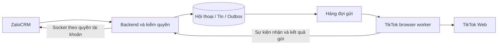

# Lộ trình tích hợp TikTok Personal bằng QR vào ZaloCRM

Ngày: 13/10/2026.

## Mục tiêu

Thử một tài khoản TikTok Personal bằng QR → tích hợp chỉ đọc → mở gửi văn bản → thử nhiều tài khoản. Chưa thay database ZaloCRM trước khi PoC connector đạt.

Đây là kế hoạch, không phải bằng chứng connector đã hoạt động hoặc quyền tự thực hiện mọi bước. AI triển khai phải đọc hướng dẫn repository, kiểm checkout hiện tại và đánh giá từng cổng trước khi thực hiện.

## Lộ trình

### Tiến độ ngày 13/10/2026

- **TT10 foundation đã triển khai và kiểm tra:** bổ sung capability ảnh, cổng policy cho media/AI/automation/broadcast và hai feature flag mặc định OFF. Tất cả capability live vẫn fail-closed; `canInitiate`, AI tự gửi, automation và broadcast luôn false. Backend targeted 73/73, AI/Zalo 25/25, frontend 69/69 và PoC 20/20 PASS; build backend/frontend và Prisma validate PASS. Xem `TIKTOK-TT10-FOUNDATION-RESULTS.md`. Chưa có transport media hoặc AI TikTok live; không deploy, migrate production hay kết nối tài khoản thật.

- **TT09 capacity mock/local đã triển khai và nghiệm thu:** admission gate theo trần worker và
  ngân sách RAM; heartbeat có CPU/RSS/event-loop/profile/ledger; fleet status có headroom và
  cảnh báo; benchmark hai Chromium mock đạt p50 100,19 ms, p95 116,41 ms và working set trung
  bình 292.171.776 byte/worker. Giới hạn mặc định vẫn là 2. Xem
  TIKTOK-TT09-CAPACITY-RESULTS.md, TIKTOK-TT09-ACCEPTANCE-EVIDENCE.json và
  TIKTOK-TT09-BENCHMARK-EVIDENCE.json. TikTok thật/staging/production chưa mở.

- **TT08 hai tài khoản mock local đã triển khai và nghiệm thu:** giới hạn hai account; profile/ledger/lease riêng; ACL, claim đồng thời, heartbeat và rollback tách biệt. PostgreSQL 16.15 acceptance đạt 17/17 nhóm, frontend 67/67, PoC Node 19/19 và browser 3/3. Xem TIKTOK-TT08-TWO-ACCOUNT-RESULTS.md và TIKTOK-TT08-ACCEPTANCE-EVIDENCE.json. TikTok thật và TT09 chưa triển khai.

- **TT07 pilot mock local đã triển khai và nghiệm thu:** heartbeat HMAC, RSS/heap và số lượng ledger; trạng thái Outbox; đối soát ID chỉ đọc; cảnh báo phiên/heartbeat/unknown/mismatch; rollback tắt nhận-gửi, tăng epoch và giữ command. PostgreSQL 16.15 acceptance đạt 16/16 nhóm, backend 165/165, frontend 66/66, PoC Node 16/16 và browser 3/3. Xem TIKTOK-TT07-MOCK-PILOT-RESULTS.md và TIKTOK-TT07-ACCEPTANCE-EVIDENCE.json. readyForRealPilot vẫn false; TT08 chưa triển khai.

- **TT06 mock local đã triển khai và nghiệm thu:** Outbox ghi Message + OutboundCommand trước transport; claim PostgreSQL SKIP LOCKED; kết quả CONFIRMED/FAILED/UNKNOWN; reaper không retry trạng thái chưa rõ; composer chỉ mở theo capability và quyền chat. PostgreSQL 16.15 acceptance đạt 14/14 nhóm, backend 162/162, frontend 64/64, PoC Node 13/13 và browser 3/3. Xem TIKTOK-TT06-MOCK-RESULTS.md và TIKTOK-TT06-ACCEPTANCE-EVIDENCE.json. Chỉ mock/local; TikTok thật và TT07 chưa triển khai.

- **TT05 mock local đã triển khai và nghiệm thu:** một tài khoản, QR/confirm mô phỏng, bridge HMAC loopback, epoch fencing, lưu ContactIdentity/Conversation/Message idempotent, socket read-room và UI chỉ đọc. PostgreSQL 16.15 full-schema acceptance đạt 13/13 nhóm; inbound lặp không tăng unread lần hai. Xem `TIKTOK-TT05-MOCK-RESULTS.md` và `TIKTOK-TT05-ACCEPTANCE-EVIDENCE.json`. TikTok thật, staging/production và gửi từ CRM vẫn khóa; dừng trước TT06.

- **Nghiệm thu local mới nhất:** 11/11 nhóm PASS trên PostgreSQL 16.15 native, schema fixture đầy đủ 116 bảng/1.202 tin, pg_dump/restore, B/D1/backfill/D2, Prisma schema diff trống, HTTP/JWT/socket/UI thật và revoke. Xem TIKTOK-TT04-ACCEPTANCE-RESULTS.md + EVIDENCE.json. Đủ để phát triển TT05 mock local khi được yêu cầu; không mở production hoặc connector thật. Các dòng dưới là lịch sử trước nghiệm thu.

- **Cập nhật mới nhất:** TT04-C/D/E đã triển khai nền local: scope/read API + UI desktop, nullable/XOR/trigger/batch backfill và realtime account/control/revoke. 188/188 backend targeted và 61/61 frontend tests PASS, typecheck/build PASS. Xem TIKTOK-TT04-CDE-RESULTS.md. B/D1/backfill/D2 chưa áp dụng trên DB thật; TT04 deployment acceptance còn chờ restore/rollout test, live TikTok vẫn tắt. Các dòng dưới là lịch sử trước lần triển khai này.

- TT-04B: đã chuẩn bị schema expand, SQL migration local và tenant registration; Prisma validate/generate, backend typecheck và 153/153 targeted tests PASS. Xem TIKTOK-TT04B-RESULTS.md. Chưa thực thi migration hoặc test PostgreSQL; giữ zaloAccountId bắt buộc. TT04-C/D/E chưa triển khai, TT-04 tổng thể chưa hoàn thành. Dòng TT04-A bên dưới là trạng thái trước lần chuẩn bị B này; các cổng live/staging vẫn chưa mở.

- TT-00: đã có TIKTOK-TT00-ASSESSMENT.md.
- TT-01/TT-02: đã triển khai mock độc lập, 9/9 test PASS; xem TIKTOK-TT02-TEST-RERUN-2026-10-13.md. TikTok thật NOT TESTED; login thủ công không chứng minh connector.
- TT-03: thiết kế có điều kiện tại TIKTOK-TT03-INTEGRATION-DESIGN.md. Chọn dữ liệu chung và transport riêng, không giả định commandId/ACK mock tồn tại ở live.
- TT-04A đã hoàn thành: contract/capability/flags/health, backend typecheck và 130 test targeted/regression PASS; xem TIKTOK-TT04A-RESULTS.md. Không có runtime connector. TT-04B/schema/migration và live channel writes vẫn chờ bằng chứng connector thật; không mở staging/production vì mô phỏng PASS.
- Live chỉ đọc ngày 13/10: account @setupxebanhcorep mở được Messages; 30 thread IDs unique giữ nguyên sau một reload. Xem TIKTOK-LIVE-READONLY-CHECK-2026-10-13.md. Chưa mở thread thử, chưa kiểm message ID/nhận-gửi/worker profile; live PoC vẫn PARTIAL.
- Kiểm tiếp thread đang mở: 3 message IDs unique giữ nguyên sau reload/recovery, direction quan sát 2 self/1 inbound. Đã thêm pure DOM reader và test fixture, 10/10 PoC tests PASS; xem TIKTOK-LIVE-SELECTED-THREAD-2026-10-13.md. Chưa có background live worker, tin mới hoặc outbound; các capability live vẫn false.
- Kiểm inbound thật: người dùng gửi và xác nhận tin thử từ @bepbanhcrep; Web hiển thị đúng một tin thử có ID, đọc lặp không nhân đôi. Đã thêm read-checkpoint metadata và xử lý unsupported, 11/11 test fixture PASS; xem TIKTOK-LIVE-INBOUND-CHECKPOINT-2026-10-13.md. Chưa nối checkpoint/worker nền vào phiên thật hoặc CRM; history sâu và gửi thật chưa kiểm.

| Bước | Công việc | Tiêu chí hoàn thành |
|---|---|---|
| TT-00 — Chốt phạm vi | Xác nhận loại tài khoản, môi trường thử và quyền sử dụng; kiểm repo hiện tại | Có tài khoản thử, người nhận thử và phạm vi rõ |
| TT-01 — PoC QR độc lập | Browser worker riêng, một profile; quét QR, xác minh danh tính, lưu/khôi phục phiên | Đăng nhập đúng tài khoản; hết phiên yêu cầu QR lại |
| TT-02 — PoC tin nhắn | Nhận/gửi văn bản thủ công; kiểm self-message, lịch sử, ID tin, mất mạng và restart | Không thiếu/trùng tin không giải thích được; gửi chưa rõ kết quả được đánh dấu unknown |
| TT-03 — Chốt kiến trúc CRM | Đối chiếu schema và khung Messenger; thiết kế adapter, tài khoản kênh, ACL và dữ liệu chung | Có migration, kiểm thử và rollback cụ thể theo file |
| TT-04 — Chuẩn bị đa kênh | Sửa code null-safe, quyền HTTP/socket, query danh sách/đếm; bổ sung schema theo từng bước | Regression Zalo đạt; tài khoản không quyền không nhận dữ liệu |
| TT-05 — TikTok chỉ đọc trên staging | Thêm tài khoản/QR, lưu inbound, hiển thị hội thoại TikTok chung với Zalo | Đối chiếu đủ tin với TikTok; đúng tài khoản và thứ tự |
| TT-06 — Gửi văn bản từ CRM | Outbox → queue → worker; trạng thái pending/confirmed/failed/unknown | Không retry mù, không gửi trùng hoặc sai tài khoản |
| TT-07 — Pilot một tài khoản | Theo dõi nhiều ngày; đo tài nguyên, cảnh báo mất phiên, diễn tập rollback | Tiêu chí nhận/gửi/phục hồi đạt; điều kiện production được xác nhận |
| TT-08 — Thử hai tài khoản | Profile riêng, lease worker, phân quyền và gửi đồng thời | Ngắt một tài khoản không ảnh hưởng tài khoản còn lại |
| TT-09 — Mở rộng | Giới hạn số worker theo RAM/CPU thực đo; thêm giám sát | Có headroom và giới hạn vận hành rõ |

## Môi trường và điều kiện PoC

TT-01/02 chạy ngoài database và dịch vụ production. Có thể kiểm thử kiến trúc bằng hệ thống mô phỏng độc lập trước; kết quả mô phỏng không chứng minh TikTok thật hoạt động.

Trước PoC tài khoản thật, xác nhận phạm vi được chủ tài khoản cho phép và đánh giá điều khoản/quyền sử dụng áp dụng. QR chỉ xác thực phiên, không tự cấp quyền API hay quyền tự động hóa. Không dùng stealth, giải CAPTCHA hoặc kỹ thuật né cơ chế bảo vệ. Xác minh thông thường do chủ tài khoản thực hiện.

Browser worker là ứng viên cần thử, chưa phải connector được chứng minh. Xác nhận tài khoản là Personal trong app; URL business-suite/messages trong ảnh chưa đủ kết luận loại tài khoản.

## Checklist TT-01/02

- [ ] QR và ID/username sau login khớp tài khoản thử.
- [ ] Nhận 20 tin đánh số, đối chiếu đủ và đúng hội thoại.
- [ ] Gửi 10 văn bản thủ công tới người thử đồng ý, không trùng.
- [ ] Đọc được tin do chính tài khoản gửi từ điện thoại.
- [ ] Hai tin giống nội dung không bị gộp mất sau reload/cuộn.
- [ ] Ghi ID tin/thread và kiểm độ ổn định; không coi hash nội dung theo phút là dedup đầy đủ.
- [ ] Ghi phạm vi lịch sử thực tế, không cam kết toàn bộ lịch sử.
- [ ] Restart và mất mạng: phục hồi hoặc phát hiện được khoảng thiếu tin.
- [ ] Timeout quanh lúc gửi: unknown, không tự gửi lại; có cách đối soát.
- [ ] Hết phiên: dừng gửi và yêu cầu QR lại.
- [ ] Ghi khả năng đọc message request; không tự chấp nhận mọi request.
- [ ] Đo CPU, RSS, dung lượng profile/log và độ trễ p50/p95.

Quan sát đề xuất ít nhất 72 giờ có hoạt động mỗi ngày. Đây không phải bảo đảm ổn định production. Ghi PASS/PARTIAL/FAIL/NOT TESTED và bằng chứng; không đánh dấu PASS cho phần chưa thử.

## Các vùng thay đổi trong ZaloCRM

- **Prisma:** tài khoản kênh, quyền tài khoản, danh tính khách, quan hệ hội thoại và Outbox.
- **Backend chat:** adapter, query đa kênh, kiểm quyền và định tuyến gửi.
- **Realtime:** phát tin vào room tài khoản có kiểm quyền; thu hồi quyền phải có hiệu lực.
- **Frontend:** danh sách tài khoản, nhãn kênh, QR và trạng thái gửi.
- **Deployment:** worker Chromium riêng, volume phiên riêng và giới hạn tài nguyên.

AI phải đối chiếu file thực tế, đặc biệt schema.prisma, chat-routes.ts, message-handler.ts, scope/ACL Zalo, shared/realtime, use-chat.ts, ChatView.vue, AI/automation và Docker. Không tạo ZaloAccount giả. Không tự ghép khách TikTok–Zalo bằng tên/avatar.

Nếu dùng bảng hội thoại chung, code null-safe và quyền phải sẵn sàng trước migration nullable và trước hội thoại TikTok production. Giữ đường nhận/gửi Zalo hiện tại trong MVP. Mỗi PR phải nêu file sửa/tạo, phụ thuộc, migration, test, nghiệm thu và rollback.

## Kiến trúc dự kiến

Worker chạy container riêng; không đưa Chromium vào container app đang hoạt động chỉ để thử. Cookie/profile không ghi vào log hoặc xuất cho nhân viên. QR chỉ người có quyền kết nối nhìn thấy.

confirmed phải có định nghĩa và bằng chứng cụ thể; tin xuất hiện trên UI không tự chứng minh khách đã nhận/đọc. Lệnh unknown không retry mù. Khi mở rộng, mỗi tài khoản có profile và lease riêng.

## Điểm dừng và quyết định

Dừng khi lẫn tài khoản, tin thiếu không phát hiện được, gửi lặp, rò phiên hoặc phải né cơ chế bảo vệ để tiếp tục. Thiếu ID tin ổn định phải đánh giá trước khi chọn cách chống trùng.

- **PASS:** đủ bằng chứng cho phạm vi đề xuất, xem xét bước tiếp theo.
- **PARTIAL:** giảm scope, ví dụ chỉ đọc; không gọi là hai chiều khi chưa gửi được.
- **FAIL:** ghi nguyên nhân và dừng đường tích hợp chưa đáp ứng.

MVP chỉ văn bản, gửi thủ công, một tài khoản. Bình luận, media, AI tự gửi và broadcast làm sau. Business API là phương án so sánh, không tự chuyển hướng thay chủ dự án.

## Deployment và rollback

Mọi cờ mặc định OFF. Kiểm thử Zalo phù hợp mỗi PR. Trước migrate/deploy cần backup/restore DB và media, health Zalo, mạng worker và tài nguyên live. Số liệu VPS ngày 12/10 còn khoảng 15 GB là tham khảo, không dùng thay kiểm tra hiện tại.

Tắt outbound chặn cả lệnh chờ; lệnh có khả năng đã gửi giữ unknown để đối soát, không reset hàng loạt. Tắt inbound phải nêu rõ buffer/backfill hoặc khoảng mất tin. Rollback không xóa volume/database/backup; giữ dữ liệu để đối soát và bảo đảm app cũ tương thích schema.

Không tự mở gửi production chỉ vì staging đạt. Production là cổng riêng về kỹ thuật, quyền sử dụng và vận hành.

## Tài liệu liên quan

- TIKTOK-MULTIACCOUNT-RESEARCH.md: đọc phần hiện hành trước, phần Business-first là phụ lục.
- TIKTOK-MULTIACCOUNT-IMPLEMENTATION-ROADMAP.md: kế hoạch chi tiết đã điều chỉnh ưu tiên Personal.
- TIKTOK-INTEGRATION-FEASIBILITY-2026-10-12.md: khảo sát đầu mối, cần kiểm chứng lại.
