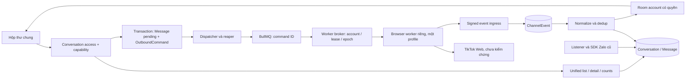

# TT-03 — Thiết kế tích hợp TikTok Personal vào ZaloCRM

Ngày: 13/10/2026. Checkout đọc trực tiếp: main @ bf31cdf. Phạm vi: thiết kế, không sửa code/schema, cài dependency, migrate, deploy hoặc dùng phiên TikTok thật.

## 1. Quyết định và mức bằng chứng

Chọn hướng **chuyển đổi tăng dần sang dữ liệu hội thoại/tin chung**, giữ nguyên transport Zalo, tách browser worker và adapter cho kênh mới. Đây là quyết định thiết kế dựa repo, có điều kiện connector thật; chưa cho phép bật kênh TikTok.

| Cổng | Hiện trạng | Hành động |
|---|---|---|
| TT-01/02 mô phỏng | 9/9 test PASS theo báo cáo chạy lại | Dùng làm bằng chứng kiến trúc fixture |
| Login thủ công | Người dùng báo thành công | Chỉ chứng minh người dùng vào được website; không xác nhận loại account/connector |
| Nhận/gửi thật, stable ID, self-message, phục hồi | NOT TESTED | Cần live PoC riêng, phạm vi và quyền sử dụng rõ |
| Thiết kế TT-03 | Hoàn thành có điều kiện | Có thể review, lập plan chi tiết |
| Nền đa kênh TT-04 | Có thể chuẩn bị contract/test local khi được yêu cầu | Không mở schema TikTok production trước bằng chứng connector |
| Migration/shared inbox TikTok staging và outbound | Chưa mở cổng | Cần điều kiện phần 11 |

Mock echo commandId, ID UUID, idempotency và history toàn bộ là khả năng fixture, không giả định TikTok có. Không hứa exactly-once với UI transport. Không áp policy Business 48h/10 tin lên Personal. Không chuyển Business thay người dùng.

## 2. Bằng chứng repo hiện tại

| File:dòng | Quan sát | Hệ quả |
|---|---|---|
| backend/prisma/schema.prisma:764,767,794,802 | Conversation bắt buộc nick Zalo, FK và unique nick/thread | Cần channelAccountId và code chịu zaloAccount null |
| schema.prisma:817,824,887,889 | ID Zalo numeric, unique conversation/zaloMsgId, clientEchoId | Thêm external ID riêng; giữ ordering Zalo |
| schema.prisma:921,923;1784,1789;1829,1833 | TelegramTopicMap, AiSuggestion, PinnedConversation trỏ Conversation | Bảng chat riêng gây FK đa hình/nhân đôi nghiệp vụ |
| chat/chat-routes.ts:140,475,1028 | List/count/search lọc quan hệ Zalo | Query phải có branch channel/ACL |
| chat/chat-routes.ts:1574,1598,1607,1708,1786,1828 | Middleware Zalo, dereference zaloAccount, gửi SDK rồi persist | Route đa kênh phải branch trước access SDK; TikTok qua Outbox |
| zalo/zalo-access-middleware.ts:69-87 | Resolve nick từ conversation | Tạo conversation access resolver theo kênh |
| shared/realtime/socket-auth.ts:97,101 | Join org và user rooms | Chưa có account-channel room được cấp quyền |
| shared/realtime/emit-chat.ts:58-63 | Nick Thường phát nguyên nội dung tới org | Không dùng nguyên emit này cho kênh mới |
| zalo/zalo-socket.ts:29-49 | Subscribe nick chỉ kiểm cùng org ở handler | QR kênh mới cần quyền admin/connect, không chỉ org |
| frontend/src/composables/use-chat.ts:112 | DTO hiện có zaloAccount nullable nhưng không channel account | Nullable frontend không có nghĩa backend đã đa kênh |
| frontend/src/views/ChatView.vue:42,76,123 | List/thread/contact panel | Tái sử dụng layout với capability |
| ai/ai-auto-reply-service.ts:281; ai-followup-cron.ts:273 | Gửi qua zaloOps | Kênh mới giữ AI gửi tắt, thêm guards |
| dashboard/dashboard-routes.ts:130 | Raw SQL lọc zalo_account_id | Chọn rõ báo cáo Zalo-only hoặc multi-channel |
| shared/tenant/org-scoped-models.ts:15-35 | Danh sách org models thủ công, Message chưa org column | Thêm models và tenant checks, backfill nếu thêm org vào Message |
| docs/TRIEN-KHAI-PRODUCTION-MESSENGER-NATIVE.md:94,424-426,503-514 | ChannelAccount/Event/Outbox/XOR là plan chưa code | Dùng khung chung, tránh làm hai bộ account/outbox |

Không tìm thấy model ChannelAccount/OutboundCommand ở schema hiện tại. Không có tracked diff trước nghiên cứu; các file tài liệu/PoC và file khác untracked đã tồn tại được giữ nguyên. Đây không phải security audit; các khác biệt socket/HTTP cần đối chiếu policy và tái hiện riêng trước sửa lỗi Zalo.

## 3. So sánh mô hình dữ liệu

| Phương án | Lợi ích | Chi phí/rủi ro |
|---|---|---|
| Bảng TikTok Conversation/Message riêng | Ít tác động bảng Zalo lúc đầu | UNION list/count/search/cursor; ghim, note/AI/contact linkage cần xử lý hai FK; dễ hai pipeline vĩnh viễn |
| Thay toàn bộ sang model chung ngay | Tên/model thống nhất | Bán kính lớn, ảnh hưởng Zalo, automation và migration |
| Bổ sung ChannelAccount, mở Conversation/Message từng bước | Giữ FK nghiệp vụ, lớp đọc chung, transport Zalo nguyên trạng | Phải xử lý nullable/ACL/SQL kỹ; có thể test trên restore trước |

**Chọn phương án thứ ba.** Không gộp ZaloAccount vào ChannelAccount ở MVP, không đổi tên mọi trường Zalo, không chuyển Outbox Zalo trong PR TikTok. Không tạo nick giả hoặc đánh dấu isVirtual để né transport routing.

## 4. Kiến trúc mục tiêu



Mock provider chỉ bật trên local/test, không mạo danh live provider. Worker không kết nối PostgreSQL CRM trực tiếp. Broker/ingress là hệ thống của chúng ta; không suy rằng TikTok Web có webhook hoặc endpoint ổn định.

## 5. Schema đề xuất, chưa áp dụng

Tên cuối phải thống nhất với khung Messenger trước code.

| Model/cột | Thiết kế |
|---|---|
| ChannelAccount | id, orgId, ownerUserId, provider, authKind, externalId nullable đến khi verified, displayName/avatar, connectionState, inboundEnabled/outboundEnabled default false, archivedAt, lastHeartbeatAt, lastErrorCode |
| Provider | MOCK_BROWSER (chỉ test), TIKTOK_WEB_SESSION (chưa bật live), FACEBOOK_PAGE nếu track Messenger dùng chung |
| ChannelAccountAccess | orgId, accountId, userId, permission read/chat/admin; unique account/user; user và account phải cùng org |
| BrowserSessionRef | orgId, accountId unique, workerId/profileRef, leaseEpoch, lastVerifiedIdentityAt; chỉ reference, không cookie/token/profile blob |
| ContactIdentity | orgId, accountId, externalUserId String, contactId; unique account/externalUserId; không auto-merge theo tên/avatar |
| Conversation | zaloAccountId nullable, channelAccountId nullable; đúng một account bằng CHECK XOR; threadKind default dm, externalThreadId String |
| Message | orgId, externalMessageId String nullable, externalClientId nullable, channelSource, sendState nullable; giữ zaloMsgId/Num/CliMsgId, clientEchoId cũ |
| ChannelEvent | orgId/accountId, worker epoch, eventId, type, normalized payload, dedupKey, status/attempts/error; TTL payload, không credential |
| OutboundCommand | org/account/conversation/message/user, idempotencyKey, text/payload, status, claimedAt/sendAttemptedAt, workerEpoch, externalMessageId, errorCode |

Chưa cần TokenCredential cho browser session. Model đó thuộc OAuth track; đừng tạo refresh token giả cho Personal.

### Ràng buộc và tenant

- Conversation channel unique account/threadKind/externalThreadId (partial cho channelAccountId != null). Zalo unique cũ giữ nguyên.
- Message external unique conversation/externalMessageId, hoặc account/externalMessageId nếu đã chứng minh scope ID; ưu tiên conversation để không mặc định global uniqueness.
- Outbound unique org/account/idempotencyKey; cùng key khác payload trả conflict, không gửi lại. Hash payload chỉ kiểm conflict, không làm message dedup.
- ChannelEvent unique account/eventId hoặc dedup namespace; replay khác epoch xử lý theo section 7. Message duplicate không tăng unread/metrics hai lần.
- Thêm tenant guard cho model mới. Check org ownership trong services, cần composite FK (orgId,id) khi khả thi cho account/user/contact/conversation. CHECK XOR không tự đảm bảo cùng org.
- Message.orgId backfill qua Conversation; relation bảo đảm cùng org. Ghi field này cho mọi đường message.create gồm virtual/AI-local trước SET NOT NULL.
- ChannelAccount archive thay delete; giữ lịch sử. FK channel account RESTRICT. Không đổi semantics xóa ZaloAccount hiện tại trong PR này.

### Migration tương thích

1. Expand columns/bảng mới nullable/default, không đổi NOT NULL Zalo. App cũ vẫn chạy.
2. Code null-safe + scope/queries + ghi orgId mới, feature OFF. Prisma client có nullable nhưng DB chưa bỏ NOT NULL; không dùng db push để tự đồng bộ.
3. Backfill batch idempotent trên restore trước, đo lock/time và kiểm row count; không dùng số dòng/runbook cũ làm số liệu live.
4. Bỏ NOT NULL zaloAccountId, thêm XOR NOT VALID/FK rồi VALIDATE theo bước; thêm partial unique. Preflight duplicates/orphans; PostgreSQL version hiện hành cần xác nhận.
5. Message org NOT NULL sau backfill/validated check, index theo kế hoạch phù hợp kích thước; CONCURRENTLY phải tách khỏi transaction nếu dùng.
6. Chỉ mở channel writes sau code/ACL/socket đã sẵn sàng và cổng connector đủ. Rollback app không trả app Zalo cũ chưa null-safe khi DB đã có channel rows.

Không chạy migration trong TT-03. Backup/restore/offsite/media evidence cần trước migration production, không phải cổng chặn thiết kế.

## 6. Hợp đồng adapter và API

```ts
type ChannelCapabilities = {
  textRead: boolean; textSend: boolean; stableMessageId: boolean;
  nativeSelfSync: boolean; history: 'none' | 'partial' | 'verified';
  reliableSendConfirmation: boolean; aiAutoSend: false;
};
type Observation = {
  eventId: string; accountId: string; epoch: number; threadId: string;
  externalMessageId?: string; externalClientId?: string;
  externalUserId?: string; direction: 'inbound' | 'self';
  platformSentAt?: string; observedAt: string; text: string;
};
type SendOutcome =
  | { kind: 'confirmed'; externalMessageId: string; evidence: string }
  | { kind: 'rejected'; errorCode: string }
  | { kind: 'unknown'; errorCode: string };
```

Provider MOCK_BROWSER có capability test riêng. TIKTOK_WEB_SESSION capabilities false/unknown đến khi live evidence. Không gán mock canSend cho live. Không lấy server limit 1.000 ký tự fixture thành TikTok limit.

API đề xuất:
- GET/POST /api/v1/channel-accounts: list theo scope, tạo draft account bởi admin.
- POST /channel-accounts/:id/connect, disconnect: quyền admin; QR/status theo phòng riêng người được phép. connect không nhận cookie trong request.
- PATCH /channel-accounts/:id/access: org admin hoặc policy account admin được chốt.
- Conversation routes cũ giữ URL nhưng dùng requireConversationAccess và channel-discriminated DTO. Account filters mới phải namespace, không gộp UUID hai loại trong biến accountId cũ.
- POST /internal/channel-workers/events: signed raw-body, timestamp/replay guard, worker/account binding, schema/size validation; backend tự lấy org, không tin orgId do worker gửi.
- Worker claim/heartbeat/result routes scoped worker/account, chỉ mạng nội bộ. Credentials provisioning riêng, không key trong URL/QR/event.

## 7. Phiên, worker và khôi phục

Một worker/account với profile riêng, giữ cookie chỉ ở host worker. Session at-rest cần ACL hoặc mã hóa volume; storageState không tự mã hóa profile. Key/internal credentials không log; ảnh QR, screenshots/traces có thể nhạy cảm, TTL ngắn, không payload org-wide.

Lease Redis + monotonic epoch server phát. Worker mất lease dừng send. Fencing chỉ ngăn ghi/sự kiện nội bộ cũ; không thu hồi được click đã gửi tới nền tảng. Vì vậy không cấp worker mới phát lại command cũ đang in-flight.

Old-epoch event xử lý cẩn thận: không cho cập nhật trạng thái/send result hiện hành; có thể giữ quarantine metadata để đối soát tin đã quan sát, không bỏ vĩnh viễn tin chỉ vì epoch cũ. Scope/identity phải match account. Nếu không lấy được ID ổn định, chưa mở live writes chỉ bằng hash text/time.

Restart worker: verify identity, restore session, đối soát outstanding commands, đọc checkpoint/history nếu đã chứng minh. Server restart mất mock history không chứng minh khôi phục live. Cần xác định replay retention/history depth và báo gap; không hứa phục hồi mọi tin.

## 8. Outbox, ordering và trạng thái

- Ghi Message pending + OutboundCommand trong transaction trước enqueue; DB là nguồn sự thật, enqueue fail có dispatcher bù.
- Kiểm ACL/capability/flag/account ngay lúc tạo và ngay trước send. Thu hồi grant/account disable khi lệnh còn chờ phải chặn.
- PENDING → DISPATCHING → PROCESSING trước transport → CONFIRMED/FAILED/UNKNOWN. Reaper DISPATCHING chỉ requeue khi chứng minh chưa worker nhận; PROCESSING stale → UNKNOWN, không PENDING.
- Queue delivery at-least-once. Worker durable journal không auto-send command đã submitted/unknown; shared DB claim bảo vệ duplicate job, browser click không có exactly-once guarantee.
- CONFIRMED chỉ khi external ID/tín hiệu tương ứng đáng tin. Không đồng nghĩa delivered/seen; không hiển thị tick đã xem nếu chưa có receipt.
- Mock exact command echo không được dùng làm thuật toán live. Nếu live không có correlation, text/time match chỉ gợi ý cho người kiểm tra; không tự confirmed một ứng viên vì nội dung giống.
- Unknown không tự resend. User gửi lại phải cảnh báo khả năng trùng, tạo command mới và giữ audit/link lệnh trước.
- Quy tắc Zalo sorting giữ nguyên. Channel sort theo platformSentAt đáng tin nếu có, observedAt/createdAt và ID làm tie-breaker; cursor phải chứa tuple. Timestamp quan sát không là dedup key. Cùng conversation không trộn snowflake Zalo và thời gian channel.

## 9. UI, quyền và các tính năng khác

DTO là union theo channel: Zalo có zaloAccount và friendship, channel có channelAccount và capabilities; frontend không gọi Zalo operation khi channel khác Zalo. Giữ fields cũ cho compatibility.

Inbox All/Zalo/TikTok, account selector theo scope. List/count/search dùng cùng predicate permission/deleted/archive để không lệch badge. Zalo-only filters có semantics rõ: chưa chọn không loại TikTok; đã chọn filter Zalo thì chỉ kết quả tương ứng, UI nói rõ.

Tin channel phát channel account room chỉ sockets có read; room QR riêng chỉ admin/connect. Revoke grant buộc leave/recheck; HTTP không thay socket authorization. QR/profile không public route.

Contact status/notes/internal reminders tái dùng theo org; không tự ghép người từ Zalo/TikTok. Không bật AI/broadcast/sequence, Friend lookup, group admin, labels, recall/reaction/typing/media chưa support. Dashboard SQL từng report chọn Zalo-only hoặc multi-channel, không âm thầm exclude do JOIN. Telegram bridge hiện giữ Zalo-only.

## 10. PR/file map TT-04 và sau đó

| PR | Sửa file hiện có | Tạo mới dự kiến | Kiểm tra / rollback |
|---|---|---|---|
| TT04-A Contract + flags | app.ts, shared/http/health.ts, .env.example | config/tiktok-personal-config.ts, modules/channels/channel-types.ts, channel-capabilities.ts | Flags OFF, health kênh không làm Zalo fail; revert code |
| TT04-B Expand schema | prisma/schema.prisma, tenant/org-scoped-models.ts | migration multichannel_expand, schema/tenant tests | Restore + duplicate/tenant tests; giữ schema additive khi rollback app |
| TT04-C Access/read/null safety | chat-routes.ts, chat operations/attachment routes, AI guard, raw SQL, use-chat.ts, ChatView.vue, ConversationList/MessageThread/ContactPanel | channel-scope.ts, conversation-access.ts, unified-inbox-query.ts | Ma trận quyền, list/count/search, virtual Zalo; rollback code trước channel rows |
| TT04-D Nullable/backfill | schema + message writers | backfill-message-org-id.ts, migrations XOR/validate/index | Counts, orphans, lock time, old/new client compatibility; no down migration trên dữ liệu channel |
| TT04-E Realtime | emit-chat.ts, socket auth integration, use-chat.ts | channel-socket.ts, socket ACL tests | Unauthorized sockets không nhận data/QR, revoke effective |
| TT05 Worker bridge/read-only | app.ts, config, UI accounts/router/inbox | worker-broker.ts, worker-auth.ts, event-ingress.ts, channel-event-processor.ts, contact-identity.service.ts, worker package/image | Staging mock trước; live gate riêng; composer khóa |
| TT06 Outbound | route gửi, message-bubble, MessageThread | outbound-command.service.ts, dispatcher/reaper, browser sender, reconciler | Crash/duplicate jobs/unknown/revoke/rollback; Zalo route giữ đường cũ |
| TT07 Pilot | health/metrics/notifications | worker metrics, gap/reconcile runbook | Tài nguyên live, lỗi/72h nếu đủ phạm vi, diễn tập rollback |

Tên file mới là thiết kế, chưa tồn tại. TT04-C phải inspect toàn bộ references và route preHandlers khi code, không chỉ sửa các dòng trong bảng. Characterization Zalo ở backend/tests/characterization có 6 file; thêm test thật cho cross-org/account/null branches, typecheck backend và frontend/build theo CONTRIBUTING. Không thêm test snapshot capability chỉ phản chiếu implementation.

Cổng schema TT04-B/D vẫn chờ live connector evidence theo roadmap. Nếu người dùng chỉ yêu cầu chuẩn bị nền mock local, scope TT04-A/contract tests có thể làm độc lập; không suy ra quyền migrate production. Không đồng thời tạo khung khác với Messenger: review tên/model/PR ownership trước expand.

## 11. Điều kiện cần trước mở staging/live

1. Xác nhận account Personal trong app và môi trường/recipient thử được chỉ định; không lấy URL Suite làm xác nhận.
2. Quyền sử dụng tự động hóa đã đánh giá; giữ phân tích TT-00, không lấy mô phỏng hoặc đồng ý chủ tài khoản thay quyền nền tảng.
3. Bằng chứng stable IDs/dedup, inbound/self sync, nhận/gửi văn bản, tín hiệu confirmed, unknown resolution và giới hạn history; thiếu ACK có thể chỉ read-only PARTIAL.
4. Phép thử restart thực process, mất mạng, lease stale, gap và revoke; không chỉ dựng lại class/browser trong harness.
5. Trước migrate/deploy: backup/restore DB/media, tài nguyên hiện tại, app image rollback null-safe và scope logs/QR.

Cần đề xuất giảm scope nếu chỉ đạt một phần, không tự chuyển tài khoản Business. Chưa có ID/correlation thì không auto-match text/time rồi mở outbound.

## 12. Rollback/flag và nghiệm thu TT-03

Flags: CHANNELS_ENABLED, TIKTOK_PERSONAL_ENABLED, inbound/outbound per global và account, MOCK_CHANNEL_ENABLED chỉ local/test; mặc định OFF. Server production từ chối mock provider. AI auto-send false.

Tắt outbound: chặn tạo/claim command mới, bỏ pending chưa attempt có audit; processing/unknown giữ unknown để reconcile. Tắt inbound: quyết định pause buffer hoặc discard có gap rõ, không ACK rồi mất tin âm thầm. Không đưa unknown về pending khi bật lại.

Schema additive giữ nguyên khi rollback app; khi có channel rows chỉ dùng phiên bản null-safe hoặc tắt kênh trên phiên bản hiện tại. Không xóa DB/volume/backup. Profile logout/purge là thao tác riêng theo người có quyền, không mất session khi chỉ rollback code.

Đầu ra TT-03: báo cáo này và cập nhật trạng thái roadmap; không sửa application/schema/PoC. Kiểm file references, headings, git tracked diff. Không chạy suite ứng dụng vì chỉ tài liệu; không chạy lại PoC nếu không thay code. Chưa tạo PR/commit hoặc deploy.
