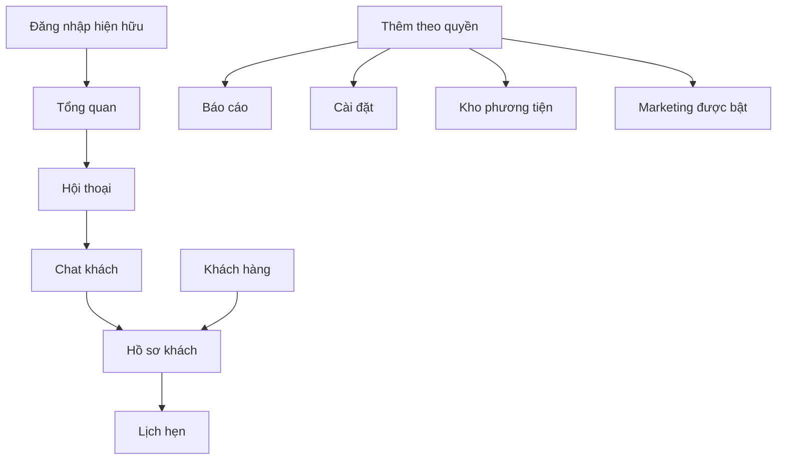

# 03 — Kiến trúc thông tin mobile

Ngày 29/10/2026 · Đề xuất, chưa triển khai · Cơ sở: source audit 01, UX audit 02.

## Quyết định đề xuất

Giữ một ứng dụng Vue, cùng URL/API/quyền/Pinia/composables; dùng shell và container trình bày riêng cho mobile. Repository đã có hướng này ở `frontend/src/App.vue:27`, `layouts/MobileLayout.vue`, `views/MobileChatView.vue`, `views/MobileContactView.vue`. Không tạo ứng dụng CRM thứ hai, không chép useChat để tạo state độc lập. Chỉ tách controller khi cần loại bỏ khác biệt xử lý route/lifecycle đang có.

Bottom navigation tối đa năm mục: **Tổng quan · Hội thoại · Khách hàng · Lịch hẹn · Thêm**. Không thêm Đơn hàng: chưa tìm thấy route/module đơn hàng chuyên biệt trong router đã khảo sát. Deal stage của contact không phải hệ thống quản lý đơn hàng. Quyết định này cần chủ sản phẩm xác nhận nếu một module nằm ngoài repository hiện tại.

## Bản đồ điều hướng

| Vùng | Đường hiện hữu tái sử dụng | Nội dung mobile đề xuất |
|---|---|---|
| Tổng quan | `/` | Việc cần xử lý trước, KPI xếp hai cột rồi một cột khi cần, đường vào danh sách đã lọc |
| Hội thoại | `/chat`, `/chat/:convId?` | Inbox một màn; chọn khách mở thread full screen; back trả lại vị trí/filter inbox |
| Khách hàng | `/contacts`, `/contacts/:id/profile`, `/customers/:id/activity` | Card list, hồ sơ, lịch sử; giữ quyền sửa và phân công hiện hữu |
| Lịch hẹn | `/appointments` | Agenda theo ngày là mặc định; xem tuần tùy chọn, không ép lịch desktop vào 320px |
| Thêm | Menu presentation mới, chọn đến route có sẵn | Hồ sơ cá nhân, media, báo cáo, marketing, quản trị, tích hợp theo quyền/edition/feature flag |

`Thêm` là menu điều hướng, không phải nghiệp vụ mới. Route cài đặt hiện có ở `frontend/src/router/index.ts:111`; báo cáo ở `:85`; marketing ở `:221`. Các mục placeholder phải có nhãn chưa khả dụng hoặc không xuất hiện theo chính sách hiện hành, không dùng bản thiết kế để quảng cáo đã có chức năng.

## Hợp đồng hành vi shell

- Root tab giữ header gọn và bottom nav. Thread chat, xem media và form dài dùng header riêng; ẩn bottom nav để ưu tiên nội dung, nhưng vẫn có nút back rõ ràng. Không render hai thanh header cùng nhiệm vụ.
- Active tab xét tên/nhóm route, không so khớp nguyên route.path như `BottomNav.vue:30`; deep link `/chat/abc` phải nhận đúng Hội thoại.
- Mỗi mục lấy quyền từ store RBAC hiện hữu. Việc ẩn menu không thay kiểm tra backend. Khi quyền bị thu hồi, đưa về màn được phép và hiển thị thông báo.
- Back dùng lịch sử hợp lệ nội bộ; mở deep link trực tiếp thì fallback inbox. Không để back đóng PWA hoặc quay sang trang ngoài khi người dùng mong về danh sách.
- Giữ search/filter và scroll theo route/view; không lưu toàn bộ message/customer vào localStorage chỉ để giữ vị trí. Đổi org/logout phải xóa state theo chính sách hiện có.
- Thay đổi viewport do xoay máy không được tạo thêm socket, gửi lại tin hoặc mất bản nháp. Dùng state/controller dùng chung, kiểm thử mount/unmount.

## Thiết kế ưu tiên: hội thoại

Inbox: header Hội thoại + trạng thái kết nối; search; chọn phạm vi/nick/kênh trong sheet; chips Chưa đọc/Chưa trả lời theo filter đã hỗ trợ; avatar, tên, preview, giờ, unread và người phụ trách nếu API có trường. Không sáng tạo trạng thái mới không có dữ liệu.

Thread: back + tên/avatar + mở hồ sơ; lỗi kết nối là banner riêng; danh sách message là vùng cuộn chính; composer nằm trong cột flex với min-height:0. Sheet công cụ hiển thị các chức năng attachment/template/AI mà desktop và quyền hiện có hỗ trợ. Không giảm chức năng chỉ vì dùng mobile wrapper.

AI: giữ cùng chính sách xem/gợi ý/áp dụng/gửi hiện có; mobile chỉ đổi cách mở panel. Nội dung AI không tự gửi do gesture nhầm. Panel có nguồn/cảnh báo hiện có, loading/cancel/error rõ ràng. Khi request chưa có response, không khóa toàn bộ chat nếu desktop không yêu cầu.

Scroll: chỉ cuộn xuống khi đang gần đáy hoặc chính người dùng gửi; đang đọc lịch sử thì hiện nút tin mới. Prepend lịch sử giữ anchor. Khi ảnh tải xong không đẩy vị trí đọc bất ngờ. Mở bàn phím không coi là tin mới.

## Hồ sơ, khách hàng và dashboard

Khách hàng dùng list card với tên, điện thoại (theo privacy), stage/tag chính, người phụ trách. Mỗi card mở hồ sơ; thao tác gọi/chat/tạo lịch chỉ xuất hiện nếu đã có chức năng và quyền. Filter hiển thị số điều kiện, reset rõ ràng; loading initial khác loading thêm; có retry và end-of-list.

Hồ sơ dùng các phần Tổng quan, Lịch sử, Ghi chú và Lịch hẹn theo dữ liệu đang có. Field chưa triển khai ở `ContactProfileView` không thiết kế thành dữ liệu thật. Form sửa full screen giữ validation/API hiện tại, có xác nhận rời khi có thay đổi chưa lưu.

Dashboard đặt Việc cần làm ở đầu, KPI ngắn, biểu đồ có tóm tắt text. Bộ chọn ngày/phạm vi mở sheet. Không hiển thị 0 thay lỗi/chưa có dữ liệu. Nút KPI chỉ deep link được khi target thực sự hỗ trợ filter tương ứng; nếu chưa có thì ghi backlog frontend rõ ràng.

## Pattern overlay

| Desktop hiện tại | Mobile đề xuất | Hợp đồng giữ nguyên |
|---|---|---|
| Sidebar bộ lọc | Bottom sheet có Áp dụng/Xóa | Cùng query/filter và phạm vi quyền |
| Hồ sơ cạnh chat | Full screen hoặc sheet gần full height | Cùng contact ID, field và mutation |
| Menu hover/right-click | Nút thêm + action sheet | Cùng action/permission; destructive có confirm |
| Form nhiều trường | Full screen dialog | Cùng validation/payload |
| Preview file | Full screen viewer | Cùng URL được phép, không đưa file private vào cache công khai |

Focus đi vào overlay, có nhãn và nút đóng, trả focus về nguồn khi đóng. Sheet dài phải cuộn bên trong; không đồng thời khóa body và mất vùng cuộn nội dung. Swipe là phụ trợ, luôn có nút tương đương.

## Gate nghiệm thu thông tin

Tất cả role đi đến chức năng đang được phép trong tối đa hai bước từ tab liên quan; nested routes nhận đúng tab; deep link vẫn mở đúng conv/contact; back giữ search/scroll; không xuất hiện menu đơn hàng/EE chưa có. Toàn bộ là tiêu chí tương lai, chưa nghiệm thu ở audit này.
