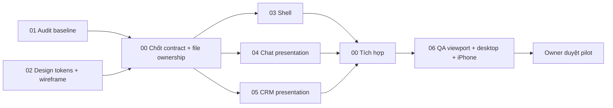

# 07 — Kế hoạch triển khai nhiều AI agent

Ngày: 29/10/2026. **Đây là phân công cho giai đoạn sau khi được duyệt, không phải lệnh triển khai hiện tại.** Audit chỉ tạo tài liệu. Chưa tạo branch/worktree/PR, chưa commit/push hay thay CI/CD.

## 1. Số agent và thứ tự

Bảy vai trò có thể dùng, nhưng không nên mở bảy agent cùng sửa code. Khuyến nghị tối đa **ba agent implementation/QA độc lập cùng lúc, cộng một orchestrator**. Architecture Auditor và UI/UX Designer hoàn tất nền trước; sau đó chuyển sang review để tiết kiệm context và tránh xung đột. Số agent chạy thực tế còn phụ thuộc slots/công cụ, không bảo đảm Gas Town/Ruflo/Claude Code/Codex đã được cài hoặc kết nối.

Shell/chat/CRM chỉ song song sau khi props, tokens, navigation và controller ownership được chốt. QA chuẩn bị fixtures/expected states song song; chạy tích hợp sau merge vào nhánh staging. Không có agent tự động deploy production.

## 2. Ranh giới file

Danh sách file mới là **đề xuất**, chưa tồn tại và chưa được tạo trong ứng dụng. Nếu thiết kế cuối thay tên, orchestrator cập nhật manifest ownership trước khi giao việc.

| Vai trò | Phạm vi được giao | Phạm vi không tự sửa | Đầu ra / nghiệm thu |
|---|---|---|---|
| 00 Orchestrator | Integration branch; `App.vue`, `router/index.ts`, wrappers `ChatView.vue`/`ContactsView.vue`; contract migration nhỏ được review | Backend/API/auth/CI/deploy không nằm trong UI scope | Chốt baseline, merge thứ tự, review desktop parity, integration checklist |
| 01 Architecture Auditor | `docs/mobile-upgrade/01_SOURCE_CODE_AUDIT.md`, ADR mobile, contract inventory | Không sửa production code trong audit | Mỗi finding có evidence; phân biệt static/runtime; giải quyết dependency ownership |
| 02 UI/UX Designer | Docs 03/04/05, prototype riêng trong docs; token spec | Không chạm token global production | Wireframe có loading/empty/error/offline, permission variants, contrast/touch/keyboard spec |
| 03 Mobile Shell Developer | `layouts/MobileLayout.vue`, `components/BottomNav.vue`; mới `components/mobile/shell/*`, `assets/mobile-tokens.css`, `composables/use-mobile-viewport.ts` | Không tự sửa App/router/global CSS/auth | Safe-area, orientation, bottom-nav visibility; không làm đổi desktop |
| 04 Chat UI Developer | `views/MobileChatView.vue`; mới `components/mobile/chat/*`; component chat dùng chung chỉ theo lock riêng | Không đồng sửa MessageThread/use-chat với agent khác; không đổi send logic | List→detail/back/deep-link, media/AI parity, composer và scroll; contract tests |
| 05 CRM Mobile Developer | `views/MobileContactView.vue`; mới `components/mobile/crm/*`, `views/mobile/*` cho dashboard/settings adapters | Không sửa DashboardView/ContactsView wrapper cùng 00; không tạo module order | Card/filter/profile, dashboard, lịch hẹn, role handling; dùng API hiện có |
| 06 QA Engineer | Mới `frontend/tests/mobile/*`, fixtures giả và tài liệu evidence; cấu hình test mới chỉ nếu được duyệt | Không cài package/đổi CI/CD tự ý; không sửa code để làm test xanh | Viewport 320/375/390/393/402/430/768 + desktop, regressions và device checklist |

Shared files **lock mặc định chỉ 00 được tích hợp**: `frontend/src/main.ts`, `App.vue`, `router/index.ts`, `plugins/vuetify.ts`, `assets/main.css`, `assets/hs-crm-theme.css`, `stores/auth.ts`, `stores/privacy.ts`, `api/index.ts`, `api/socket.ts`, `composables/use-chat.ts`, `components/chat/MessageThread.vue`. Quyền sửa auth/API/backend vẫn phải được chủ dự án phê duyệt riêng nếu cần; ownership không tự cấp quyền đổi logic.

## 3. Contract trước khi chia việc

- Token namespace `--m-*`, wrapper `.crm-mobile` theo tài liệu 04; không override Vuetify toàn cục bằng selector mới thiếu scope.
- Shell phát vùng chiều cao khả dụng và trạng thái header/nav; chat không tự trừ số pixel cứng lần nữa.
- Một owner chat controller; presentation nhận props và emit event có kiểu. Dùng nguyên kiểu Conversation/Message và API adapter hiện có.
- Quy định route `/chat/:convId?`, back behavior, query/filter persistence và tab active; không tự tạo route `/m` khác contract.
- Mobile phải giữ AI/media/privacy/RBAC hiện có; UI chưa hỗ trợ một hành động phải được ghi trong parity table, không âm thầm bỏ chức năng.
- Fixtures hoàn toàn giả; không copy customer/token production vào snapshot, trace hoặc prototype.

## 4. Branch/worktree và tích hợp

1. Xác minh working tree còn thay đổi chưa commit; người quản lý xác nhận base commit và cách bảo toàn các thay đổi hiện có. Không reset/stash/checkout làm mất dữ liệu tự động.
2. Sau duyệt, tạo worktree riêng từ cùng base đã chốt. Tên branch đề xuất `codex/mobile-shell`, `codex/mobile-chat`, `codex/mobile-crm`, `codex/mobile-qa`; không tạo trong audit.
3. 00 tạo skeleton contract hoặc merge PR contract trước; agents rebase/cherry-pick đúng contract revision, không copy shared files tùy ý.
4. Mỗi PR ghi phạm vi, screenshots fixture, viewport, permissions, kiểm thử và rollback. Không coi mock API pass là E2E backend thật.
5. CI và required checks phải đạt trước merge; nếu cần bổ sung CI/dependency, trình thay đổi riêng để chủ hệ thống duyệt. Không bỏ qua failing baseline bằng xóa test.
6. Thứ tự merge: tokens/contract → shell → chat → CRM → QA/integration. Nếu conflict shared file, 00 giải quyết; agent component dừng sửa file bị lock nhưng tiếp tục phần độc lập.

## 5. Gates và định nghĩa hoàn thành

| Gate | Bằng chứng bắt buộc |
|---|---|
| G0 Audit/design approved | Docs 01–08, baseline capability map, quyết định navigation và offline policy |
| G1 Shell | Safe-area/portrait/landscape; nav đúng route/quyền; không overflow viewport; desktop snapshot không đổi ngoài phạm vi |
| G2 Chat | Deep-link, back, loading/error/empty, media/AI actions, privacy, unread, reconnect; keyboard test Safari/PWA iPhone thật |
| G3 CRM | Search/filter/profile/lịch hẹn cùng API/quyền; không thiếu thao tác quan trọng; không tự thêm order module |
| G4 Release candidate | Typecheck/build/unit + fixture E2E, desktop regression, PWA update/session test; ghi rõ ca chưa chạy |
| G5 Pilot release | Chủ hệ thống duyệt deploy riêng, image/version pin, backup cần thiết, người trực và rollback đã diễn tập |

## 6. Rollback và trách nhiệm

UI rollout theo module, có cơ chế trở về mobile cũ hoặc image trước đã được thiết kế và duyệt. Không đưa flag mới vào hệ thống trong audit. Mobile branch không kèm migration, đổi auth hay thay event message; nếu phát hiện cần thay backend thì tách proposal và PR riêng. Rollback chỉ UI không hoàn tác tin đã gửi, vì vậy thử nghiệm gửi thật chỉ trên account test được cho phép.

Orchestrator chịu trách nhiệm tổng hợp evidence, không chỉ tổng hợp lời agent nói đã xong. QA ghi commit/browser/device/data fixture/expected/actual và phân biệt **static finding**, **desktop browser**, **WebKit desktop**, **Safari iPhone**, **Home Screen PWA iPhone**.
