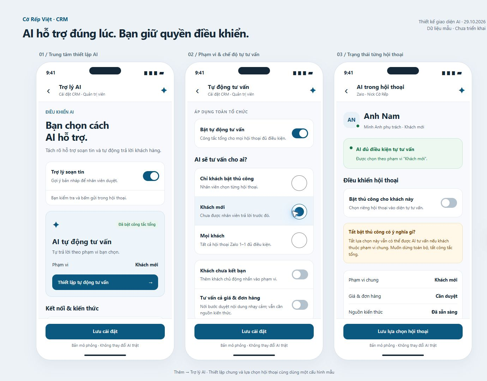

# Bản render điều khiển AI

Ngày 29/10/2026. Tiếp nối bộ thiết kế iPhone hiện có, áp dụng interface-design và vue-best-practices. Đây là đề xuất giao diện bằng dữ liệu giả; không gọi API, không lưu cấu hình thật, không gửi tin nhắn.

1. **Trung tâm AI**: phân biệt trợ lý soạn bản nháp với tự động trả lời; trạng thái nhà cung cấp và kho kiến thức là minh hoạ.
2. **Tự động tư vấn**: công tắc tổng, phạm vi thủ công/khách mới/mọi khách, khách chưa kết bạn và chế độ tư vấn giá/đơn hàng.
3. **Trong hội thoại**: hiển thị lý do khách được chọn; bật thủ công riêng không phải công tắc loại trừ tuyệt đối. Tắt công tắc tổng sẽ dừng trạng thái tự tư vấn trong bản mẫu.

Đường vào **đề xuất**: Thêm → Trợ lý AI. Vị trí trong ứng dụng hiện tại: Cài đặt → CRM → Trợ lý AI; xem `../10_AI_CONTROLS_LOCATION.md` để đối chiếu mã nguồn.

## Xem bản tương tác

Tại thư mục gốc dự án chạy `node docs/mobile-upgrade/preview-v2/server.cjs`, rồi mở `http://127.0.0.1:5181/ai-controls`. Mỗi màn hình riêng có `?page=settings`, `?page=scope` hoặc `?page=conversation`. Dùng Vue có sẵn trong frontend/node_modules, không cài thư viện mới.

Root giữ cấu hình mẫu dùng chung; AiPhone nhận props và phát sự kiện thay đổi; ToggleRow giữ ngữ nghĩa checkbox/switch. Nút Lưu chỉ hiện phản hồi mô phỏng, tải lại trang sẽ đặt lại dữ liệu. Giờ hoạt động và cấu hình nâng cao mới được mô tả; chưa dựng biểu mẫu nâng cao hoặc cấu hình provider/model/API key.

## Kiểm tra

Đã render bằng Chromium; 9 kiểm tra DOM tại 320/390/430 CSS px đều không tràn ngang và không có vùng điều khiển dưới 44×44 CSS px trong #app (`ai-controls-check.json`). Đã kiểm tra tắt công tắc tổng làm hội thoại chuyển sang tạm dừng và nút Lưu hiện phản hồi mô phỏng. Chưa kiểm tra iPhone/WebKit thực tế. Nội dung dài cuộn bên trong màn hình, nút Lưu cố định phía dưới.

Ảnh riêng: `renders/ai-settings.jpg`, `renders/ai-scope.jpg`, `renders/ai-conversation.jpg`.
