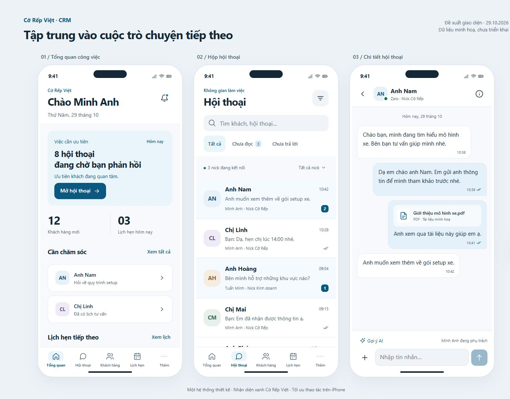
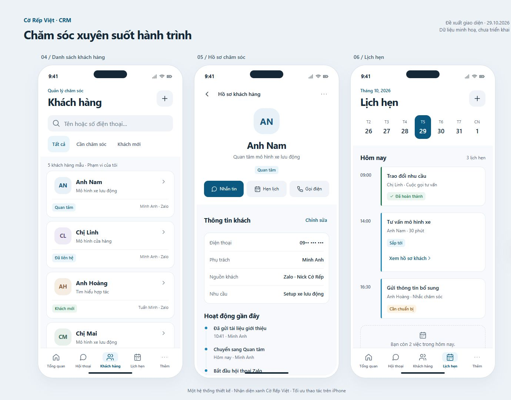
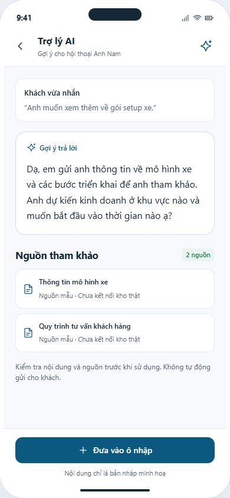

# CRM iPhone — bản xem trước áp dụng skill

Ngày 29/10/2026. Đã cài sáu skill vào thư mục Codex và đọc trực tiếp trong phiên này để áp dụng. Skill mới có thể được nhận tự động từ lượt tiếp theo; kết quả dưới đây không phụ thuộc chờ catalog refresh. **Đây là preview dữ liệu giả, chưa thay giao diện app đang chạy.**

## Xem ảnh

### Tổng quan, inbox và chat



### Khách hàng, hồ sơ và lịch hẹn



### Trợ lý AI



Các ảnh riêng: [tổng quan](renders/overview.jpg), [inbox](renders/inbox.jpg), [chat](renders/thread.jpg), [khách hàng](renders/contacts.jpg), [hồ sơ](renders/profile.jpg), [lịch hẹn](renders/agenda.jpg), [AI](renders/ai.jpg), [công cụ](renders/more.jpg). Có thêm [desktop tham chiếu](renders/03-desktop-continuity.jpg), không phải thay đổi desktop production. Widget tím ngoài khung app trong ảnh desktop thuộc extension trình duyệt, không phải thành phần thiết kế.

## Skill đã áp dụng

| Skill | Cách áp dụng có bằng chứng |
|---|---|
| interface-design | Khám phá domain/account/owner, chọn nhiệm vụ chính của từng màn, hierarchy và nhịp spacing; ghi contract tại `.interface-design/system.md` |
| mobile-ux-optimizer | Một vùng cuộn cho từng màn, nav năm mục, back/controls44px, safe-area và textarea16px; đo viewport trực tiếp |
| vue-best-practices | Preview dùng Vue runtime sẵn có; component Icon/ConversationRows/ChatBubbles/ProfileInfo; computed lọc dữ liệu, props/events và draft có một owner |
| design-system | Token màu/spacing, dùng chung row/avatar/tag/button; sửa badge unread sang nền đậm sau kiểm tra tương phản |
| web-design-guidelines | Rà semantic button, nhãn input/icon, focus-visible, reduced-motion, long text, vùng bấm và không disable zoom |
| ui-ux-pro-max | Đã chạy search local theo product/UX/Vue; kết quả lưu trong `skill-search-evidence.json`. Truy vấn đầu trả match không đúng domain, đã loại và dùng truy vấn hẹp hơn; chọn CRM & Client Management trong kết quả sau |

Kết quả lookup là đầu vào tham khảo. Không áp dụng glassmorphism/landing hero hoặc chuyển framework từ kết quả chung SaaS. Nhận diện và đặc tả04 vẫn là chuẩn của dự án.

## Cài đặt và provenance

[skills-lock.json](skills-lock.json) lưu repository, path, commit và thông tin cài đặt. Cài bằng installer chính thức. Riêng mobile-ux-optimizer phải chuyển từ download ZIP sang sparse Git do lỗi đường dẫn dài khi giải nén repo trên Windows; cuối cùng đã cài thành công cùng commit.

`design-system` được bổ sung CONNECTORS.md gốc và sửa một liên kết tương đối để chạy standalone. Root license được giữ bên cạnh skill khi upstream có file tương ứng; web-design-guidelines không tìm được file LICENSE/README license ở các tên root đã thử, không tự gán license. Đây là ghi nhận phạm vi kiểm tra, không phải đánh giá toàn bộ quyền phân phối.

## Chạy preview local

Tại root repository:

```powershell
node docs/mobile-upgrade/preview-v2/server.cjs
```

Mở `http://127.0.0.1:5181/`. Trang Vue dùng runtime có sẵn tại `frontend/node_modules/vue/dist/vue.esm-browser.prod.js`, không cài dependency mới. Nếu chưa có node_modules, ảnh JPEG vẫn xem được mà không cần chạy server. Server chỉ bind loopback và chỉ phục vụ bốn tài nguyên allowlist; không proxy API/backend.

Các màn được khai báo trong `app.js`: query `?screen=inbox`, `?screen=thread`, `?screen=contacts`, `?screen=profile`, `?screen=agenda`, `?screen=ai`, `?screen=overview`, `?screen=more`. Bảng tổng hợp: `?mode=board-a`, `?mode=board-b`; desktop concept: `?mode=desktop`.

## Kết quả kiểm tra và giới hạn

- Cú pháp Node cho server/app JS: đạt.
- [responsive-check.json](responsive-check.json): 24 ca = 8 màn × 320/390/430px, không phát hiện horizontal overflow của document hoặc button có rect nhỏ hơn44×44 CSS px. Đây là phép đo DOM, không phải xác nhận tương đương touch trên iPhone thật.
- [contrast-check.json](contrast-check.json): bốn cặp text/button/chip chính đều >=4.5:1. Chưa đo mọi cặp màu, opacity, focus indicator hoặc trạng thái trên thiết bị; không tuyên bố chứng nhận accessibility.
- Đã thao tác search→empty→reset→chat→AI→đưa vào draft trong trình duyệt; chỉ thay dữ liệu trong RAM preview, không gửi tin hoặc gọi AI thật.
- Browser capture có lỗi timeout ở chế độ chụp crop trong giai đoạn cuối; ảnh bảng/desktop cuối được xuất lại bằng chụp viewport. Các ảnh riêng là ảnh component đã render trước đó; kiểm tra trực quan để loại ảnh bị cắt.
- Chưa kiểm tra Safari/WebKit, bàn phím phần cứng/iOS, installed PWA, offline/send/reconnect, VoiceOver, Dynamic Type hay dark mode. Preview chốt light mode. Mock không chứng minh app production đã hoạt động theo thiết kế.
- Filter/sources/KPI là dữ liệu minh hoạ; đây không phải full business fixture. Chỉ có thread/hồ sơ Anh Nam làm mẫu, không đại diện tính đúng mapping của mọi khách trên CRM. Desktop trong preview là concept tĩnh.

## Chuyển sang implementation sau khi duyệt

Giữ API/auth/quyền/socket và send policy hiện có. Chuyển các mẫu được chọn thành SFC TypeScript có scoped styles, dùng Vuetify primitive hiện hữu; không chép toàn bộ preview JS vào production. Dùng file ownership và rollout gate trong tài liệu07/08. Chưa tạo branch/commit/push/deploy hoặc migration.
# Bổ sung: giao diện điều khiển AI

Xem [bản render và hướng dẫn điều khiển AI](AI-CONTROLS-README.md), gồm trung tâm thiết lập, phạm vi tự tư vấn và trạng thái từng hội thoại. Chỉ sử dụng dữ liệu giả.

